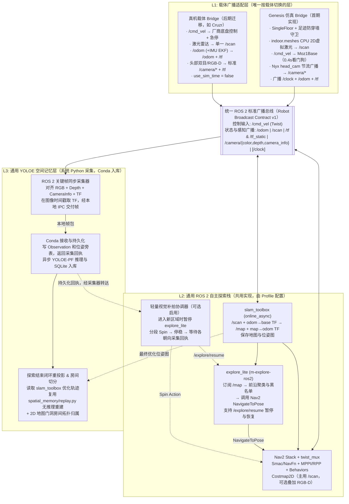

# 通用多房间自主探索与 YOLOE 空间记忆构建设计文档

本文定义一套以载体无关接口为目标的封闭式多房间自主探索与基于 YOLOE 的三维空间记忆构建方案。方案以仓库当前 `main` 分支为基础，**首期在本机 Genesis 仿真环境完成全链路闭环验证**，后续通过载体级 ROS 2 广播对齐与参数 Profile 微调迁移至真机（首台参考载体为 Cruzr，并面向任意具备 2D LiDAR + RGB-D 能力的移动机器人）。

- [1. 目标与核心设计原则](#goals)
- [2. 整体分层架构与进程边界](#architecture)
- [3. 统一 ROS 2 广播契约（Robot Broadcast Contract v1）](#ros2-contract)
- [4. L1 载体适配层设计（仿真优先 + 真机迁移蓝图）](#carrier-layer)
- [5. L2 通用自主探索栈设计（ROS 2 + Nav2 + explore_lite）](#exploration-layer)
- [6. L3 基于 YOLOE 的三维空间记忆构建](#spatial-memory-layer)
- [7. 产物规范与拟议目录结构](#layout)
- [8. 基础环境需求与同卡资源预算](#environment)
- [9. 分阶段实施计划与验收标准](#roadmap)

---

<a id="goals"></a>

## 1. 目标与核心设计原则

### 1.1 现状与演进目标

仓库 `main` 分支已具备完整的 YOLOE 空间记忆核心（[spatial_memory/](../jiuwensymbiosis/spatial_memory/__init__.py)）、不可变观测证据模型 [Observation](../jiuwensymbiosis/spatial_memory/models.py)、离线重放建库 [replay.py](../jiuwensymbiosis/spatial_memory/replay.py) 以及多房间 USD 室内仿真资产（`InteriorAgent`）。但现有的探索链路 [exploration.py](../jiuwensymbiosis/spatial_memory/exploration.py) + [memory_scan.py](../jiuwensymbiosis/simulators/genesis/memory_scan.py) 属于基于仿真真值位姿与静态全图准入的短步试探（单步上限 `0.2 m / 30°`），不具备实时 SLAM、连续避障、自主穿门与真机可迁移能力。

本设计的目标是将该能力升级为一套可在不同载体上验证的自主探索与语义建图体系。

1. **最大化复用 ROS 2 + Nav2 成熟能力，不做重复开发**：实时建图（`slam_toolbox`）、全局/局部路径规划与避障（`Nav2`）、卡死脱困（`Nav2 Behaviors`）、多房间前沿探索（`m-explore-ros2` / `explore_lite`）全部采用社区标准栈；自研工作严格收敛在“载体标准广播桥接”“视觉补拍协调”与“YOLOE 空间记忆管线”。
2. **仿真与真机统一走 ROS 2 广播契约**：无论是 Genesis 仿真还是真机载体，均通过标准 ROS 2 Topic 与 TF 广播感知与状态、订阅标准速度指令。上层探索栈与空间记忆模块不感知底层是仿真还是真机。
3. **跨载体共用探索与建库实现**：全向轮与差速轮差异、底盘尺寸足迹、速度限制、相机安装外参全部收口到载体 Profile YAML 与 L1 薄桥接中，核心算法零分支、零硬编码载体名称。
4. **先本机仿真闭环，后真机迁移**：Phase 0–3 全部在本机 Genesis 封闭式多房间场景（如 `InteriorAgent` 户型）中跑通并量化验收；Phase 4 再基于同一套契约迁移至 Cruzr 或其他真机。
5. **本机同卡运行与严格进程隔离**：系统 `/usr/bin/python3`（ROS 2）与 Conda（Genesis/Nyx、YOLOE/PyTorch）严格分进程隔离；Nyx 渲染进程与 YOLOE 推理进程隔离，独立核算显存和控制回路延迟，按第 9 节验收。

---

<a id="architecture"></a>

## 2. 整体分层架构与进程边界



### 2.1 进程与运行时边界

沿用仓库 [ros2/worker.py](../jiuwensymbiosis/ros2/worker.py) 已验证的跨解释器隔离原则，系统划分为 4 类松耦合进程：

| 进程 | Python / 运行时 | GPU 使用 | 职责与边界 |
|---|---|---|---|
| **Genesis 仿真服务** | Conda (`symbiosis_genesis`) | Nyx 光追渲染（~3–6 GB） | 运行 CPU 物理步进、足迹防穿墙守卫、CPU 2D 射线扫描、Nyx RGB-D 抓取；不导入 `rclpy` |
| **ROS 2 载体 Bridge** | 系统 `/usr/bin/python3`（Jazzy） | 无 | 仿真期通过本地 IPC 桥接 Genesis；真机期对接载体底层驱动；对外唯一暴露标准 ROS 2 广播契约 |
| **ROS 2 探索与导航栈** | ROS 2 Jazzy C++/Python 节点 | 无 | `slam_toolbox`、`Nav2`、`twist_mux`、`explore_lite`、分段补拍协调器及采集节点。采集节点负责同步、按图像时间戳查询 TF、交付帧和转达回执 |
| **YOLOE 空间记忆 Worker** | Conda (`symbiosis_genesis` / `sim_agent`) | PyTorch 推理（~2.5–4.5 GB，设显存上限） | 接收本地 IPC 帧包，持久化 Observation、位姿旁表和序列索引后发回采集回执。异步执行 [YoloEPromptFree](../jiuwensymbiosis/spatial_memory/yoloe.py) 推理与 [SpatialMemory](../jiuwensymbiosis/spatial_memory/memory.py) 入库；探索结束后执行闭环重投影与房间切分 |

**物理与仿真资源互斥。** 探索栈以独立 ROS 2 拓扑运行，不经过 `RobotSession` / `ActionSpec` 单步调用链；但启动入口在绑定真机载体（或共享仿真实例）前，须通过仓库 [runtime/resources.py](../jiuwensymbiosis/runtime/resources.py) 获取对应载体的物理设备锁（`resource_keys`），运行期间阻止 CLI 或 Workbench 并发建立 `RobotSession` 争抢底盘、关节或相机连接，退出或异常清理时释放锁并留存停止确认证据。

---

<a id="ros2-contract"></a>

## 3. 统一 ROS 2 广播契约（Robot Broadcast Contract v1）

所有载体（仿真或真机）均须严格满足以下接口契约；任何偏离均在 L1 载体适配层内吸收转换，不得向 L2/L3 扩散。

### 3.1 话题与 QoS 契约

| 方向 | 标准话题 | 消息类型 | 推荐频率 | QoS 约定 | 语义与格式硬约束 |
|---|---|---|---|---|---|
| **底盘控制** | `/cmd_vel` | `geometry_msgs/msg/Twist` | 10–20 Hz | `RELIABLE / VOLATILE` | Nav2 设置 `enable_stamped_cmd_vel: false`。车体轴为前、左、上，正偏航为逆时针，差速 Profile 输出 `linear.y=0`。载体端用单调壁钟计时，最后一条有效指令后 0.4 s 内撤销驱动目标并开始制动 |
| **里程计** | `/odom` | `nav_msgs/msg/Odometry` | ≥ 20 Hz | `RELIABLE / VOLATILE` | `header.frame_id="odom"`，`child_frame_id="base_footprint"`。pose 在 odom 系，twist 在子系原点、沿子系各轴表达，时间戳与对应 TF 一致 |
| **2D 激光** | `/scan` | `sensor_msgs/msg/LaserScan` | 10–20 Hz | `BEST_EFFORT / VOLATILE`（SensorData） | `frame_id = "base_scan"`；统一为单帧 2D 扫描（推荐 360°、量程 ≥ 8–12 m）；`range_min` 取雷达有效近限。仿真射线排除本体，真机按雷达外参与本体几何过滤自回波，保留偏置安装一侧贴近门框的有效回波 |
| **彩色图像** | `/camera/color/image_raw` | `sensor_msgs/msg/Image` | 1–3 Hz（探索期节流） | `BEST_EFFORT / VOLATILE` | `encoding = "rgb8"`；**已去畸变（rectified）**；`frame_id = "camera_optical_frame"` |
| **对齐深度** | `/camera/depth/image_raw` | `sensor_msgs/msg/Image` | 与 color 同步 | `BEST_EFFORT / VOLATILE` | `encoding = "32FC1"`（彩色光学系的 Z 深度，单位为米），尺寸与 color 完全一致且像素严格对齐；无效/越界深度置 `NaN`（禁止用 `0` 或 `inf` 冒充有效深度） |
| **相机内参** | `/camera/color/camera_info` | `sensor_msgs/msg/CameraInfo` | 与 color 同步 / latched | `RELIABLE / TRANSIENT_LOCAL` | 去畸变针孔模型：`D = [0, 0, 0, 0, 0]`，零偏斜（`K[0,1] = K[1,0] = 0`）。所发 K 对应交付图像的校正后投影、分辨率与裁剪范围，采集器按生效时间和标定版本关联内参 |
| **时钟** | `/clock` | `rosgraph_msgs/msg/Clock` | ≥ 50 Hz（仅仿真） | `BEST_EFFORT / VOLATILE` | 仅仿真载体发布，所有仿真传感器/TF 均打同一仿真时间戳；真机不发布，统一置 `use_sim_time: false` |
| **地图（L2 产出）** | `/map` | `nav_msgs/msg/OccupancyGrid` | 0.5–2 Hz | `RELIABLE / TRANSIENT_LOCAL` | `frame_id = "map"`；`-1` 未知、`0` 自由、`100` 占据；分辨率默认 `0.05 m` |

### 3.2 标准 TF 坐标树

```text
map                                 (由 slam_toolbox 动态发布 map -> odom)
 └── odom                           (由载体里程计/EKF 动态发布 odom -> base_footprint)
      └── base_footprint            (地面投影中心，z = 0，REP-103: +X前 +Y左 +Z上)
           └── base_link            (机器人本体基准坐标系)
                ├── base_scan       (2D 激光雷达坐标系，静态 TF)
                └── … → 相机挂载连杆   (沿实测关节链更新，固定安装可折叠固定段)
                        └── camera_optical_frame   (固定标定，+X右、+Y下、+Z前)
```

`T_A_B` 表示把 B 系坐标变换到 A 系。以彩色图的采集时刻 `t` 查询 `T_map_camera`、`T_odom_camera` 和 `T_base_camera`（此处 `base = base_footprint`）。TF 缺失、外推或标定版本不一致时，等待有界时限，超时丢帧并按原因计数。复位或时钟倒退时结束当前序列，另开 `scene_epoch` 和地图会话。

仿真用 `TimeSynchronizer` 精确匹配 RGB 与深度的整数纳秒戳。真机用 `ApproximateTimeSynchronizer` 和正容差，默认 `|Δt| < 50 ms`，保存两个原始时间戳。订阅端显式匹配图像的 SensorData QoS。审计时在本机 Jazzy 对同戳消息做了最小验证，`slop=0` 的近似同步收到 0 对，精确同步收到 1 对。[Jazzy 同步器实现](https://github.com/ros2/message_filters/blob/jazzy/src/message_filters/__init__.py)

---

<a id="carrier-layer"></a>

## 4. L1 载体适配层设计（仿真优先 + 真机迁移蓝图）

### 4.1 Genesis 仿真 Bridge（首期核心实现）

本次审计基于本地 `main@6ee1dd9`。结合对 [scene_runtime.py](../jiuwensymbiosis/simulators/genesis/scene_runtime.py)、[single_floor.py](../jiuwensymbiosis/simulators/genesis/single_floor.py)、[omni_base.py](../jiuwensymbiosis/simulators/genesis/omni_base.py) 和 [robot_cameras.py](../jiuwensymbiosis/simulators/genesis/robot_cameras.py) 的调研，Genesis 仿真端需补齐以下 5 项能力并接入 `genesis_ros2_bridge`：

1. **地面支撑与碰撞守卫**。`SingleFloor` 只提供无限物理平面。由场景网格生成源地面支撑区和障碍高度带，复用已有出生与运动准入的支撑语义，但**禁止沿用 [navigation.py](../jiuwensymbiosis/simulators/genesis/navigation.py#L83-L92) 的保守旋转外接圆（`radius ≥ 0.47 m`）**，统一采用与载体 Profile 及离线可达评估一致的**锁定姿态有向多边形整机包络（SE(2) oriented footprint）+ 高度带**检查每步平移和转动扫掠区域，避免常规门洞被守卫误杀。遵守 [omni_base.py](../jiuwensymbiosis/simulators/genesis/omni_base.py#L3-L4) 不瞬移根位姿的物理约束，在刚性接触边界外预留覆盖单步制动滑移的软裕度；当支撑缺失、未知或有符号净距低于阈值时，**仅拦截使净距继续减小的速度分量/运动指令，放行远离障碍法向的退避或转向（如 Nav2 `BackUp` 脱困）**，防止贴障后恢复动作被连带锁死。记录守卫触发前的指令、净距、拟议运动以及执行后的实测轨迹。真值几何仅供 L1 模拟环境与离线评分器使用。[SingleFloor](../jiuwensymbiosis/simulators/genesis/single_floor.py) · [已有支撑区准入](../jiuwensymbiosis/simulators/genesis/navigation.py)
2. **CPU 2D 虚拟 LiDAR**。支持在指定安装高度对 `indoor.meshes` 建水平切片索引（`single_slice`），以及在仿真关闭 `VoxelLayer` 期间（Phase 1–3）与碰撞守卫共用整机高度带 `[0.06, 1.86]` m（`DEFAULT_MOZ1_HEIGHT_BAND_M`）的垂直障碍投影模式（`height_band`，默认 1080 束射线），使悬空桌面/高处柜体对 2D 代价地图可见而与 L1 立体守卫一致；Phase 4 真机单线 2D 激光下，高于/低于扫描平面的障碍改由双目稠密点云 `VoxelLayer` 与近障保护承担。按真实安装偏置生成射线，记录近限、远限、无回波编码与噪声种子。对贴门框场景比对原始与过滤后的扫描。20 Hz 为目标，单帧 CPU 耗时和发布间隔分别实测。
3. **连续速度控制与租约**。`VelocityControlMode` 与相对运动、臂运动互斥，遵守现有携载约束和 `validate_twist` 限速。驱动端检查本机单调壁钟的到期时刻；断连或复位时清空待执行速度并使旧会话失效。暂停后恢复步进前先检查租约，已过期时保持制动，直到收到新指令。记录最后有效命令、撤销目标和实测停稳三个时刻。[底盘控制](../jiuwensymbiosis/simulators/genesis/omni_base.py)
4. **时钟、里程计与 TF**。`/clock` 取 `runtime.steps × settings.dt`。模型根的前向是 `−Y`，`measure()` 的速度在世界系。桥接将模型根换算到地面投影原点，用车头偏航构造 REP-103 的 `base_footprint`，将该原点速度旋转至车体系后发布 twist；存在原点偏置时先计入角速度产生的线速度。`/odom` 与 `odom → base_footprint` 共用同一估计。理想里程计用于调通，正式闭环用按增量积分的固定种子漂移，独立物理轨迹留给离线评分。[底盘实测定义](../jiuwensymbiosis/simulators/common/base_motion.py#L27-L52)

   `head_cam.link_from_camera` 只覆盖挂载连杆到相机的固定段。按同一物理步的关节或连杆状态复合 `T_footprint_link × T_link_mount × T_mount_camera`，其中 `link = base_link`。Profile 改变安装高度或俯仰时，渲染和广播共同使用更新后的标定。TF 平移统一为米。[相机位姿组合](../jiuwensymbiosis/simulators/genesis/robot_cameras.py#L36-L50)
5. **Nyx 快照异步 RGB-D**。目标频率为 2 Hz，图像和相机姿态冻结在同一物理步 `t_step`，以该步的仿真时间戳交付。现有 `read_rgbd()` 是阻塞物理循环的同步屏障（含 [rgbd.py](../jiuwensymbiosis/simulators/genesis/rgbd.py#L78-L83) 的 Python 逐束 `trace_ray`），满载时易突破 `/scan` 150 ms 最大间隔与控制延迟门槛；探索期改为在物理线程仅拷贝 `RigidSnapshot`（冻结刚体状态与传感器位姿），将 Nyx RGB 渲染与深度射线采样移至渲染线程**异步串行执行**（与预览流互斥调用 `update_scene()`，不阻塞物理步进、`/clock`、`/scan` 和底盘控制），回读完成后仍打 `t_step` 仿真时间戳广播，由采集器在 TF 历史缓存中按 `t_step` 精确取姿（若回退同步屏障模式，须实测单帧阻塞 P99 `< 60 ms`）。全图模式只在采样像素写入光学 Z，其余像素保留 NaN；经 Phase 1 在 `kujiale_0004` 实测标定，2 Hz 在线探索默认采用 `stride = 6`（单帧均值约 `330 ms < 500 ms`，满频 2.0 Hz 零忙丢帧，有效点密度约为 `stride = 8` 的 1.8 倍；静态停稳补拍可按需切至 `stride = 4`），并与 §6.2 稀疏遮挡策略协同标定。每帧记录采样步幅、有效深度比例、快照步号和抓取壁钟耗时，以第 9 节的扫描间隔和指令延迟衡量并发效果。[RGB-D 同步屏障与快照](../jiuwensymbiosis/simulators/genesis/threaded_rendering.py#L18-L278) · [深度采样](../jiuwensymbiosis/simulators/genesis/rgbd.py#L47-L89)

### 4.2 通用真机迁移蓝图（后期迁移，以 Cruzr 为首个目标）

Phase 4 将验证 L2/L3 能否使用同一版本部署到 Cruzr。载体接入包括两项工作：

1. 确保载体通过自身 ROS 2 节点或薄桥接满足第 3 节全部广播契约；
2. 新增一份 `profiles/<carrier>.yaml` 配置微调运动学、足迹与代价地图参数。

#### 首个真机参考载体（Cruzr）对齐要点记录（备忘，不在首期实现）
- **运动控制**：已有底盘驱动与桥接基础，对外对齐标准 `/cmd_vel`（差速模式 `vy = 0`，看门狗 0.4 s 急停 + 雷达近距急停）。
- **定位与激光**：已有 `/mc/odom`、IMU、里程计 TF 与双激光合流基础，对外统一广播 `/odom`（含 `odom → base_footprint` TF）与单一 360° `/scan`。
- **空间记忆视觉源**：明确选用 **头部双目相机**（视角高，与仿真 MOZ1 `head_cam` 一致）：
  - 将头部双目校正左图（`/sensor/camera/stereo/left/image_rect_color/compressed`）与组织化点云（`/sensor/camera/stereo/pointcloud/jazzy`）投影转换为像素对齐的 `32FC1` 米制深度图；
  - 结合关节状态 `/mc/sdk/robot_state` 与 URDF 通过 `robot_state_publisher` 持续发布 `base_link → camera_optical_frame` TF（解决 [lowlevel.py](../jiuwensymbiosis/adapters/cruzr/lowlevel.py#L161-L168) 中记录的头部 TF 缺失问题）；
  - 按 1–2 Hz 定时短订阅或补拍按需拉取，**抓帧后立即释放底层双目图像与点云订阅**，严禁长生命周期持久订阅，实测重复采集、订阅释放和相机掉流恢复。该载体已有持久订阅拖垮 SDK 引发相机退化的记录。[Cruzr 相机配置](../configs/cruzr/cruzr.yaml#L66-L69)
- **宿主资源互斥**：启动与收尾统一接入 [runtime/resources.py](../jiuwensymbiosis/runtime/resources.py) 的物理设备锁，防止探索期间与 `jiuwensymbiosis-run` 或 Workbench 并发访问同一台 Cruzr。

---

<a id="exploration-layer"></a>

## 5. L2 通用自主探索栈设计（ROS 2 + Nav2 + explore_lite）

本层完全基于 ROS 2 Jazzy 标准生态组合，通过“**公共基线 YAML + 载体微调 Override YAML**”实现跨载体通用。

### 5.1 配置分层结构（通用性保障）

```text
configs/exploration/
├── launch/explore_and_map.launch.py     # 参数 carrier、use_sim_time
├── base/
│   ├── slam_toolbox.yaml
│   ├── nav2_base.yaml
│   ├── explore_lite.yaml
│   └── twist_mux.yaml                   # 急停锁、遥控和 Nav2，含行为服务器
└── profiles/
    ├── genesis_moz1.yaml                # 全向模型、整机足迹、速度和传感器
    └── cruzr.yaml                       # 差速模型、整机足迹、速度和传感器
```

### 5.2 各核心模块关键配置策略

#### 1) `slam_toolbox`（`online_async_slam_toolbox_node`）
- **模式**：`mode: mapping`，`resolution: 0.05`，`max_laser_range: 12.0`（与载体 `/scan` 对齐）。
- **闭环与轨迹**：开启 `do_loop_closing: true`。运行期由采集侧旁路记录高频 `(t, T_odom_base)` 至 `map/odom_trajectory.jsonl`；探索收尾时调用标准服务 `/slam_toolbox/save_map`（导出 `.pgm/.yaml`）与 `/slam_toolbox/serialize_map`（归档 `.posegraph/.data`），并由匹配的 ROS 2 C++ 位姿图导出节点（或闭环后节点图话题结合扫描时间戳映射）直接输出标准 JSON `map/trajectory.json`，避免 Python 侧直接解析 `karto_sdk` Boost Serialization 二进制格式。

#### 2) `Nav2` 导航栈（多房间穿门与安全微调）
- **全局规划器**：`SmacPlanner2D`（或 `NavfnPlanner`），设置 `allow_unknown: true` 以支持向未知前沿边缘规划。
- **局部控制器（按载体 Profile 选择）**：
  - 全向载体（如 Genesis MOZ1）：`MPPIController`（`motion_model: "Omni"`）或 `DWBLocalPlanner`（开启 `vy`），用窄门斜入用例验证横移和转向；
  - 差速载体（如 Cruzr）：`RegulatedPurePursuitController` 或 `DWBLocalPlanner`（`vy = 0`），转向平滑、过冲小。
- **多房间门洞通行关键项**：
  - 禁止使用过保守的外接圆 `robot_radius`，统一配置真实**多边形 `footprint`**；
  - 合理标定 `inflation_radius` 与 `cost_scaling_factor`（使贴近门框存在软代价梯度而非硬堵死），以门洞净宽 ≥ 车宽 + 0.15 m 为首轮实测工况，局部控制器启用相应的多边形足迹碰撞检查并记录实际通行结果。
- **Costmap2D 观测源**：
  - Local Costmap 主观测源为 `/scan`（`marking: true, clearing: true`）；Global Costmap 在带漂移里程计闭环建图下采用 `StaticLayer + InflationLayer`（消费 `slam_toolbox` 闭环修正后的 `/map`，避免未修正瞬时射线鬼影残留堵塞已闭环门洞）；
  - Local Costmap 预留可选 `VoxelLayer`（消费 RGB-D 点云），用于防范高于或低于单线 2D 激光平面的悬空桌面/低矮障碍。**仿真期（Phase 1–3）因 RGB-D 为 2 Hz 稀疏采样深度，默认关闭 `VoxelLayer`**（防止稀疏射线无法有效 clearing 残留伪影，立体安全由 `height_band` `/scan` + L1 高度带守卫保障）；Phase 4 真机稠密双目点云再按需启用验证。
- **速度安全仲裁（`twist_mux`）**：
  - 导航与补拍均经 Nav2 发布至 `/cmd_vel_nav`，由 `twist_mux` 仲裁后输出唯一 `/cmd_vel`。急停锁优先于遥控，遥控优先于 Nav2；协调器仅调用动作接口。

#### 3) 前沿派发、返航与分段补拍

`explore_lite` 订阅 `/map`，基线配置为 `min_frontier_size=0.35 m`、`progress_timeout=22 s`、`return_to_init=false`（实测上游 `explore.cpp` 的 `returnToInitialPose()` 先调 `async_cancel_all_goals()` 再同步发返航目标，易自取消返航动作；因此统一将“在线 `/map` 测地线未访内室补访 + 终态返航与停稳核验”收归 `exploration_orchestrator.py` 顺序编排）。小于阈值的前沿可能被过滤，超时也可能把通向可达房间的目标加入黑名单。记录运行版本、前沿数量、黑名单变化与导航目标结果。已核查的上游版本对“前沿为空”和“剩余目标均在黑名单”发布相同的 `EXPLORATION_COMPLETE`。优先从锁定版本的搜索诊断取结束分支；仅有公共状态时记为 `reason_unknown`。[上游结束与超时处理](https://github.com/robo-friends/m-explore-ros2/blob/326cf8a0b487c34246bb8f3326afbcd69576dc60/explore/src/explore.cpp#L230-L287)

Phase 2 关闭补拍，Phase 3 启用。当**首次穿门进入新连通域/房间内部**，或距已完成锚点超过 `sweep_spacing_m`（初值 2.5 m）且旋转空间充足时（进门后原地补拍同时借激光扫清室内前沿，减少角落往返），协调器执行以下流程：

1. 发布 `/explore/resume = false` 暂停前沿派发，**等待在途 `NavigateToPose` Action 完全达到终态退出**并确认实测停车，再发起后续动作，避免与 `bt_navigator` 产生目标抢占冲突。遥控接管、急停或返航开始时取消补拍。
2. 默认按 8 个相隔 45° 的朝向采样，也可在运行前配置 6 个相隔 60° 的朝向。起始朝向先拍，再按段调用 Nav2 `Spin`。每次动作成功后检查实测朝向误差和停车窗口，再请求一帧；最后按需转回起始朝向。[Jazzy Spin](https://api.nav2.org/nav2-jazzy/html/spin_8cpp_source.html)
3. 采集器为本次请求关联 `sweep_id`、扇区与 `observation_id`。等待 §6.1 的持久化回执，回执中的采集时刻须晚于该扇区停稳时刻，实测朝向误差 ≤ 5°。所有扇区均取得有效回执时才登记为完成。超时按 Profile 有界重试，记录缺失扇区；仅当运动控制权仍属探索会话时恢复前沿派发。

### 5.3 探索结束与覆盖证据

| 报告项 | 判定依据 |
|---|---|
| 在线停止原因 | 保存原始状态、当前前沿数、黑名单数、最后目标及预算。原因分别记为 `frontiers_empty`、`blacklist_exhausted`、`budget`、`fault`、`cancelled` 或 `reason_unknown`。黑名单条目保留最后一次失败原因。 |
| 返航与停车 | 单独记录 `return_requested`、返航动作结果、终点位置与航向误差，以及 `stopped`。用带时间戳的新鲜 `/odom` 连续确认低速，流中断则为 `unknown`；无返航任务记 `not_requested`。 |
| 在线几何结论 | 只在已观测连通域满足封闭边界、零剩余前沿、近期无新增收益、无遗留可疑目标且已实测停稳时，声明该域完成。证据不足保留 `unknown`，语义清单完整性保持 `inventory_complete=false`。[已有完成口径](../jiuwensymbiosis/spatial_memory/completion.py) |
| 离线多房间覆盖 | 在固定栅格上按整机包络、朝向、地面支撑和门扇状态求从起点可达的房间及中心位置集合。进房率以起始房间之外的可达房间为分母，用独立实测轨迹确认整机足迹越过门洞进入房间内部。起始房间单列。自由区覆盖率为可达中心位置中在配准后的最终地图被正确标为自由的格数 / 全部可达中心格数。固定分辨率、配准方式与真值版本。 |
| 激光与视觉观测 | 分别统计激光已观测房间、车体已进入房间、有效 RGB-D 实际命中表面所在房间及各自分母。视觉统计使用深度有效的可见表面，另报稀疏采样和遮挡造成的未知区、合格关键帧数与补看任务状态。 |

真值房间、支撑网格和评分轨迹由单独的离线评估器读取；L2/L3 在线输入限于第 3 节广播及其派生产物。

---

<a id="spatial-memory-layer"></a>

## 6. L3 基于 YOLOE 的三维空间记忆构建

L3 完全独立于仿真器与真机驱动，直接复用仓库现有 [spatial_memory](../jiuwensymbiosis/spatial_memory/__init__.py) 数据契约与核心引擎。

### 6.1 从 ROS 2 帧包到不可变观测

**系统 Python 负责采集。** 独立 ROS 节点按 §3 获取同步图像、对应的 CameraInfo 和同一时刻的 TF、插值或近时刻的速度，记录数据年龄。首个合格帧直接交付；其后以连续的 odom 系计算相对上一已确认帧的位移 ≥ 0.35 m 或偏航变化 ≥ 20°。补拍请求可单独触发采样。普通采样门限为角速度 ≤ 0.15 rad/s、平移速度 ≤ 0.25 m/s；补拍还需满足 §9 的停车窗口。图像编码、标定、深度有效样本和速度新鲜度门限在运行清单中固定。

**跨解释器交付。** 首版共用本机临时目录保存大数组，通过 Unix 域套接字发送包含协议版本、帧 ID、文件位置与摘要的小消息，并沿同一连接返回回执。生产方完整写入后再宣布就绪，收到回执后回收临时文件。积压达到运行清单中的上限时，普通候选帧显式丢弃并计数，补拍请求返回可重试结果。帧包含下列证据。该节点按独立脚本或独立 ROS 包启动，依赖 ROS 消息和数组编解码。审计时本机系统 Python 直接导入 `jiuwensymbiosis.spatial_memory.artifacts` 触发了包初始化，因缺少 `openjiuwen` 失败。[仓库 ROS worker 的导入边界](../jiuwensymbiosis/ros2/worker.py#L24-L28)

| 帧包内容 | 字段和用途 |
|---|---|
| 唯一身份 | `run_id`、`scene_epoch`、`clock_id`、`observation_id`、递增序号、可选补拍请求号与扇区。重发沿用同一 ID。 |
| 传感器证据 | RGB、对齐的 float32 光学 Z、K、分辨率、`calibration_id`、RGB/深度各自的采集时间（整数 ns）、深度采样步幅及有效比例。 |
| 位姿证据 | 同刻的 `T_map_camera`、`T_odom_base`、`T_base_camera`、`T_odom_camera`，以及帧名、外参来源和时间戳。验证 `T_odom_base × T_base_camera ≈ T_odom_camera`。 |

**Conda 负责落盘与回执。** 接收端构造 `Observation(pose_source="ros2_slam_tf", map_frame="map", …)`，调用现有 `write_observation`。将新增的位姿与时钟字段写入同帧 `poses.json`，保留既有 `observation.json`、`rgbd.npz` 格式。为严格对齐 [SpatialMemory.ingest](../jiuwensymbiosis/spatial_memory/memory.py#L161-L163) 的单调时间戳约束（拒绝 `Out-of-order capture`），接收端维护已提交 `timestamp_s` 单调水位线：因 TF 等待差异而晚于当前水位线到达的迟到候选帧（普通帧或超时补拍旧帧）显式记为 `late_out_of_order` 拒绝并计数，绝不乱序写入序列或在线库。同时在运行清单中显式约束单次关键帧容量上限（`< 1000` 帧，对齐现有 [replay.py](../jiuwensymbiosis/spatial_memory/replay.py#L54-L71) 的 `03d` 零填充目录命名与 `query_objects(limit=1000)` 边界；若超限须同步扩展目录宽度与查询上限）。在临时目录写完并校验后原子发布帧目录，按单调采集时间追加序列并原子替换 `sequence.json`，随后返回含 `observation_id` 和 RGB 摘要的持久化回执。相同 ID 的重发经完整帧包校验一致后可重取回执，像素、位姿或标定任一证据冲突则拒绝并记录。接收端按完整帧目录恢复索引，推理独立消费序列。[观测模型](../jiuwensymbiosis/spatial_memory/models.py#L36-L53) · [已有读写接口](../jiuwensymbiosis/spatial_memory/artifacts.py)

`scan-report.json` 记录 RGB/深度输入数、配对数、TF/标定缺失、乱序迟到拒绝（`late_out_of_order`）、速度或质量拒绝、队列溢出、已提交帧、推理成功与失败数。关机时先停止接收、排空已接受的帧，再冻结序列与检测索引。中断或有缺帧时报告保留原因和 ID。

### 6.2 同卡异步 YOLOE 推理与在线空间记忆

独立 Conda 进程监听落盘的关键帧序列：
1. 加载 [YoloEPromptFree](../jiuwensymbiosis/spatial_memory/yoloe.py#L28-L110)（4585 类 Prompt-Free 实例分割），可选叠加本地 `models/spatial-memory/` 下的 `dinov3-vits16` 或 `clip-vit-base-patch32` 外观嵌入（见 [appearance.py](../jiuwensymbiosis/spatial_memory/appearance.py)）。
2. 为防止同卡 PyTorch 缓存池挤压 Nyx 显存：
   - 设置 `PYTORCH_CUDA_ALLOC_CONF=expandable_segments:True`；
   - 通过配置显式限制单进程显存比例（例如 `torch.cuda.set_per_process_memory_fraction(0.35)` 限制 PyTorch 分配器使用的份额）。记录设备总显存峰值、各进程峰值和 OOM，按 §8–9 的同卡负载验收。
3. 对每帧执行 `detector.detect(rgb)`，可选外观描述子随检测一起冻结。原子提交 `detections/<序号>/`，在 `detections/index.json` 中绑定 `observation_id`、序号、RGB SHA-256、检测文件摘要和模型版本，再按序调用 `SpatialMemory.ingest` 更新 `memory_online.sqlite`。RGB 摘要统一对解码后的 H×W×3、uint8、连续排列的 RGB 字节计算，尺寸另行校验。推理异常单列为失败，有效空检测也保留成功记录。
4. **仿真稀疏深度与前景遮挡兼容。** 仿真全图深度只在网格采样点有值（其余为 `NaN`），而现有 [geometry.py](../jiuwensymbiosis/spatial_memory/geometry.py#L50-L111) 先对掩码做形态学腐蚀再判定 `min_points`，且 `surface_in_view()` 以单像素 `uv = floor(pixels)` 索引深度图剔除遮挡——在高度稀疏网格（如 `stride=8`，98.4% 为 `NaN`）下易出现中小物体点数不足与前景遮挡漏剔除（导致回访双向重叠度跌破阈值而碎片化）。为此：① 仿真 2 Hz 在线探索默认选用实测不丢帧的更密步幅 `stride = 6`（静态补拍可选 `stride = 4`）；② `surface_in_view()` 在带采样步幅的稀疏深度输入下，按包围步幅网格的 4 角点保守判定独立前景遮挡（仅引用实测有效样本，不插值伪造物体表面），使仿真稀疏观测与真机稠密深度的回访关联语义保持一致。

### 6.3 闭环后按帧重投影与冻结重放

在线库保留采集时刻的 SLAM 估计。结束采集并停稳后，从同一次最终建图状态保存地图、`.posegraph/.data` 归档及导出的标准 `trajectory.json`，记录 SLAM 版本和文件摘要。按以下步骤生成独立的修正库：

1. **原始里程计与闭环节点位姿双轨读取。** 原始底盘里程计 `T_odom_base(t)` 直接取自运行期旁路记录的 `map/odom_trajectory.jsonl`；优化后节点轨迹由匹配的 ROS 2 C++ 位姿图导出器（或闭环后位姿图话题结合扫描时间戳映射）输出至 `map/trajectory.json`，包含同一时钟内各节点 ID、扫描时间与优化后底盘位姿 `T_map_base*(t_k)`（核实基准系，存在激光安装偏置时先行换算至 `base_footprint`），避免在 Python 侧直接反序列化 `karto_sdk` Boost 二进制 `.posegraph` 文件。Jazzy 对应的 2.8.5 源码将扫描消息时间写入节点。[slam_toolbox 2.8.5](https://github.com/SteveMacenski/slam_toolbox/blob/2.8.5/src/slam_toolbox_common.cpp#L731-L752)
2. 每个节点计算平面修正 $C_k = T_{\text{map\_base}}^*(t_k) \cdot T_{\text{odom\_base}}(t_k)^{-1}$（物理意义即 $t_k$ 时刻闭环优化后的 $T_{\text{map\_odom}}^*(t_k)$）。在同一时钟、地图会话和连续里程计段内，对夹住图像时刻 $t_i$ 的相邻节点 $C_a, C_b$ 按 $SE(2)$ 相对变换 $\Delta C = C_a^{-1} C_b$ 的对数/指数映射插值得到 $C(t_i)$（避免大回环偏航修正时对平移做欧氏线性插值引入弧线畸变），再计算 $T_{\text{map\_camera}}^*(t_i) = C(t_i) \cdot T_{\text{odom\_camera}}(t_i)$。这样完整保留了图像时刻的实际相机高度、俯仰与摆头。同戳可直接取节点；缺少包围节点、跨复位或间隔超过预设上限时，将帧记为不可修正并记录原因。
3. 保留原始 `capture/` 和在线库，在 `capture_refined/` 从原观测生成同 ID 的新 Observation，只更新位姿及其来源。先用 `observation_id`、RGB 摘要、尺寸和检测摘要逐帧核对原始观测与冻结检测。现有 `replay` 按**输出序列下标**读检测，任何缺帧或顺序变化都要按已核对 ID 同步生成新的序列及连续编号的检测目录，保存映射到 `refinement.json`。重复 ID、摘要冲突、缺少检测均须显式报错。[重放读取逻辑](../jiuwensymbiosis/spatial_memory/replay.py#L34-L60)
4. 将修正后的序列和匹配的 `--detections` 传给现有 `replay`，使用新的临时结果目录，关闭额外外观推理。重开并核对数据库后发布 `memory.sqlite`。报告纳入帧数/原始帧数、排除明细、独立地标修正前后残差、推理调用数和壁钟重建耗时。部分重建可诊断，正式运行的通过条件见 §9。

### 6.4 多房间层级空间记忆构建（Map → Rooms → Entities）

1. 在最终地图的已知自由区内，以距离变换、窄通道检测和分水岭分割得到房间掩码及门洞邻接图，记录地图原点、分辨率与图像行方向。
2. 根据实体表面点和周围可见自由区确定 `room_id`。质心落在占据格时，使用同侧表面与观测射线判定所属房间，避免跨墙吸附。门洞缓冲带保存两个候选，证据不足记 `unknown`。验收集包括贴墙柜体和门洞附近物体。
3. 从冻结的逐帧检测读取 `scene` 类别，结合修正相机位姿与可见区域定位语义证据；实体库仅对 `object` 实例建立三维实体。聚合房间内物体标签和场景证据后，输出 `rooms_memory.json` 与无损 HOVSG v2.2 场景图 `structured_scene_graph.json`，保留来源帧和歧义；其房间、对象、邻接关系与来源图像引用字段直接对齐下游统一 Chat 的 `scene` 只读加载契约，供查看器与离线场景问答直接挂载使用。[标签分类](../jiuwensymbiosis/spatial_memory/yoloe.py) · [实体入库](../jiuwensymbiosis/spatial_memory/memory.py#L211-L227) · [场景问答设计](./offline-scene-assistant-overview.md)

### 6.5 空间记忆存储组织、实体模式与读写接口契约

#### 1) 场景会话目录边界与地图分离原则

空间记忆以**单次多房间探索会话（`run_id` / `scene_epoch`，即整套连通户型）**为最小独立目录单元，**不按单个子房间拆分目录**。同一户型内的全部房间、门洞连通关系与跨房实体均锚定到同一 `map_frame: "map"` 下统一管理：

- **2D 地图与轨迹资产存于 `map/` 目录（不入 SQLite）**：`map.pgm` / `map.yaml` 保存闭环优化后的 2D 占据栅格地图；`slam.posegraph` / `slam.data` 保存原始序列化位姿图；`trajectory.json` 与 `odom_trajectory.jsonl` 分别保存闭环节点位姿与连续里程计流；`room_labels.png` 与 `room_segmentation.json` 保存房间分割像素掩码与门洞邻接图。
- **三维观测与物理实体存于 SQLite**：探索期实时生成 `memory_online.sqlite`（含在线里程计漂移）；闭环后经 §6.3 重放生成最终权威库 **`memory.sqlite`**。
- **房间-实体层级拓扑存为派生 JSON**：`rooms_memory.json` 与 `structured_scene_graph.json` 将 SQLite 确认/暂定实体与 `map/` 房间拓扑融合，供高层符号/大模型规划器免 SQL 直读。

#### 2) `memory.sqlite` 五表组织结构

单库绑定唯一 `(scene_epoch, map_frame, clock_id, calibration_id, pose_source)` 作用域，在 [memory.py](../jiuwensymbiosis/spatial_memory/memory.py#L59-L70) 中通过 `BEGIN IMMEDIATE` 事务维护 5 张表：

| 表名 | 主键 | 存储内容与职责 |
|---|---|---|
| `metadata` | `key` | 全局契约：`schema` 版本、`association` 算法版本、`policy`（`MemoryPolicy` 参数 JSON）、`scope`、`model`（YOLOE/外观权重 SHA-256）、单调水位线 `timestamp` / `last_observation` 及可选 `scan_report`。 |
| `observations` | `id` (`observation_id`) | **不可变帧证据**。`metadata` 存时间戳与坐标标识；`detections` 存实例标签、置信度、`kind`（`object`/`surface`/`scene`）与嵌入向量；`payload` 为无 pickle 压缩 NPZ BLOB（封存 `rgb`、`depth_m`、`intrinsics`、`map_from_camera` 4×4 矩阵及实例二值 `masks`）；`fingerprint` 为全帧 SHA-256 摘要。 |
| `entities` | `id` (`entity_id`) | **持久三维物理实体**。拆分为结构化属性 `record`（JSON）与多帧融合表面点云 `points`（压缩 NPZ BLOB）。 |
| `assignments` | `(observation_id, local_id)` | **帧-实体关联溯源**。记录每个检测实例匹配到的 `entity_id`、对称表面重叠度、外观得分、Top-5 候选与被拒原因。 |
| `view_tasks` | `id` (`task_id`) | **主动补看任务**。记录因遮挡、掩码竞争或身份模糊处于 `open` / `resolved` / `deferred` 状态的待重访目标。 |

#### 3) 单个实体（Entity）保存字段规范

- **SQLite `entities` 核心持久字段**（[memory.py](../jiuwensymbiosis/spatial_memory/memory.py#L347-L374)）：
  - `points`（BLOB）：`map` 系下融合多帧观测后的 $3\text{ cm}$ 体素降采样三维可见表面点云 `float64 (N, 3)`（上限 `4096` 点，仅存实测可见表面，不补全遮挡背面）。
  - `record`（JSON）：确定性 UUIDv5 `entity_id`；状态 `state`（单视角 `"provisional"` / 跨视角基线确认 `"confirmed"`）；多帧开放词汇标签投票字典 `labels`（如 `{"sofa": 6, "couch": 2}`，标签作统计证据而非身份主键）；表面包围盒 `bounds_m` 与中位数中心 `observed_center_m`（米）；`point_count`、`observation_count`、`first_observation`、`last_observation`、`last_seen_s`；内部关联使用的 `appearance_gallery`（最近 8 帧归一化外观向量）与 `first_camera_pose`（对外查询自动剥离）。
- **房间拓扑派生字段**（[room_topology.py](../jiuwensymbiosis/spatial_memory/room_topology.py) 输出至 `rooms_memory.json` / `structured_scene_graph.json`）：
  - 最高票主标签 `primary_label`、防穿墙视线回退归属 `room_id`（门洞缓冲带歧义物体记 `"unknown"` / `null`）、`ambiguous`、`candidate_rooms`、`room_votes` 得票明细，以及关联到 `capture_refined/<idx>/` 的 `source_frames` 相对路径。

#### 4) 空间记忆构建与读取接口索引

| 阶段 | 用途 | 核心接口与所在模块 |
|---|---|---|
| **在线构建** | 单帧原子入库与表面关联 | `SpatialMemory.ingest(observation, detections) -> dict`（[memory.py](../jiuwensymbiosis/spatial_memory/memory.py#L120-L204)） |
| **在线构建** | ROS 2 帧接收、同卡 YOLOE+CLIP 推理与写库 | `FrameReceiverServer` / `SpatialMemoryLiveWorker`（[ros2_pipeline.py](../jiuwensymbiosis/spatial_memory/ros2_pipeline.py)） |
| **离线精化** | $SE(2)$ 闭环位姿修正与零推理冻结重放 | `refine_and_replay(capture_dir, detections_dir, trajectory_json, odom_trajectory_jsonl, run_root)`（[pose_refinement.py](../jiuwensymbiosis/spatial_memory/pose_refinement.py#L215-L233)）· `replay(...)`（[replay.py](../jiuwensymbiosis/spatial_memory/replay.py)） |
| **拓扑构建** | 2D 房间分割、防穿墙归属与场景图导出 | `segment_rooms_from_map(...)` · `build_rooms_memory(run_dir, ...)` · `export_structured_scene_graph(...)`（[room_topology.py](../jiuwensymbiosis/spatial_memory/room_topology.py)） |
| **只读检索** | 按语义标签子串 + 空间坐标半径检索实体 | `SpatialMemory(db, readonly=True).query_objects(*, label=None, near=None, radius_m=1.0, limit=100)`（[memory.py](../jiuwensymbiosis/spatial_memory/memory.py#L413-L446)） |
| **只读检索** | 读取单实体详情/证据链、还原原始帧、查补看任务 | `get_entity(entity_id)` · `get_observation(observation_id)` · `get_view_tasks()` · `get_status()`（[memory.py](../jiuwensymbiosis/spatial_memory/memory.py#L447-L523)）；解包点云用 `unpack(row["points"])["points"]`（[models.py](../jiuwensymbiosis/spatial_memory/models.py#L30-L32)） |
| **CLI 与可视化** | 命令行回放/状态查看与自包含 HTML 网页导出 | CLI `jiuwensymbiosis-memory {capture,replay,visualize,status,scan}`（[scripts/spatial_memory.py](../scripts/spatial_memory.py)）· `write_viewer(...)`（[visualization.py](../jiuwensymbiosis/spatial_memory/visualization.py)） |

最小只读调用示例（使用 SQLite `?mode=ro` 只读连接，防止业务查询污染证据库）：

```python
import json
from pathlib import Path
from jiuwensymbiosis.spatial_memory import SpatialMemory

run_dir = Path("outputs/autonomous-exploration/phase3/runs/kujiale_0004_run2")

# 1. 程序化检索三维物理实体与原始帧证据
with SpatialMemory(run_dir / "memory.sqlite", readonly=True) as mem:
    status = mem.get_status()
    hits = mem.query_objects(label="table", near=(1.0, -1.5, 0.4), radius_m=3.0)
    if hits:
        detail = mem.get_entity(hits[0]["entity_id"])
        obs, dets = mem.get_observation(detail["last_observation"])

# 2. 高层规划器直接读取房间-门洞-实体层级场景图
scene_graph = json.loads((run_dir / "structured_scene_graph.json").read_text(encoding="utf-8"))
```

---

<a id="layout"></a>

## 7. 产物规范与拟议目录结构

### 7.1 单次自主探索与建图产物规范

严格遵守仓库产物规范，默认输出至 `outputs/autonomous-exploration/<run_id>/`（不创建仓库根 `output/`）：

```text
outputs/autonomous-exploration/<run_id>/
├── run-manifest.json                    # 版本、配置与摘要、地图会话、预算、阈值、种子
├── map/
│   ├── map.pgm / map.yaml
│   ├── slam.posegraph / slam.data       # slam_toolbox 原始序列化归档
│   ├── odom_trajectory.jsonl            # 运行期旁路记录的高频原始 T_odom_base(t)
│   ├── trajectory.json                  # ROS 2 导出的闭环节点 ID、扫描时间与底盘位姿对照
│   ├── room_labels.png                  # 2D 房间分割像素级标签掩码图
│   └── room_segmentation.json           # 地图坐标、房间多边形、门洞邻接
├── capture/                             # sequence.json + 按序号排列的原始帧目录
│   └── 000/                             # observation.json、rgbd.npz、poses.json
├── detections/                          # index.json + 按序号排列的冻结检测与描述子
├── capture_refined/                     # 配对核验后的修正序列，保留原 observation_id
├── refinement.json                      # 节点/帧关联、重放下标、摘要、排除原因
├── memory_online.sqlite / memory.sqlite  # 在线库 / 修正后最终权威重放库
├── rooms_memory.json                    # 房间、归属实体、语义证据与未决项
├── structured_scene_graph.json          # HOVSG v2.2 无损房间-门洞-实体场景图
├── events.jsonl                         # 指令、守卫、前沿、动作结果、补拍回执及计时时钟
├── evaluation/                          # 离线参考、独立轨迹、人工标注与各项评分
├── scan-report.json                     # 含停止原因、返航、停车、覆盖、质量、延迟与判定
└── viewer.html                          # 内嵌同次运行 2D 地图、轨迹、三维实体与报告的单文件网页
```

Phase 0 起保留运行清单，Phase 1 起另存运行事件。Phase 2 可先生成几何地图与导航报告；修正库、房间拓扑及语义产物在 Phase 3 验收。`evaluation/` 的真值输入不挂载到在线规划或建库进程。

### 7.2 拟议仓库模块规划（待确认后分阶段落地）

```text
jiuwensymbiosis/
├── simulators/genesis/
│   ├── collision_guard.py               # [新增] 基于有向多边形整机包络与方向性退避放行的碰撞守卫
│   ├── virtual_lidar.py                 # [新增] 基于 indoor.meshes 的 CPU 2D 虚拟 LiDAR
│   ├── exploration_server.py            # [新增] Genesis 物理/守卫/雷达 + Nyx 快照异步 RGB-D 服务（含设备锁）
│   └── ...                              # 扩展连续速度控制通道与 RigidSnapshot 异步 RGB-D 接口
├── ros2/
│   ├── worker.py                        # [已有] 跨解释器 worker 基础设施
│   ├── image_decode.py                  # [已有/扩展] 系统 Python 可直载的零依赖 RGB/Depth 解码（含 32FC1）
│   ├── contracts.py                     # [新增] 标准话题名、坐标系、时钟 ID、短路径 AF_UNIX 与 QoS 常量定义
│   ├── genesis_bridge.py                # [新增] Genesis -> ROS 2 标准广播桥接（/usr/bin/python3）
│   ├── exploration_orchestrator.py      # [新增] 跨载体探索监督、预算/看门狗、在线未访口袋补访、返航停稳与地图/位姿图导出
│   ├── keyframe_collector.py            # [新增] 系统 Python 采集、多线程 TF、旁路 odom、IPC 和回执转达
│   └── visual_sweep.py                  # [新增] 前沿暂停（等待导航终态）、进房/定距转向与持久化回执
├── spatial_memory/
│   ├── ...                              # [已有] models, yoloe, memory (v8), replay, view_tasks（含 4 角点保守稀疏遮挡）
│   ├── exploration_eval.py              # [新增] 离线 SE(2) 多房间可达参考构建、进房/覆盖/返航/安全/预算独立评分器
│   ├── phase3_eval.py                   # [新增] Phase 3 同卡负载、全景补拍回执、冻结重放确定性、预选身份与房间拓扑离线评分器
│   ├── pose_refinement.py               # [新增] 基于 trajectory.json + odom 分段旁表的 SE(2) 插值重投影
│   ├── room_topology.py                 # [新增] 基于 2D 地图的房间分割、实体归属与 scene 契约导出
│   └── ros2_pipeline.py                 # [新增] Conda 单调水位线接收、观测落盘、冻结检测、重放与报告编排
deploy/ros2/
├── setup_explore_ws.sh                  # [新增] Jazzy 导航包安装与 ros2_explore_ws 一键编译脚本
└── slam_posegraph_exporter/             # [新增] 受控 C++ 位姿图导出包（含雷达外参逆变换至 base_footprint）
scripts/exploration/                     # [约定] 仅放置确认对外发布的正式入口脚本；分阶段验收脚本归档于 outputs/autonomous-exploration/<phase>/scripts/
configs/exploration/
├── launch/explore_and_map.launch.py     # [新增] 统一 ROS 2 探索启动入口（含 slam_toolbox Lifecycle 状态机与 FastDDS SHM）
├── base/                                # [新增] slam_toolbox / nav2 / explore_lite / twist_mux / fastdds_shm.xml 基线配置
└── profiles/
    ├── genesis_moz1.yaml                # [新增] 首期仿真载体 Profile
    └── cruzr.yaml                       # [新增] 真机迁移参考 Profile（后期实机微调）
```

---

<a id="environment"></a>

## 8. 基础环境需求与同卡资源预算

### 8.1 本机已核实环境与待补装依赖

| 类别 | 当前状态 | 待补装 / 准备项 |
|---|---|---|
| **操作系统与 ROS 2** | Ubuntu 24.04.4 LTS + ROS 2 Jazzy（`/opt/ros/jazzy`） | 已就绪 |
| **ROS 2 导航与建图栈** | 审计基线含 `tf2_ros`、`sensor_msgs`、`depthimage_to_laserscan`、`foxglove_bridge` 和 `teleop_twist_keyboard` | 需通过 `apt` 安装：<br>`ros-jazzy-navigation2`<br>`ros-jazzy-nav2-bringup`<br>`ros-jazzy-nav2-simple-commander`<br>`ros-jazzy-slam-toolbox`<br>`ros-jazzy-twist-mux`<br>`ros-jazzy-robot-localization` |
| **前沿探索节点** | 未安装 | 在独立 ROS 2 工作区（如 `~/ros2_explore_ws`）源码 `colcon build` 编译 `m-explore-ros2`（`explore_lite`） |
| **仿真与记忆 Conda 环境** | `symbiosis_genesis`（Genesis 1.4.6 + Nyx）& `sim_agent`（Python 3.12） | 已就绪；YOLOE-PF 权重与 `models/spatial-memory/` 外观模型已就绪 |
| **多房间测试场景** | `~/projects/embodiment_asset/InteriorAgent/kujiale_*` 已就绪 | 结合历史 1,416 帧光照筛查与 Phase 0 16 向 $SE(2)$ 门洞核验结论：**主测多房间基准锁定 `kujiale_0004`（光照 100%，5 个非起始可达房间）与 `kujiale_0020`（光照 >91%，2 个非起始可达房间）**，备选多房间 **`kujiale_0025`、`kujiale_0038`**（各 1 个非起始可达房间）；`kujiale_0030`、`kujiale_0008`、`kujiale_0035` 在精确 $SE(2)$ 姿态格点搜索下非起始可达房间数为 `0`，仅作单房自检不作穿门分母；**明确避开严重欠曝场景 `kujiale_0003`（0%）、`0021`（0%）、`0026`（37.6%）** |

### 8.2 本机同卡资源预算（RTX 5090 D v2, 24 GB VRAM / 32 Core / 62 GB RAM）

| 进程 | CPU 预算 | 内存预算 | 显存预算 | 隔离措施 |
|---|---|---|---|---|
| Genesis 物理 + 2D LiDAR + Nyx | ~6 核 | ~6 GB | ~4–6 GB | 独立进程，RGB-D 节流 1–3 Hz |
| ROS 2（SLAM + Nav2 + Explore + Bridge） | ~4 核 | ~2 GB | 0 GB | 系统 `/usr/bin/python3` 与 C++ 进程 |
| YOLOE-PF + 外观特征 Worker | ~4 核 | ~4 GB | ~3–5 GB（分配器目标上限约 8.5 GB） | 独立 Conda 进程 + `expandable_segments:True` + 显存上限 |
| **合计峰值** | **~14 / 32 核** | **~12 / 62 GB** | **~7–11 / 24 GB** | 规划估算，运行时采样设备峰值、实时倍率及控制延迟 |

---

<a id="roadmap"></a>

## 9. 分阶段实施计划与验收标准

以下数值是首轮**设计验收门槛**。Phase 0 把版本、场景、足迹、参考标注、重复次数、预算和阈值冻结到 `run-manifest.json`。如需调整，保留旧结果并对新配置重新评分。每项给出 `pass / fail / unknown`、实测值、分母和证据路径；必要项出现 `fail` 或 `unknown` 时该阶段不通过。故障注入用例单列，其通过条件是正确识别故障并给出预期状态。

### 通用测量口径

| 项目 | 测量与首轮门槛 |
|---|---|
| 停车、看门狗 | 停车沿用 MOZ1 现有阈值，连续 0.6 s 满足平移速度 < 0.008 m/s、角速度 < 0.02 rad/s，窗口内相邻里程计采样间隔 ≤ 0.1 s。失联后 0.4 s 内撤销驱动目标按载体端单调壁钟计，实测停稳另行记录；相同旧样本不能累计停稳时间。[现有停车判定](../jiuwensymbiosis/simulators/common/base_motion.py#L55-L63) |
| 实时性 | 以单调壁钟测 `/scan` 接收间隔、Nav2 发出速度到驱动应用的延迟和 RGB-D 抓取耗时。通过同机单调时钟事件关联指令，对无消息区间同样计时。首轮在目标 20 Hz 扫描和 2 Hz RGB-D 下，同轨迹从负载就绪后测量至少 60 s 壁钟时间（含控制及采集停顿），窗口内实际平均频率分别 ≥ 18 Hz、≥ 1.8 Hz，扫描最大间隔 ≤ 150 ms，控制延迟 P99 ≤ 100 ms，无意外租约到期。另报实时倍率 `Δt_sim/Δt_wall`、丢帧数与设备显存峰值。 |
| 返航与进房 | 返航启用时需动作成功、终点相对起点平面距离 ≤ 0.20 m、航向误差 ≤ 10°，并确认停车。仿真离线以独立实测轨迹核对；进房按 §5.3 的整机过门定义，报告逐房间结果。 |
| 独立评估 | 仿真离线用已知初始坐标关系配准地图，之后保持该变换固定。保存参考地图、房间与地标版本。分别输出地图覆盖、进入房间、视觉观测、身份关联、房间拓扑；分母为空记 `unknown`。 |

### Phase 0　验证最短数据链，冻结基准

- **环境与场景。** 安装并启动 Jazzy SLAM（`LifecycleNode` 自动激活）、Nav2、`explore_lite` 和 `twist_mux`（`use_stamped: false`），由脚本实测 `dpkg` 包版本、上游提交与参数写入清单（禁止手工硬编码状态）。完成候选户型的门洞净宽、门扇、有向多边形整机足迹和出生点核验，**锁定非起始可达房间分母 > 0 的主测多房间场景 `kujiale_0004`、`kujiale_0020`**（排除精确 $SE(2)$ 非起始可达房间为 `0` 的 `0030`、`0008`、`0035`）；冻结每个场景的离线可达房间清单、自由区分母、关键帧上限（`< 1000` 帧）以及每次运行的时间及里程预算。
- **跨进程最小用例。** 向系统 Python 节点注入一对同戳 RGB-D、内参和完整 TF。要求配对 1、持久化 1、回执 1，Conda 可重开观测并用冻结检测重放。重发同一帧只产生一个记录。分别注入仿真错戳、真机模式超容差、缺 TF、**晚于单调水位线的乱序旧戳帧（`late_out_of_order`）**和同 ID 证据冲突，要求各自被拒绝或超时，并定位到对应计数。同时构造稀疏深度（如 `stride = 4` 与 `stride = 8`）的局部前景遮挡同物回访对，验证 `surface_in_view` 遮挡剔除与关联不因 `NaN` 网格退化。
- **闭环可行性。** 固定 `slam_toolbox` 闭环位姿图到 `trajectory.json` 的导出工具链与 `odom_trajectory.jsonl` 旁路对齐逻辑。用有大角度转弯且有已知累计漂移的短序列演练 $SE(2)$ 相对变换插值逐帧修正和重放。用独立静态地标算世界坐标的三维 RMSE，构造在线 RMSE ≥ 0.10 m 的样本；要求修正后 ≤ 0.05 m 且低于修正前，冻结重放模型调用数为 0。另做缺包围节点、删去中间帧、交换检测目录的反例，要求报告缺失 ID、保留正确配对或显式拒绝，错误配对数为 0。

### Phase 1　验证 Genesis 传感器、坐标与制动

- **坐标与测量。** 遥控车体转 90° 后沿车头直行。达到稳定速度后，要求 `twist.linear.x > 0`、横向速度绝对值 ≤ 0.02 m/s，里程计与同刻 TF 位姿一致。在至少两个车朝向和两套头姿或安装标定下，投影至少三个独立地标，像素误差 P95 ≤ 2 px。校验激光偏置侧门框近距回波和 RGB-D 的光学 Z、NaN、分辨率、同戳性，保存原始帧。
- **支撑与制动。** 分别遥控窄门斜入、贴门框、接近低矮障碍和支撑区边缘。正常有向多边形足迹穿门须成功；有意越界用例须触发守卫，且**触发守卫贴障后执行远离障碍法向的退避/转向（如 `BackUp`）须可正常脱困、不发生双向锁死**。分别报告守卫拦截次数、退避放行次数、执行轨迹障碍侵入次数和无支撑越界次数，后两项均为 0。切断 Bridge、停止 Nav2 发布以及暂停仿真超过租约后恢复，逐例核验 0.4 s 租约、恢复首步旧指令失效和实测停车。
- **采集对控制的影响。** 在同一遥控轨迹分别关闭/开启 2 Hz 快照异步 RGB-D，保存地图、时间戳与壁钟统计。开启采集时物理步进与 `/clock` 不被渲染屏障阻塞，满足通用实时性门槛（`/scan` 最大间隔 ≤ 150 ms、控制延迟 P99 ≤ 100 ms）且无 TF/时钟错配；此轮作为 Phase 3 同卡对照。

### Phase 2　验证多房间自主探索与返航

- 在 `0004`、`0020` 各运行 3 次，锁定起点/种子、带漂移里程计、预算和 Profile，关闭视觉补拍。每次零人工接管，在预算内进入 **100% 离线可达房间**，离线可达自由区覆盖率 ≥ 90%。逐房列出进入、激光观测两列，报告分子和分母。L2 在线只接收契约话题，记录输入来源供复核。
- 每次均须通过返航及停车门槛，且正常自主运行的守卫拦截、实测侵入和无支撑越界均为 0。保留前沿结束原因、返航动作结果、轨迹、地图、位姿图和报告。仅发布 `EXPLORATION_COMPLETE` 不能通过。
- **漏房反例。** 在已知可达的门口让导航目标超时并进入黑名单，保留门后参考房间。要求报告能定位漏掉的房间，进房率低于 100%。自由区覆盖率按地图独立计算，允许激光透过门洞观测到部分室内区域。黑名单耗尽和正常返航可以同时出现。预算耗尽、返航失败或定位流中断也要分别产生对应结果，均不能计为成功探索。

### Phase 3　验证同卡建库、补拍、重投影与房间归属

- **闭环及负载。** 与 Phase 2 使用相同场景、起点、种子与预算，启用补拍和同卡推理。逐次报告导航和返航结果，继续满足 Phase 2 的房间、覆盖、安全和返航门槛。按同一轨迹对照启用/关闭推理的壁钟指标，满载满足通用实时性门槛，OOM 和未处理推理失败均为 0。报告序列长度、峰值积压及排空时长。
- **补拍与重放。** 每个验收场景至少完成一个全景锚点，每个完成锚点均须有全部目标朝向的回执。注入单扇区丢帧后，该轮应记录缺失或取得有效重试回执。正常验收序列要求已提交帧全部有冻结检测与可追溯的修正位姿，错配和重放推理调用均为 0。原始库、最终库均可重开；复跑冻结重放须得到相同的实体关联与任务状态。对固定的带漂移回环沿用 Phase 0 的地标残差门槛。
- **身份质量。** 五个静态物体仅作冒烟抽查。正式验收在查看最终实体 ID 前冻结人工标注，每个场景至少 10 对同物回访、10 对异物（含外观相似对象）。同物 ID 保持率 = 两端均关联到相同 ID 的同物对数 / 全部预选同物对数，首轮要求 ≥ 80%；异物错误合并为 0，且至少 80% 的预选异物对两端均有可判定 ID。漏检、未决留在分母，分列碎片、误合并、未决及 `view_tasks` 的 open/deferred/resolved。用既有评估器评分有检测锚点的部分，同时补记未检测到的标注。[配对评估](../jiuwensymbiosis/spatial_memory/evaluation.py)
- **房间结果。** 用离线房间掩码匹配预测房间并记录匹配表，一对一匹配按最大重叠确定。门洞邻接以房间对为边，精确率与召回率分别 ≥ 90%。每场景预选至少 10 个可唯一归房的静态物体（含贴墙物），正确归属数 / 全部预选数 ≥ 90%，缺失或未知计入分母。另测门洞歧义例，要求输出候选房间或 `unknown`。检查 §7 所列数据库、地图、房间摘要、报告与查看器均对应同一 `run_id`。

### Phase 4　验证 Cruzr 真实载体迁移

在实地预先勘测并记录可达房间、门洞、起终点、地标和人工身份样本，冻结传感器近限、制动距离、外参和速度 Profile。先在低速受控区域复验物理设备锁互斥（并发启动 `RobotSession` 须被拒绝）、双目按需短订阅释放与防掉流恢复、双目深度对齐、头部运动 TF、近障回波、遥控接管、急停及断联制动；其中 0.4 s 指令租约和实测停车均须通过。实车停止距离另按现场预定上限判定。

记录与仿真相同的 L2/L3 版本，仅更换 L1、载体 Profile 和 `use_sim_time=false`。在固定边界和起点的多房间场地自主探索至少 3 次，以预先勘测的地面范围与房间作分母，以独立地标或人工测量核对返航和重投影。逐次复用 Phase 2 的进房、覆盖和返航门槛，以及 Phase 3 的补拍、身份和拓扑规则；人工接管、接触障碍或触发保护制动的正常验收轮次均计失败。现场参考数据不足的指标记 `unknown`，待补测后判定迁移结果。
