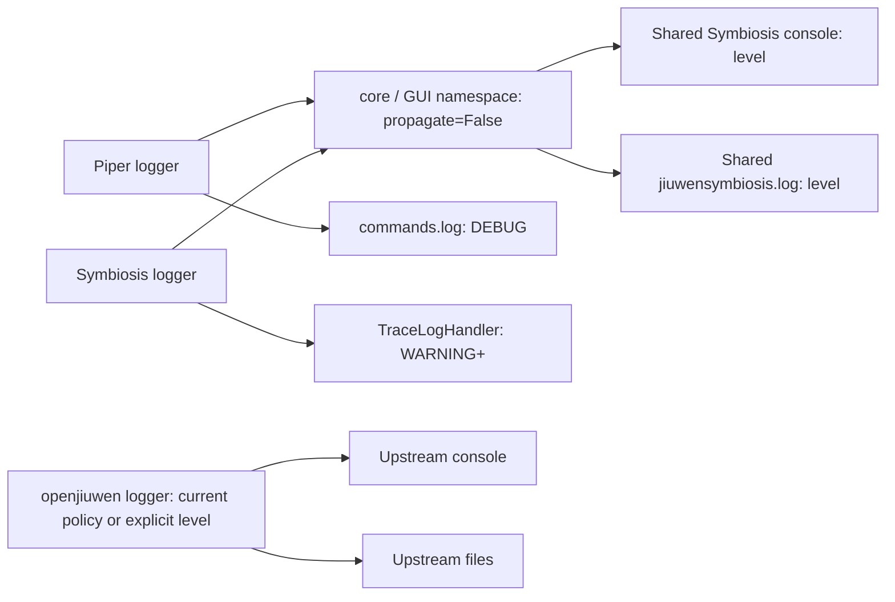

# 日志模块设计文档

## 职责边界

`jiuwensymbiosis.utils.logging` 管理 Symbiosis 的格式、级别和主文件，使用标准库 Logger 与 handler。业务代码只产生日志；入口通过 `LoggingConfig.configure()` 应用配置。

openjiuwen 保留自己的日志内容、后端、格式、输出目标、路由及文件轮转。`_openjiuwen_logging.py` 只通过公开 `get_log_config_snapshot()` / `configure_log_config()` 设置级别，不修改私有接口或包装生命周期方法。包导入不调用该适配层；只有入口应用显式上游级别时才调用。导入期日志遵循上游自身策略。

用户配置 `agent.logging.level` 默认 INFO；`agent.logging.openjiuwen_level` 默认 `None`，省略/null 保留上游当前配置，不修改 handler、logger 或 sink，也不重置其日志系统。先显式配置再传 None 保留当时状态，不回滚快照。显式级别与 Symbiosis 级别独立，分别作用于对应终端和文件；此时上游默认 logger、per-logger 和 Loguru sink 级别统一设置，不保留相互冲突的级别覆盖。旧的终端专用字段 `openjiuwen_console_level` 已移除。公开使用说明见 [配置和使用日志](../docs/zh/how-to/configure-logging.md)。

适配层在公开配置快照上只更新级别；快照未变化时跳过配置调用。级别变化会通过上游公开接口重置 logger，可能重新打开其文件，后续惰性创建的 logger 使用新设置。宿主之后显式重配上游时以宿主设置为准，直到再次通过 Symbiosis 显式设置上游级别；不安装持续拦截重配置的钩子。

当前依赖链中的 `pymilvus` 首次导入调用全局 `logging.dictConfig()`，可能关闭已有标准库 handler；这项既有导入副作用不在适配层控制范围。宿主预配置测试先加载该依赖，再验证适配层行为。

## 初始化和输出

CLI 先合并全部命令行覆盖，再构造、校验一次 Agent 配置，检查 query 后初始化日志；Runtime 同样在创建或连接会话、语音监听和首次规划之前配置日志；`prepare_session()`、builder 和 `run_fast_task()` 为不同 Python 入口提供幂等兜底。缺少 query 时直接向 stderr 报错并返回 2，不创建 Symbiosis 日志目录；adapter 导入前仍配置日志，以记录导入失败。整个配置作用于进程，沿用官方 Runtime 一次只执行一个操作的约束。

Symbiosis 主文件只接收 `jiuwensymbiosis`、`jiuwensymbiosis_gui` 及其子命名空间。标定日志归入 `jiuwensymbiosis.calibration`，CLI 使用稳定的 `jiuwensymbiosis.cli.run_task`，不依赖脚本运行时的 `__main__` 名称。

Symbiosis 的两个命名空间在根节点停止传播，共用相同的控制台与文件 handler 实例，避免重复打开同一轮转文件。`configure_logging()` 不修改 root 的级别、handler、formatter 或 filter。Symbiosis 配置 NOTSET 时，命名空间使用最低正级别 1，让标准日志级别全部通过且不继承宿主阈值。

openjiuwen 默认后端拥有独立 handler，继续沿用上游的传播行为。显式配置上游时，纯 `openjiuwen.*` 标准库 logger 的命名空间级别由 `openjiuwen_level` 独立控制；补充终端 handler 挂在 `openjiuwen` 节点，传播路径上已有其他控制台 handler（含宿主 root）时不补充输出。宿主 handler 保持自己的策略。NOTSET 是显式级别，不表示跳过配置；它允许全部标准级别：标准库使用最低正级别 1 避免继承 root，Loguru 使用上游支持的最低标准级别 DEBUG。

`get_logger(__name__)` 和已有 `logging.getLogger(__name__)` 返回相同的标准库 logger。框架命名空间内的日志都会路由至统一 handler，无需业务代码直接操作 handler。脚本和可用 `python -m` 执行的模块使用稳定命名空间；服务入口调用 `configure_logging()`，不调用 root 的 `basicConfig()`。

## Handler 所有权

- 仅更新或关闭两个框架命名空间根节点上带 `_jiuwensymbiosis_owned` 标记的 handler；不扫描子 logger 的专用 handler。
- 控制台一个，滚动文件至多一个（5 MB / 3 备份）。重复配置更新 formatter 和 handler 级别。
- 目录 A → B 时先准备新文件，成功后统一更新所有出口和 logger，再移除、关闭旧文件；`None` 移除主文件 handler。
- 每个输出 handler 都设置阈值。父 Logger 的级别不重新过滤子 Logger 传播的记录，因此仅设置命名空间级别无法隔离 Piper 的 DEBUG 内容。
- 目录创建或文件打开失败时，不修改原有 logger、handler 或上游日志策略。旧 handler 关闭失败时，新配置已完整生效；尝试所有待清理 handler 后向调用者报告错误，保留失败句柄供下一次配置重试。

Piper 命令 handler 只负责 `<logging.motion_dir>/<时间戳>/commands.log`。运行目录由 `RobotSession.connect()` 的 `begin_run()` 确定，默认根目录 `./jiuwen_motion_log`，与抓取调试图共享。驱动通过弱引用共享 handler，最后一个使用者关闭时释放文件，并恢复它为写入 DEBUG 而调整的 logger 原级别；外部随后调整过级别时不覆盖。构造失败会回滚日志资源，关闭失败保留清理状态供重试。每次附加时检查路径并关闭旧路径 handler；禁用 `JIUWEN_PIPER_CMD_LOG=0` 会移除已有 handler，切换路径后新文件打开失败也不会继续写入旧文件。驱动不调用全局 `configure_logging()`，不改变主日志的级别或目的地。

Piper 的 `commands.log` 使用追加模式：关闭驱动后在同一运行目录内重连不会截断已有记录；`begin_run()` 创建的新运行目录仍独立保存命令。

## 内容级别

- INFO：会话状态、LLM 请求/完成和耗时、规划步数、动作开始/完成。
- DEBUG：用户任务、LLM 消息和回复、完整计划、工具参数和结果、伺服 tick、跟踪 metrics。
- WARNING / ERROR：检测、规划、工具和清理失败，以及安全/恢复事件；保留可诊断的错误原因。

Fastagent 直接调用 HTTP，不经过 openjiuwen LLM logger，因此自己的 LLM 摘要和 DEBUG 内容由 planner 记录。HTTP Authorization 不写入这些日志。CLI 最终文本回答是用户输出；fastagent 成功且无文本回答时按 `steps_done` 输出“任务完成，共执行 N 步”，WARNING 配置也可见；语音模式在 on_command 回调里向 stdout 输出一次回复，再交给 TTS，因此 NullTTS 下也可见，连续命令逐条输出。完整执行结果只进入 DEBUG。

CLI 对 `ok: false` 结果单独记录 ERROR 摘要：任务原因，以及失败步骤的序号、操作与原因。文本和语音入口共用该提取逻辑，确保 `reason` / `steps[].reason` 不会随完整结果一起被 DEBUG 隐藏；成功步骤的结果和完整参数不进入该摘要。

`TraceRail.console` 的步骤展示使用同一日志设施，不直接 print 参数。Trace JSON 是独立结构化产物，仍保存配置要求的参数、结果和观测，不受文本日志级别裁剪。

## Trace 与 Runtime

两者直接附加到框架命名空间，不依赖 root 传播。宿主聚合器或 pytest `caplog` 也需把捕获 handler 附加到 `jiuwensymbiosis` / `jiuwensymbiosis_gui`；不要为了捕获恢复 root 传播，否则会造成重复输出。仓库的 `caplog` fixture 已适配此边界。

`TraceLogHandler` 通过最小 sink 协议把 WARNING+ 转成 trace `log_events`，无需业务 logger 依赖 TraceRail。invoke 结束解除 sink，下次 invoke 重新绑定；Session 清理移除 handler。协议调用的 AttributeError / TypeError / ValueError 被隔离。

Runtime 的 `EventLogHandler` 使用任务的 Symbiosis 级别，避免显式 DEBUG 子 logger 绕过 WARNING 配置向工作台队列发送 INFO。Runtime 事件存储失败的取消策略保持原有语义。

## 验证

离线测试覆盖：导入、省略/null、显式覆盖后传 None 均保留上游当前策略，宿主已有 logger/handler 存活，CLI 缺 query 不创建日志文件，文本/语音成功摘要输出一次，Symbiosis / openjiuwen 独立级别、终端与文件统一过滤、per-logger / sink 级别覆盖、后端与输出目标保留、重复配置不重置、导入前预配置和惰性创建的上游 logger、公开 reset / 重配置、default / Loguru 后端（含 stdout/stderr）、无重复输出、目录切换、外部 handler 保留、DEBUG 子 logger 不越过框架输出阈值、Piper 命令文件独立、连接及规划失败前的日志、Symbiosis 上下文只在 DEBUG、Trace 与工作台日志消费。
