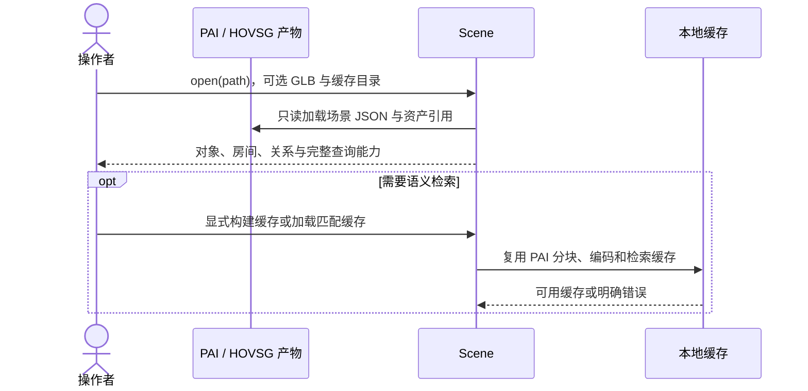
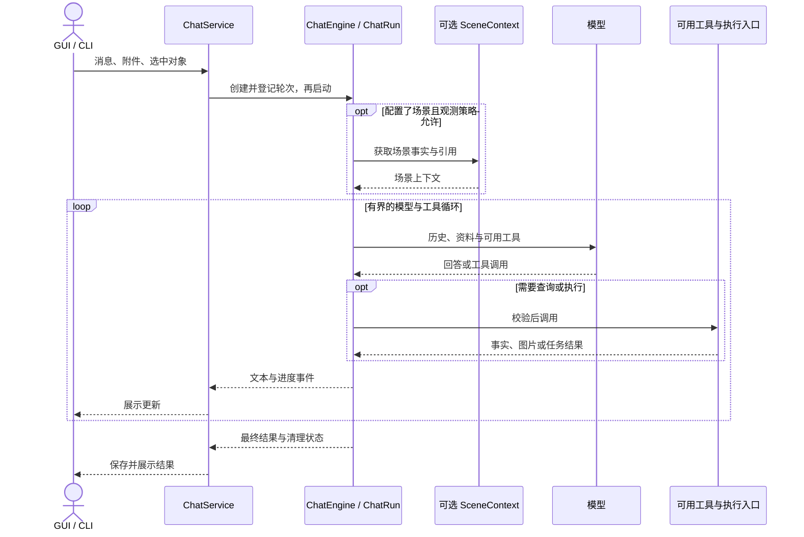
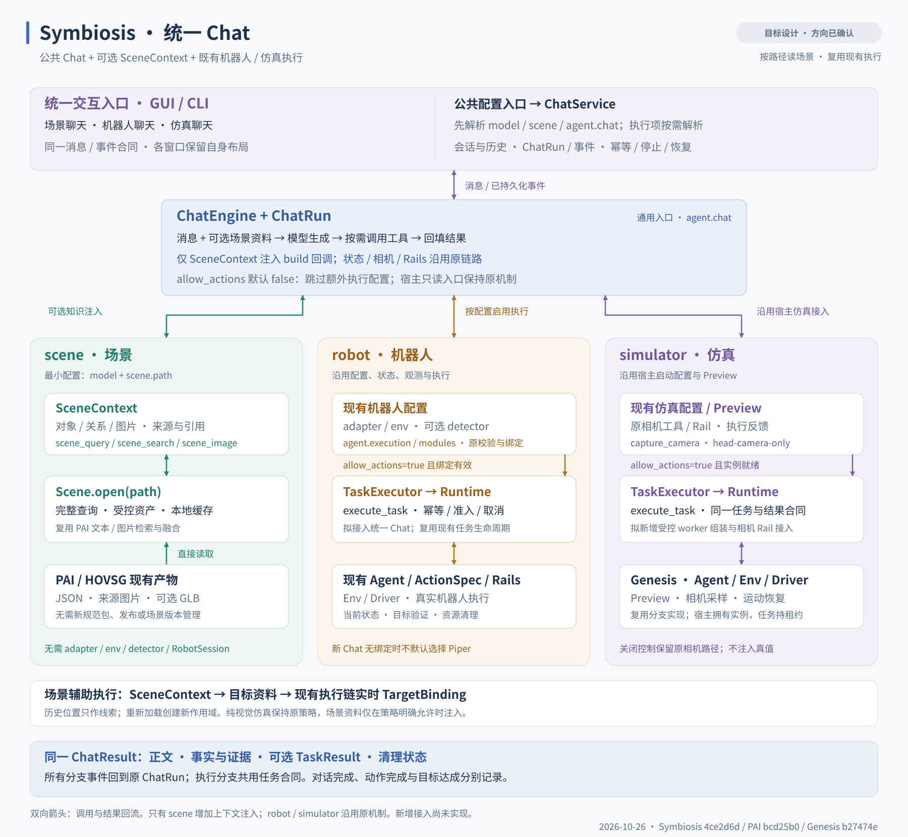

# Symbiosis 统一 Chat：设计简版

本文面向团队沟通，概述场景聊天、机器人聊天和仿真聊天如何共用一套对话能力。以下为目标设计，新增接口与配置尚待实现；具体合同与验收要求见[完整设计](offline-scene-assistant.md)。更新日期：2026-10-26。

## 1 设计目标与使用方式

让三类聊天共用对话入口、历史、消息、事件和运行生命周期。离线场景通过可选的 SceneContext 提供知识；机器人状态、相机观测和仿真反馈沿用已有配置、工具与执行链。场景读取和检索优先复用 PAI 的实现。

**整体设计：公共 Chat + 可选 SceneContext + 按现有配置启用的执行链路。**

| 使用方式 | 输入与能力 | 执行方式 |
|---|---|---|
| 场景聊天 | model + scene.path；查询房间、对象、关系和来源图片 | 无动作执行，不创建 RobotSession |
| 机器人聊天 | 现有机器人配置；沿用状态、相机和动作能力 | 开启控制并绑定设备后，委托现有 Runtime/Agent |
| 仿真聊天 | 现有仿真配置与 preview；沿用相机和反馈 | 保留只读观察；开启控制并确认实例就绪后执行动作 |
| 场景辅助执行 | 在机器人/仿真聊天中增加场景资料 | 场景提供目标线索，执行前再用实时观测确认目标 |

场景按路径直接读取已有 JSON/目录，不建设场景库、发布流程或版本管理。只有 Scene 需要新增上下文注入，机器人和仿真保留原机制。

## 2 两条核心流程

### 2.1 打开场景，按需准备检索



打开场景即可做完整计数、对象和已有关系查询；语义检索使用额外的文本/图片编码模型与缓存。首次提问不自动构建索引，源目录保持只读，派生缓存可以删除重建。

### 2.2 共用一个 Chat 循环



Scene 打开后，主机构造 SceneContext，并在创建 ChatEngine 时注入其 build 回调。场景查询通过 scene_query / scene_search / scene_image 补充资料；需要动作时通过 execute_task 委托已有机器人或仿真 Agent，底层动作仍由原执行链规划和执行。

首期每轮最多委托一个执行任务，任务内部可包含多个动作。没有执行能力时仍可聊天；停止由主机直接传播到当前运行，已有步骤和实际执行结果继续保留。仿真的纯视觉策略仍生效，场景资料只能在策略明确允许时注入。

## 3 模块分工与目录

### 3.1 模块分工

| 模块 | 主要职责 |
|---|---|
| agent.chat | ChatEngine / ChatRun；模型与工具循环、消息、结果、预算和取消 |
| agent.chat_config | 公共配置入口；统一拥有配置拆分与叶级更新，供 CLI、Runtime、GUI 共用 |
| agent.model_io.openjiuwen | 复用 ModelSpec/build_model，处理文本、图片和流式输出 |
| agent.task | TaskExecutor 及任务请求/结果合同，连接 Chat 与执行侧 |
| scene | 按路径读取、完整查询、资产访问和可选 PAI 检索/缓存 |
| scene.context / tools | 将场景事实、图片和引用送入 Chat，提供只读查询工具 |
| runtime.chat | ChatService；会话、历史、运行句柄、事件和恢复 |
| runtime.task_executor / scene_binding | 委托任务，将历史场景目标与实时执行目标关联 |
| simulators.genesis | 复用 preview、相机工具、观测策略及执行逻辑，接入公共 Chat |
| 现有 Runtime / Agent / API / Env | 资源准入、动作规划、能力校验、安全检查、执行与清理 |
| GUI / CLI | 加载配置、接入场景和执行资源，展示消息、证据与任务结果 |

公共 Chat 通过回调和任务合同使用领域能力。场景基础查询不要求安装检索或硬件依赖；需要检索或执行时再加载对应模块。

### 3.2 拟实施目录

```text
jiuwensymbiosis/
├── agent/
│   ├── chat.py, chat_config.py, task.py
│   ├── model_io/openjiuwen.py
│   └── run.py, builder.py, fast/       # 复用现有执行
├── scene/
│   ├── scene.py, config.py, models.py
│   ├── loaders/hovsg.py, query.py, assets.py
│   ├── retrieval/                     # 复用 PAI 检索与缓存
│   └── context.py, tools.py
├── runtime/
│   ├── chat.py, task_executor.py, scene_binding.py
│   └── jobs.py, worker.py, store.py    # 复用现有任务生命周期
└── simulators/genesis/
    ├── chat.py, integration.py        # 公共 Chat 接入
    └── agent.py, agent_camera.py, preview.py

plugins/scene_gui/                     # 独立场景 GUI 插件
scripts/scene/                        # 场景检查与缓存命令
examples/chat.py                      # 无 GUI 的公共入口
```

Genesis 已有实现位于独立 checkout，仍需选择性接入主仓库。



[打开 SVG 原图](../docs/images/architecture-scene.zh.svg)

## 4 Scene 的核心接口

Scene 对外提供读取、查询、检索和资产访问，具体 HOVSG 解析及 PAI 算法留在模块内部。拟实施接口如下：

```python
class Scene:
    @classmethod
    def open(cls, path: Path, *, cache_dir: Path | None = None,
             glb_path: Path | None = None) -> Scene: ...

    # 完整查询：数量、列表、对象关系等。
    def query(self, query: SceneQuery) -> FactResult: ...
    def get_object(self, object_id: str) -> ObjectRecord: ...

    # 可选语义检索：返回文本/图片证据与对象引用。
    async def search(self, query: str,
                     budget: EvidenceBudget) -> EvidencePack: ...

    # 受控、限量的资产读取；句柄按块读取并由调用方关闭。
    def open_asset(self, asset_id: str) -> AssetHandle: ...
    def close(self) -> None: ...
```

open 只读取和校验本地资料，不启动编码模型、构建缓存或连接机器人。query 基于完整记录，因此“有几把椅子”不依赖检索召回数量；search 则用于按语义寻找相关证据。

每次打开产生新的 load_id，对象引用绑定本次加载。缺失位置或关系明确为未知；离线位置只作执行线索，实际动作前仍需实时确认。

## 5 GUI 如何接入

保留工作台和 Genesis 窗口的现有技术栈，场景 GUI 沿用 React/R3F/drei 的可复用实现。三类窗口统一提交 ChatRequest、消费 ChatEvent/ChatResult，各自保留布局与三维展示方式。

场景 GUI 作为独立 wheel，通过已有 GUI Launcher 的插件入口接入：

```toml
[project.entry-points."jiuwensymbiosis.gui"]
scene = "jiuwensymbiosis_scene_gui.plugin:describe"
```

插件启动时调用公共 load_chat_config，按配置打开 Scene、接入 ChatService。拟议启动方式为：

```bash
jiuwensymbiosis-gui --gui scene --config ./runtime.yaml --workspace ./agent_workspace
```

插件及对应安装组合仍待实现。纯场景部署使用 chat/scene 基础依赖；语义检索另加 scene-retrieval，机器人和仿真按各自已有部署要求安装。

## 6 最小配置与执行开关

**纯场景聊天只需 model + scene，无需 adapter、env、detector 或 RobotSession。** 模型端点和名称按实际部署填写：

```yaml
model:
  api_base: http://127.0.0.1:8110/v1
  model_name: Qwen/Qwen3-VL-32B-Instruct

scene:
  path: /data/room-a/structured_scene_graph.json
```

模型其他字段沿用既有 ModelSpec 默认值。scene.path 接受场景 JSON 文件或包含 structured_scene_graph.json 的目录，相对路径以 YAML 所在目录为准。可按需增加 scene.glb_path、scene.cache_dir，以及 scene.retrieval 下的文本/图片编码模型路径。

该最小配置支持完整查询、基本标签匹配和已有空间关系问答，不启用语义索引。资料来自已有场景产物，无需重新检测现场。

agent.chat.allow_actions 默认 false：公共 Chat 跳过额外执行配置解析与绑定。若需要执行，在一份已可运行的机器人配置上保留原有 adapter/env/agent.execution 等设置，仅按叶级合并下面的增量：

```yaml
# 合并到现有机器人配置；不是独立的执行配置
scene:
  path: /data/room-a/structured_scene_graph.json
agent:
  chat:
    allow_actions: true
```

开启后仍需有效执行绑定、能力与资源准入；缺少目标时不默认选择 Piper。仿真继续使用宿主已有配置和 preview，关闭动作控制仍可保留原只读相机入口。

这些是新 Chat 入口的目标配置，不能直接交给当前机器人任务 CLI 作为纯场景启动配置使用。

## 7 分阶段实施计划

### 第一阶段：公共 Chat 与基础场景聊天（M0、M1、M2a）

先统一模型、配置、历史、事件和停止流程，再接入 Scene 路径读取、完整查询、资产与 SceneContext。

**交付：** 一份 model + scene 配置即可在无 GUI 的入口回答数量、房间和已有空间关系问题，无需硬件、仿真或检索编码模型。这是首个可用版本。

### 第二阶段：复用 PAI 的检索能力（M2b）

在基础 Scene 上迁入文本/图片检索、关系扩展、融合和缓存工具，继续共用原 Chat。

**交付：** 支持语义查找与图片证据；未启用检索或相关能力不可用时，基础查询仍可使用。

### 第三阶段：接入机器人与仿真执行（M3）

通过 TaskExecutor 连接现有 Runtime/Agent，补齐场景目标的实时确认、预算与取消传播、部分执行结果回传。

**交付：** 从同一聊天入口委托任务并查看实际结果；先通过替身与故障测试，再分别验证 Genesis 和代表机器人。

### 第四阶段：窗口接入与离线交付（M4、M5）

完成场景 GUI 插件与三维交互，将工作台和仿真窗口接入公共 Chat，整理安装依赖、静态资源和离线制品。

**交付：** 三类窗口共用后端消息与任务合同，最小场景部署与完整部署分别验收。

基础场景 GUI 可在第一阶段后启动；第二阶段与不依赖语义检索的第三阶段可分别推进。各阶段按实际通过的能力交付，真实模型、浏览器、仿真和硬件分别记录验证结果。
