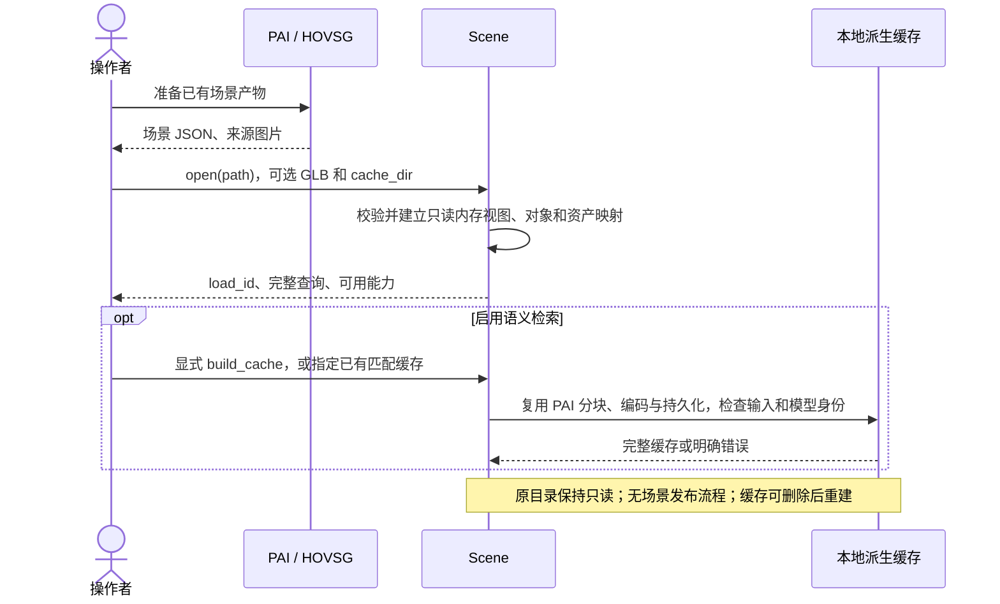
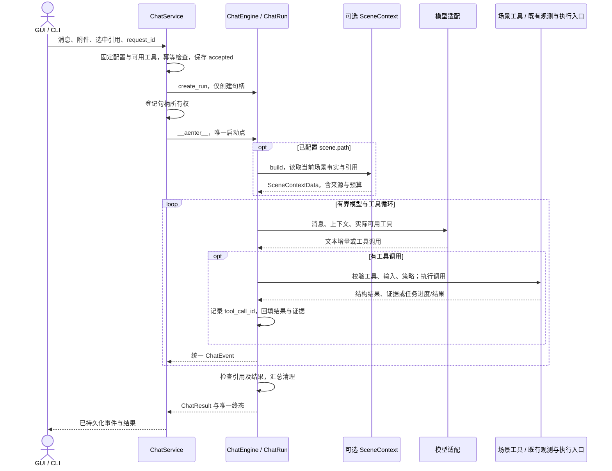
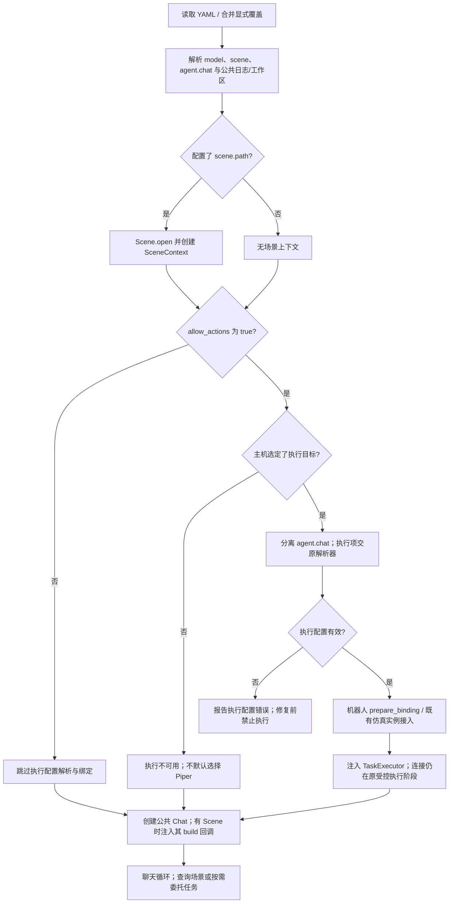

# Symbiosis 统一 Chat：场景、机器人与仿真集成方案

状态：**公共 Chat、可选 SceneContext、沿用机器人/仿真执行配置、按路径读取场景的方向已确认；本文是目标设计，尚未完成业务实现。** 修订日期：2026-10-26。代码依据：Symbiosis `4ce2d6d`、PAI `bcd25b0`、Genesis 分支 `b27474e`，详见第 14 节。

目标是让场景聊天、机器人聊天和仿真聊天共用一套对话入口、历史、消息、事件和运行生命周期。只为离线场景增加可选的 SceneContext 注入；机器人状态、相机观测与仿真反馈沿用现有配置、工具和 Rails。PAI 提供可复用的场景读取与检索实现；机器人和仿真动作继续经过现有执行链。

本文中的新增模块、接口、配置和连线均为拟实施合同。本文及配套架构图描述目标方案，不将已有局部实现表述为三类窗口已经接通；第 11 节给出待实施的执行计划。

## 0 设计决策与交付边界

**Chat = 公共对话流程 + 可选 SceneContext + 按现有配置启用的执行链路。**

| 决策 | 本稿采用的方案 | 实施约束 |
|---|---|---|
| D1 统一入口 | `agent.chat.ChatEngine` / `ChatRun`，由 `runtime.chat.ChatService` 托管 | GUI、CLI 共用合同；通用层不按场景类型分支，不先分类为问答/任务/混合 |
| D2 最小扩展 | 只有场景知识增加 SceneContext；机器人/仿真保留已有配置、状态和观测机制 | 不新增通用 ContextProvider 注册表、RobotContext 或 SimulationContext |
| D3 场景简化 | `Scene.open(path)` 直接读取 HOVSG JSON/目录；完整查询与资产按需读取 | 不建设场景库、规范交换包、发布事务、场景版本列表或历史版本管理 |
| D4 优先复用 | 保留 PAI 分块、文本/图片检索、关系扩展、融合和现有缓存实现 | 调整路径、模型注入和证据合同；首期不同时替换检索底座 |
| D5 按需启用执行 | agent.chat.allow_actions 默认 false；为 true 才解析额外执行配置并接入 TaskExecutor | 机器人复用 adapter/env、Runtime 与 Agent；仿真复用宿主配置和 preview，不重复定义配置 |
| D6 生命周期与身份 | ChatService 持有轮次；Runtime 持有执行任务；来源、目标、提交意图和结果可追溯 | 简化场景管理不削弱停止、幂等、资源清理和实时目标校验 |
| D7 按验证层交付 | 通用 Chat → PAI 场景接入 → 机器人/Genesis 接入 → GUI 与离线验收 | 仿真、真实模型和真实硬件分别记录，不以其中一种代替其他验收 |
| D8 公共配置入口 | 独立解析 model、scene 和 agent.chat；model + scene 即可启动场景聊天 | 不要求 adapter/env/detector，不构造 RobotSession，不继承任务 CLI 的默认 Piper 行为 |

首期每个会话一个活动或未清理轮次，每轮至多一个执行任务；任务内部仍可有多个动作、相机调用和有界重规划。只读工具允许在预算内多次调用。先验证一个真实机器人配置和 Genesis 已支持的底盘动作，不承诺任意机器人、导航或抓取任务。

本期保留“场景资料 → 选中目标 → 实时确认 → 机器人执行 → 返回实际结果”的有限闭环。场景与机器人组合不是场景聊天的启动前提。无设备时可验收软件层，真实机器人门槛保持未验证。

自动建图、在线对象更新、场景版本管理、任意环境导航、多机器人调度、通用插件注册平台和完整多 Agent 后端迁移不在本期。

## 1 使用方式与目标时序

### 1.1 三类使用方式

| 使用方式 | 资料与配置来源 | 只读能力 | 执行路径 |
|---|---|---|---|
| 场景聊天 | model + scene.path；注入 SceneContext | 完整结构查询、按对象读图，可选语义检索 | 无；不解析机器人配置或创建 RobotSession |
| 机器人聊天 | 现有 adapter/env、agent.execution/modules；状态与观测保持原机制 | 已有状态、相机工具，遵守原资源访问规则 | allow_actions=true 且绑定有效时，经 TaskExecutor 委托现有 Runtime/Agent |
| 仿真聊天 | 宿主已有仿真配置、preview、相机工具与 Rail | capture_camera，保留现有只读模式 | 开启控制且实例就绪时复用 run_agent_query 的执行逻辑 |
| 场景辅助执行 | 在现有机器人/仿真配置上增加 scene.path | SceneContext 提供历史资料；实时观测仍走原链路 | 携带结构化对象引用并实时绑定；仿真须符合其观测策略 |

场景只读工具拟命名为 scene_query、scene_search、scene_image；执行委托工具为 execute_task。底层执行器仍使用已有动作名，例如 Genesis 的 navigate_relative / rotate_base。不新增 `mode=scene/robot/simulator` 来驱动 Chat 内部流程。

历史、用户输入、附件和模型配置由 Chat 统一管理。主机在打开 Scene 后创建一个 SceneContext，将其构建上下文的方法注入 ChatEngine；每轮生成前读取资料。机器人与仿真不用改造成上下文 Provider，已有工具返回和 Rail 注入继续生效。执行工具是否可用取决于控制开关、有效绑定、实际能力和资源状态。

allow_actions=false 时，公共 Chat 不为机器人新建绑定、解析 adapter/env/detector 或启动执行资源。宿主已经提供的只读观测可沿用现有入口，例如 Genesis preview 的相机；这个开关不关闭整个仿真预览。相机采样仍需受控资源访问、取消和清理，不能绕过同设备互斥。

### 1.2 同一输入框的行为

| 输入/条件 | 行为 |
|---|---|
| “这个房间有几把椅子” | SceneContext/scene_query 查询完整对象集合；数量不依赖 Top-K |
| 选中杯子后问“它在哪里” | 使用结构化引用，显示来源及历史时间含义 |
| 场景聊天中说“拿起它” | 当前工具集中无执行能力，说明不可用，不连接机器人 |
| “你支持哪些动作” | 返回宿主已有绑定的已知能力；未启用执行且无绑定时说明当前不可用，不临时加载适配器或连接设备 |
| 仿真关闭控制时问“前面有什么” | 调用允许的相机工具；没有运动工具 |
| 仿真开启控制后说“往前移动一点，再看看” | 委托一次任务；执行器按相机策略观察、移动、复查 |
| “如果只有一个杯子就拿起来” | 完整查询提供条件事实，程序复核条件和唯一目标后才可提交 |
| “回到起始位” | 需要主机保存的起始姿态；不能自动等同 home |
| “停止”或停止按钮 | 走控制接口，定位当前运行并取消，不等待模型和普通轮次队列 |

用户明确指令在主机已启用的执行范围内可直接执行，不要求每轮弹出确认框。检索资料、图片文字、历史工具结果和模型建议不构成本轮执行授权；意图、条件或目标不清时澄清。

没有模型仍可使用显式结构查询、已知状态与停止接口；自然语言理解及需要模型规划的路径明确不可用。没有场景可使用机器人/仿真；没有执行绑定可使用场景；这些组合均无需伪造空资源。

### 1.3 场景读取与检索准备



### 1.4 统一 Chat 循环



没有工具时自然退化为一次回答。场景查询通过只读工具补充事实；相机和状态沿用宿主已有工具/执行链，结果接入同一消息事件合同。execute_task 内部交给现有机器人 Agent，其相机 Rail、状态与动作循环保持原有职责，不由 Chat 逐动作重新规划。

### 1.5 任务委托、停止和恢复

任务调用顺序为：持久化 TaskRequest 与稳定执行键 → Runtime 准入 → 受控创建 Session/仿真绑定 → 实际能力和目标校验 → 现有 Agent 执行 → 保存结果与清理 → 回到原 ChatRun。

SSE 断开只结束订阅。停止先设置信号，再取消模型/检索/工具和执行任务；未取得 job_id 时仍按稳定 request_id 管理提交竞态。主机重启先对账既有任务，不自动补发未确认动作。执行完成和停止竞争时保存真实结果；软件取消不能撤销已发生的物理效果，也不等于硬件急停。

## 2 PAI、现有 Agent 与 Genesis 的复用

### 2.1 PAI：迁入领域实现，统一外部合同

| 现有实现 | 复用方式 | 必须适配的部分 |
|---|---|---|
| HOVSG schema 2.1/2.2、场景提取 | 按路径读取，建立内存对象/房间/关系视图 | 保留来源、对象/观测身份、坐标与未知值；不复制生成新交换包 |
| chunker / SceneGraphRetriever | 保留分层分块、关系扩展与检索算法 | 场景实例取代全局 scene_id 查找；完整查询独立于召回 |
| VectorStore | 首期保留 MiniLM/配置的文本模型、BM25、RRF、Chroma 持久化及内存检索 | 注入模型路径和缓存路径，记录兼容性；不改用另一套向量库 |
| ImageChunker / ImageRetriever | 保留 CLIP、整帧/物体图片召回及文本图片融合 | 观测复合键、受控资产读取、统一 Evidence |
| 中文查询翻译 | 复用已有改写逻辑 | 模型来自统一适配；不携带第二套密钥/供应商配置，计入预算和取消 |
| ChatTurn / ContextBuilder | 复用图片附加、证据组织和消息处理经验 | 生命周期迁入 Chat；场景规则进入 SceneContext，不整体搬入第二个对话主机 |
| React / R3F / drei | 选择性移植 GLB、视角与布局 | 改接统一消息事件；对象拾取需补关联；不继承固定机器人图形与 mock 轨迹 |

PAI 的索引缺失可能返回空召回，检索失败后也可能继续生成；接入后区分 empty、degraded、unavailable。其抽取器缺位置时可能补零、图片分块仅按 frame_id 分组，均需在迁入时修正，不能将未知位置当原点或混合不同采集会话。

PAI 的 RetrievedItem 混有前端 URL 和本地路径。接入后返回 AssetRef/Evidence，模型适配读取像素，HTTP 层生成 URL。不要求运行 PAI Web 后端，也不依赖它的场景注册表和会话库。

### 2.2 模型与公共执行基础

ModelSpec/build_model、现有消息类型及工具调用机制继续复用。通用模型适配负责文本/图片转换、流事件及关闭；PAI 查询翻译可通过内部兼容适配调用同一模型入口。PAI 的多协议实现不能直接视为 build_model 已支持；M0 核验实际部署协议，缺口在同一适配位置补齐。

公共 Chat 从依赖 RobotSession 的组装中抽出。纯场景聊天不创建机器人 Agent/Session；执行任务继续使用 run_robot_task、fastagent/stepagent、ActionSpec、Rails 与 Env。首期不引入 ContextEngine、长期记忆或另一套知识库，也不为替换 PAI 检索而接入 openjiuwen 向量存储。

共用模型定义不意味着跨线程/事件循环共享同一个客户端。Genesis 已通过独立 HTTP 客户端避免工作线程与聊天事件循环混用；此所有权约束应保留。

### 2.3 流关闭与依赖门槛

核心当前声明 openjiuwen>=0.1.13,<=0.1.17。此前对安装的 0.1.17 的源码核对指出 Model.stream 普通提前结束缺少统一的内层关闭路径；本次文档修改不构成该问题已修复或已重新运行验证。

M0 重新验证正常结束、首 token 前取消、流中取消、异常和工具循环退出。如仍需修补，交付可审计的最小补丁构建、源码差异、版本、wheel 哈希与回归结果，不修改本机 site-packages 充当制品。清理须验证内层流、本地请求和自有客户端，不能用外层 await 已取消作为证明。远端计算是否结束单独记录。

## 3 模块职责与架构

### 3.1 所有权

| 模块 | 职责与公开合同 |
|---|---|
| agent.chat | ChatEngine / ChatRequest / ChatRun / ChatEvent / ChatResult；通用模型与工具循环、预算、引用检查、整轮清理 |
| agent.chat_config | 公共 ChatConfig、loader、split_agent_section / apply_config_patch；公共/执行配置拆分与保留原配置的叶级更新只有这一处实现 |
| agent.model_io.openjiuwen | ModelSpec/build_model、消息/图片/工具事件转换、请求关闭 |
| agent.task | TaskExecutor / TaskRequest / TaskHandle / TaskResult；无硬件、Web、具体 Runtime 依赖 |
| scene | Scene.open、完整查询、PAI 检索、资产及派生缓存 |
| scene.context / tools | SceneContext 与可选只读工具；场景提示规则、指代、事实和图片选择 |
| runtime.chat | ChatService；会话、历史、句柄、事件、幂等和恢复 |
| runtime.task_executor / scene_binding | 执行委托及历史对象到实时目标的可选转换；复用现有绑定与资源准入 |
| simulators.genesis.chat / agent / integration | 现有相机工具、观测 Rail 和执行配置；补公共 Chat 及 Runtime 的受控接入 |
| 现有 Runtime / Agent / API / Env | 资源准入、Session、动作规划、能力交集、Rails、执行、结果和清理 |
| GUI / CLI 主机 | 调用公共配置 loader，注入可选 SceneContext，按需接入既有执行；GUI 额外负责 HTTP/SSE、三维展示和交互 |

通用 Chat 引擎不导入 scene 的具体实现、simulators、FastAPI 或具体 Runtime。它接收可选的场景上下文构建回调与已有工具；SceneContextData、证据等传输类型放在公共 Chat 合同中。只提供一个场景注入位置，不设计 Provider 列表、注册协议或多领域组合框架。任务工具持有注入的 TaskExecutor；底层动作仅进入已有执行链。场景规则随场景资料提供，确定事实由查询结果保证，引用由公共检查验证。

### 3.2 拟实施目录

```text
jiuwensymbiosis/
├── agent/
│   ├── chat.py, chat_config.py, task.py
│   ├── model_io/openjiuwen.py
│   └── run.py, builder.py, fast/       # 复用执行；按需增加任务上下文
├── scene/
│   ├── scene.py, config.py, models.py  # 按路径打开与内存事实
│   ├── loaders/hovsg.py, query.py, assets.py
│   ├── retrieval/                     # 迁入 PAI 算法及缓存实现
│   └── context.py, tools.py
├── runtime/
│   ├── chat.py, task_executor.py, scene_binding.py
│   └── jobs.py, worker.py, store.py    # 现有任务及受控组装扩展
└── simulators/genesis/
    ├── chat.py                        # 窗口适配，迁移历史/轮次到 ChatService
    ├── integration.py                 # 拟新增受控接入；不新增上下文体系
    └── agent.py, agent_camera.py, preview.py  # 分支已有能力，选择性接入

plugins/scene_gui/                     # 独立 wheel；React/R3F 与 HTTP 薄适配
scripts/scene/                        # check / cache build / cache check
examples/chat.py                      # 无 GUI 的同一入口
```

目录表达职责，不要求每个类型独立成文件。Genesis 的已有代码来自另一 checkout，尚未合入本仓库；接入工作不能只添加 import 就宣称完成。


[可缩放 SVG 源图](../docs/images/architecture-scene.zh.svg)。scene 分支负责可选知识注入，robot / simulator 分支表示按现有配置接入的执行链。只读相机保留原机制；控制开启后通过同一 TaskExecutor 合同接入动作执行。所有事件返回同一 ChatRun；图中新增连接仍为目标设计。

### 3.3 必须补齐的接入位置

- 现有 `RobotAgentConfig.from_dict` 不接受 agent.chat；公共 loader、GUI 与执行入口共用 agent.chat_config 的拆分/更新函数，先分离 chat 配置，再按需交给原执行解析器。RobotAgentConfig 不反向依赖 Chat 配置模块，也不增加一份拆分实现；不能以忽略未知字段规避错误。
- 现有任务 CLI 缺省 adapter 时回退 Piper；工作台也有设备默认值。新增纯 Chat 入口不经过这些默认分支。现有 `prepare_binding` 仍是严格的执行入口，不改成可缺少 adapter 的通用 loader。
- 现有 build_robot_agent / run_robot_task 都需要 RobotSession。公共 Chat 必须有直接接收模型的构建路径，只有 Scene 时不经过这两个入口；仅修改 YAML 校验不足以支持场景聊天。
- detector 缺省已为 disabled。纯场景查询读取已生成的 HOVSG 事实与图片，不需要检测服务；启用机器人执行后的 env/detector 要求仍由具体适配器决定。
- 工作台 ConfigModel 的加载、叶级修改、校验和保存都涉及 RobotAgentConfig；共用 Chat 配置时须统一拆分/合并，避免加载时报未知字段或保存时丢失 agent.chat/scene。Launcher 仅传路径，场景插件直接使用公共 loader。
- Runtime 已有 submit_task/get_job/read_events/cancel、资源锁、JobStore 和 TaskEventRail；新增结构化 task_context、按 request_id 查询及结果投影，复用原有任务生命周期。
- 现有 builder 支持 extra_tools / tool_allowlist，可复用其装配机制；抽出公共 Chat 时不要求无机器人会话构造 RobotSession。
- Genesis 当前直接调用 run_robot_task，并注入相机工具和 CameraObservation Rail。Runtime 禁止通过外部 agent_options 注入 extra_tools/extra_rails，worker 也会设置自己的 Rail；需在可信 worker 组装位置合并相机与任务事件 Rail，并提供绑定到既有 preview 的会话工厂。
- 浏览器只提交绑定标识与 JSON 数据，不能传入 preview、Driver、函数或 Rail。仿真共享实例归宿主所有，单任务仅取得和释放控制租约。
- WorldState / ExecutionMemory 表示实时执行状态；离线地图留在 Scene。场景查询不加入 Env 能力或 robot_control。

## 4 共享合同与公开接口

### 4.1 Chat 与场景资料合同

| 类型 | 内容与不变量 |
|---|---|
| ChatConfig | ModelSpec、可选 scene 设置、allow_actions、公共日志/工作区；执行配置仅在启用时交给原解析器 |
| ChatSession | conversation_id、可空 scene_load_id、有效工具、可空执行绑定、观测策略和模型配置引用；每轮固定配置 |
| ChatRequest | request_id、用户消息、附件、selected_refs；内部带主机核验的 scope/工具/策略快照，不接受客户端提权 |
| ChatTurn | 输入、正文、结构事实、确认引用、tool calls、任务关联、轮次状态和清理；不设 answer/task/mixed route |
| EntityRef | scope_id、entity_type、entity_id；场景 scope_id 使用 load_id，通用代码不解释领域 ID |
| SceneContextData | 当前场景的事实、证据、候选/确认引用、来源、时间、状态、场景提示规则和预算 |
| Evidence / AssetRef | scope、来源类型、对象/观测引用、时间及受控资产标识；不把 HTTP URL 或绝对路径作为公共事实 |
| ToolBinding | 唯一工具名、输入/结果 schema、read/task 类别、所需 scope 与受控调用句柄；主机显式注入 |
| ChatEvent | conversation_id、turn_id、seq、kind、payload；工具事件含 tool_call_id，任务事件另含 job_id |
| ChatResult | 正文、权威事实、已校验引用、工具结果、可选 TaskResult、降级原因、RunCleanupReport |
| RunCleanupReport | confirmed/unconfirmed、模型/检索/工具工作状态、任务清理、未终止资源；远端计算状态另记 |

ToolBinding 表达 Chat 调用合同，输入/结果 schema 复用已有工具转换机制；不定义第二套机器人动作词汇。领域数据与指令分开，外部文档/图片不能成为系统规则。主机传入的领域提示规则才可作为配置指令。

场景资料保留 load_id 与对象身份，文本相同的两个对象也不能合并。SceneContext 校验场景引用，不自行创建第二份会话历史。机器人设备绑定、仿真实例身份与观测策略仍属于已有执行合同，不包装成场景上下文或统一 Provider envelope。

历史只复用同 scope 的已确认引用。任务结果记录过去发生的事实，不能证明当前位置或持物状态仍新鲜。切换场景、设备、仿真实例或观测策略时创建新会话；活跃旧任务仍可查看、停止。关闭控制会立即撤销新的提交并停止当前执行，不能等待新会话才生效；重新开启需要新组合快照。

### 4.2 Scene 的内存合同

| 类型 | 内容 |
|---|---|
| Scene / SceneInfo | 已解析 source_path、唯一 load_id、输入指纹、坐标系、只读记录、实际可用能力 |
| ObjectRef | load_id、object_id；可附源 persistent_id，不推断无证据的跨加载同一性 |
| SourceRef | 源格式、schema、源记录键/JSON Pointer、采集批次、时间及 clock_domain |
| SpatialPose / Geometry | frame、米制位置、已有朝向/几何、来源；缺失值为 null，不补零 |
| Observation | observation_id、object_id、session_id、frame_id、source_index、时间和 full/crop/mask 资产 |
| SceneQuery / FactResult | lookup/list/count/relations/describe 与过滤；返回完整数量、条件、分页、来源和 load_id |
| EvidencePack | 文本/图片召回、对象引用、各路径状态与预算；只在当前 load_id 内解析 |
| ObjectGoal | 历史对象、位置/几何/关系及证据；仅为实时目标解析的线索 |

这些类型是内存读取视图，不要求 PAI 额外生成一种规范包。源 revision/update_session 等字段可作为来源保留，不提供本地版本列表、发布指针或版本切换接口。

### 4.3 任务合同

| 类型 | 内容与语义 |
|---|---|
| TaskRequest | 稳定 request_id、turn_id、execution_binding_id/指纹、本轮用户目标、经核验的约束、scopes/目标引用、策略及主机收紧的执行预算；仅 JSON |
| TaskHandle / TaskSnapshot | request_id、可空 job_id、submission_status、Runtime phase、cancel_requested、快照对应的事件序号、已知步骤、可空结果及清理；区分尚未提交、提交未知与停止未确认 |
| ExecutionContext | 任务固定的资料、目标约束、观测策略和来源；worker 内解析受控依赖 |
| TargetBinding | 源 EntityRef/ObjectRef、job_id、当前观测实例、frame/时间、匹配证据、有效条件与任务内 target_id |
| TaskResult | job_id、phase、outcome、已确认完成/未执行/结果未知的步骤、目标验证、错误/停止原因、证据和 cleanup；取消不丢弃已有执行事实 |

execution_binding_id 对应主机登记的真实机器人或仿真实例；执行任务无需知道窗口类型。TaskRequest 不携带 Driver、preview、模型客户端、工具回调或任意代码。

outcome 为 succeeded / failed / incomplete / cancelled / unknown；verification 为 goal_verified / controller_reported / unverified，附实际依据。Runtime 正常返回不自动等于目标达成。blocked 表示占用/清理状态，不能改写成“没有执行”。

TaskSnapshot 表示截至所附事件序号的已知事实，不承诺取消响应时任务已停止或结果完整。后续 inspect/events 补齐进度与清理，已确认完成的步骤不能因取消被删除；已开始但没有可靠完成记录的步骤保持结果未知，不能推断为未执行。TaskResult 汇总已持久化步骤和执行器返回；存储/进程故障导致的证据缺口必须显式保留，不补造结果。

### 4.4 拟实施接口

```python
def split_agent_section(
    agent_raw: Mapping[str, Any] | None,
) -> tuple[dict[str, Any], dict[str, Any]]: ...  # chat 配置、原执行配置

def apply_config_patch(
    raw: Mapping[str, Any], patch: Mapping[str, Any],
) -> dict[str, Any]: ...  # 返回完整配置副本，不补默认值

def load_chat_config(path: Path) -> ChatConfig: ...

class SceneContext:
    # 位于 scene.context；主机在 Scene.open 后构造。
    async def build(self, request: ChatRequest,
                    budget: EvidenceBudget) -> SceneContextData: ...

class ChatEngine:
    # 模型独立于 RobotSession；场景仅通过一个可选回调注入。
    def __init__(self, model: ModelIO, *,
                 scene_context_builder: Callable[
                     [ChatRequest, EvidenceBudget], Awaitable[SceneContextData]
                 ] | None = None,
                 tools: Sequence[ToolBinding] = ()): ...
    def create_run(self, request: ChatRequest,
                   history: list[ChatTurn]) -> ChatRun: ...

class ChatRun:
    # 主机登记句柄后调用；唯一启动点，不得重复进入。
    async def __aenter__(self) -> ChatRun: ...
    # 仅消费事件，不隐式启动轮次。
    def events(self) -> AsyncIterator[ChatEvent]: ...
    async def cancel(self) -> RunCleanupReport: ...
    async def __aexit__(self, exc_type, exc, tb) -> None: ...

class ChatService:
    # 宿主持有 Scene、既有只读工具和可选执行器；不接受客户端构建资源。
    async def create_session(self, config: ChatConfig) -> ChatSession: ...
    async def submit(self, conversation_id: str,
                     request: ChatRequest) -> ChatRunRef: ...
    def events(self, run: ChatRunRef,
               after_seq: int = 0) -> AsyncIterator[ChatEvent]: ...
    async def inspect(self, run: ChatRunRef) -> ChatSnapshot: ...
    async def cancel(self, run: ChatRunRef) -> ChatSnapshot: ...

class TaskExecutor:
    async def describe(self, binding_id: str) -> ExecutionAvailability: ...
    async def submit(self, request: TaskRequest) -> TaskHandle: ...
    async def inspect(self, handle: TaskHandle) -> TaskSnapshot: ...
    def events(self, handle: TaskHandle,
               after_seq: int = 0) -> AsyncIterator[TaskEvent]: ...
    async def cancel(self, request_id: str) -> TaskSnapshot: ...

class AssetHandle:
    media_type: str
    size_bytes: int

    # 单块与总量受主机资产策略限制，不提供无上限的 read()。
    def iter_chunks(self, *, chunk_bytes: int = 262144) -> Iterator[bytes]: ...
    def close(self) -> None: ...

class Scene:
    @classmethod
    def open(cls, path: Path, *, cache_dir: Path | None = None,
             glb_path: Path | None = None) -> Scene: ...
    def query(self, query: SceneQuery) -> FactResult: ...
    def get_object(self, object_id: str) -> ObjectRecord: ...
    async def search(self, query: str,
                     budget: EvidenceBudget) -> EvidencePack: ...
    def open_asset(self, asset_id: str) -> AssetHandle: ...
    def close(self) -> None: ...
```

主机先解析公共配置、按路径打开 Scene，再构造 SceneContext；创建 ChatEngine 时传入 `scene_context_builder=scene_context.build`。没有 scene 时不传回调。每轮在模型调用前执行回调，后续查询工具可补充资料。机器人状态、相机与仿真反馈通过已有工具结果/Rails 进入对应消息链，不新增同类回调。

create_run 只创建未启动句柄，不做 I/O 或提交任务。ChatService 先持久化 accepted 并登记所有权，再由其拥有的运行协程进入 ChatRun.__aenter__，启动一次处理；重复进入报错，events 只订阅该次运行。进入前已经收到取消时禁止启动模型、工具和任务。__aenter__ 初始化失败须自行清理并保存未确认资源，因为此时不会自动调用 __aexit__；成功进入后的退出由 __aexit__ 汇总清理。ChatRun 只有一个事件消费者，由 ChatService 保存并供多个客户端订阅。HTTP 只能选择主机已允许的配置与绑定，不能提交函数或自行添加工具。

TaskExecutor.cancel 按稳定 request_id 寻址，覆盖尚未获得 job_id 的竞态；实现内部映射 Runtime.cancel(job_id)。先传播停止信号，再返回当前 TaskSnapshot；不为等待最终步骤或清理阻塞取消响应。响应可携带已确认的部分步骤，也可在尚未执行时为空；后续 inspect/events 必须持续反映收敛。describe 只报告配置与已有状态，不能替代实际连接后的能力校验。

Scene.open 只做本地读取/校验，不启动编码模型、构建缓存或连接机器人。大资产按需打开；open_asset 在返回句柄前检查类型和文件总量，AssetHandle 按块读取且须关闭。分块累计量不能超过准入长度与总量限制，文件增长或来源变化按 source_changed 处理；消费者也不能通过拼接全部块绕过解码/预览预算。模型/检索依赖由主机或内部构建器注入，不要求全部出现在用户配置里。

## 5 按路径读取场景与本地缓存

### 5.1 输入与路径规则

场景部分的唯一必需配置是 `scene.path`；自然语言聊天还需要可用的生成模型，完整最小配置见 9.1。路径接受 HOVSG 目录或明确的 JSON 文件：

```text
/data/room-a/                         # PAI/HOVSG 现有产物，直接读取
├── structured_scene_graph.json
└── images/
    ├── frames/
    └── objects/

/data/models/room-a.glb               # 可选，单独配置，不假定与 JSON 对齐
<workspace>/
├── chat/conversations.sqlite        # 对话与任务关联
├── runtime/jobs.sqlite3             # 既有 Runtime 工作区约定仍生效
├── cache/scene/<source-key>/         # 派生检索缓存，可用 cache_dir 覆盖
└── traces/                          # 实际执行观测和追踪
```

目录输入只读取固定的 structured_scene_graph.json；文件输入以文件所在目录为来源资产根。出现其他布局时传明确文件路径，不递归猜测“最新场景”。相对配置路径基于 YAML 所在目录解析；Python 接口接收已解析路径，避免随当前工作目录漂移。

JSON 是事实来源，图片按源引用读取，GLB 为可选展示资产。加载不创建 library.json/catalog，不复制或重写源目录，不要求写权限。主机将输入路径、派生缓存和 Runtime 工作区分别管理；省略 scene 时不启用 SceneContext，配置错误时明确报错。

### 5.2 加载、引用与外部修改

每次成功打开生成 load_id，并建立当前输入的内存记录、引用及资产映射。load_id 是本次加载的作用域标识，用来拒绝跨路径/重新加载后的旧引用；不代表可查询的历史场景版本。

约定使用期间来源目录不被外部修改。显式 reload 创建新的 Scene/load_id 与会话，不能在活跃任务中替换。程序读取资产或缓存时核对记录的文件信息/摘要，发现变化返回 source_changed，停止依赖这些资料的新调用；不会声称通过哈希检查获得了外部文件系统的事务快照。

旧对话保存已经使用的事实、引用、来源摘要及必要证据副本，任务保存已固定的执行资料。旧目录被替换/删除后不保证能重新浏览完整场景，也不能将新文件展示成旧证据；缺失资料明确标记不可用。主机重启后重新打开 Scene，使用新的 load_id 和会话；旧场景会话只读，不增加持久加载恢复协议。已有任务先按持久化的执行资料对账 Runtime，不因场景重新加载而重发。

### 5.3 读取校验与资产访问

| 输入 | 读取规则 |
|---|---|
| floors / rooms / objects | 接受已核验的 HOVSG 2.1/2.2 布局，检查层级引用；同名对象保持独立 |
| position_m / geometry.center_m | 保留单位和 frame；缺失为 null，冲突明确报错 |
| spatial_relations | 保留源谓词与有单位 metrics；不能把“上方”直接当成“放在上面” |
| image_observations | 保留 observation/session/frame/source_index 等身份，不只用 frame_id 去重 |
| 图片路径 | 仅加载记录中引用的文件；拒绝来源根之外的路径/软链接，旧绝对路径不能任意打开 |
| 可选 GLB | 主机显式配置的文件可单独访问；外部纹理依赖需受控解析，未知对齐仅独立预览 |
| revision / update_session / persistent_id | 作为源字段保留，不生成本地版本管理流程 |
| nearest_navigation_node | 历史导航线索；实际导航仍需有效地图对齐、定位和目标校验 |

保留源 object_id。缺 relation/observation ID 时由源记录键和规范字段确定性生成，观测键至少区分 object、session、frame/source_index；缺字段时以源记录位置补足，不能合并身份未知的记录。

AssetRef 属于当前加载映射，不能把用户传入字符串直接拼成磁盘路径。图片缺失、损坏和未关联目标时返回明确状态；不把零向量或无法读取的图片当作有效视觉证据。完整计数不受图片、模型或索引可用性影响。

资产访问同时满足路径约束和资源上限，适用于模型读图、检索读图与 GUI 预览：

| 层次 | 有界读取合同 |
|---|---|
| 文件准入 | 图片、GLB 分别设置有限的文件总字节上限；打开句柄后核验实际文件信息，超限在读取/返回响应体前拒绝 |
| 分块传输 | AssetHandle 每块缺省且最多 256 KiB；限制单次总量及并发句柄数，读取服从消费者背压，不在 HTTP 层整体 read_bytes 或拼接大文件 |
| 图片解码 | 原图、裁剪图和 GLB 纹理均检查宽高、像素数及解码内存预算；文件压缩体积小不能绕过解码限制 |
| GLB 展示 | 同时限制文件体积、几何/纹理资源预算与活动模型数；预检后才进入完整加载，对无法在预算内处理的资产返回预览不可用 |
| 释放与降级 | 取消、客户端断开、读取或解码异常均关闭自有句柄并释放额度；拒绝单个图片/GLB 不影响已加载的对象查询和完整计数 |

这些是主机内部资源策略，不要求增加最小 YAML 字段。除上述分块大小外，各类总量、像素、预览资源与并发上限在 M0 以样例和目标机器冻结为有限默认值，并作为 M2a 的边界测试参数；不得以 None/无限制作为实现默认。HTTP 流式传输只限制传输缓冲，不能代替浏览器解码/GPU 资源准入。首期超限明确拒绝，不为此增加场景发布、自动资产转换或必须支持 Range 的流程。

### 5.4 PAI 检索与缓存

保留文本 MiniLM/配置模型 + BM25 + RRF、图片 CLIP 检索、关系扩展及双路融合。首期不为场景管理另建 SQL/FTS 投影，也不更换 PAI 的 Chroma 持久化和内存检索实现。结构查询直接使用完整内存记录。

缓存元信息只记录源 JSON/相关图片摘要、分块规则、模型身份与实际维度。匹配才复用；不匹配或损坏时提示显式重建。源内容摘要用于缓存兼容性，不对外提供按摘要浏览场景的接口。

构建复用 PAI 代码，但去掉 _stage_corpus 复制源包和全局 scene_id 注册依赖。直接从 Scene 读取，在独立缓存目录构建；同目录互斥、临时输出完成后替换，避免读到半成品。这些是缓存写入保护，不增加发布数据库、索引版本目录或持久化任务状态机。中断后丢弃不完整缓存再重建。

已有缓存加载与查询允许惰性初始化编码模型；权重必须预先准备且禁止隐式下载。同步编码/检索放入有界工作执行器，不能阻塞 Web 事件循环；取消 await 不代表编码线程终止，未结束工作仍保留句柄和额度。需要强制终止的部署采用受控工作进程。

检索结果状态为 ready / empty / degraded / unavailable，并注明缺失的是文本或图片能力。未启用语义检索时，完整查询、基本标签/别名匹配和按对象读图仍可用，但不声称等价于 PAI 的语义召回。中文语义查询可复用 PAI 翻译；模型不可用时明确降级。

拟实施 CLI：

```bash
jiuwensymbiosis-scene check --config ./runtime.yaml
jiuwensymbiosis-scene cache build --config ./runtime.yaml
jiuwensymbiosis-scene cache check --config ./runtime.yaml
# 替换输入/模型或缓存损坏后，显式重建
jiuwensymbiosis-scene cache build --config ./runtime.yaml --rebuild
```

没有 import/publish/export/revisions 命令。打开和首次提问不自动构建缓存；缓存配置及构建命令不影响没有语义检索需求的使用者。

### 5.5 展示与执行坐标

采用列向量 `p_to = T_to_from @ p_from`。校验单位、有限值、刚体矩阵及来源，未知变换不补单位矩阵。Three.js 的 Y-up 与 HOVSG 的 Y-up 相同也不能证明两份数据对齐。

有可信对齐时可用对象包围盒/中心拾取；缺网格映射时不能宣称任意 mesh 点击都得到语义对象。展示缩放不能进入机器人刚体变换。地图米制到基座毫米制只在受控交接处显式转换一次。

## 6 Chat 流程、证据和取消

### 6.1 通用循环与工具准入

ChatService 固定会话配置 → 有场景时调用 SceneContext.build → 模型流式生成 → 校验并调用可用工具 → 将结果作为工具消息回填 → 模型继续或结束 → 保存 ChatResult。没有场景时直接使用消息历史及已有工具，不运行空上下文装配流程。

不设预先的问答/执行分类模型或 route 字段；模型工具选择是候选调用，主机仍校验 schema、工具许可、执行意图及约束。未装配工具即使被模型提出也拒绝调用。read/task 分类描述工具效果，不是窗口分类。

默认串行调用工具，迭代次数、总时长、证据和输出有总预算。每个 tool_call_id 记录结果，防止恢复时重复执行；执行任务另以稳定 TaskRequest 做幂等。条件、对象或执行意图不确定时返回澄清，不能由模型自行补齐。

首期至多一次 execute_task；执行失败后由 Chat 解释实际结果，不自动再发纠错任务。执行器内部已有的有界重规划仍按其配置工作。

### 6.2 事实、图片与引用

数量/房间/已记录关系来自完整查询，权威字段通过结构化事实卡或确定模板呈现；自由文本不能改写这些值。外观判断必须附加实际图片像素；URL 字符串不算视觉证据。缺图或模型不支持图片时明确说明。

SceneContext 提供场景规则、引用和候选，不独立拥有另一个生成循环。公共 Chat 校验所有输出引用属于当前证据集合；场景引用交给当前 Scene 校验，执行绑定仍由 Runtime 校验。多对象指代不从模型正文猜 ID，工具输入使用 EntityRef/ObjectRef。

执行结果由 TaskResult 表示。模型可解释失败，不能将失败改为成功；只有控制器回执时报告 controller_reported，不宣称已观测到目标达成。历史图片、实时相机和执行反馈保持不同来源。

### 6.3 预算与历史

内部初值采用最近 6 个完整轮次、单次模型请求证据最多 8000 tokens/3 张图片，输出预留复用 model.max_tokens。只读工具循环和任务内部相机另有整轮累计上限；单次请求限制不能变成允许无限拍摄。M0 用实际模型核定预算。

**嵌套 execute_task 不扩大许可预算。** 外层 Chat 与内层 Agent 各有循环，预算按以下规则执行：

| 范围 | 所有者与计算规则 |
|---|---|
| 外层模型/工具循环 | ChatRun 限制模型轮数、只读调用和整轮时长；一次 execute_task 只占一个委托名额，不代表内层只调用一次模型或相机 |
| 内层执行循环 | 现有 Agent/runner 继续执行 max_iterations、max_replans 及原动作限制；来自 Chat 的调用只能收紧，不能放宽或重置这些限制 |
| 执行截止时间 | TaskExecutor 将外层剩余时限传入受控执行；有效截止时间取 Chat 截止时间与任务自身截止时间中较早者。排队和等待任务也消耗整轮时间，不能在 worker 启动时重置为完整时长 |
| 相机与累计工作 | 任务内相机、外层只读采样分别执行本地上限，并记入整轮累计采样额度；重规划不能清零已用额度。执行位置必须在调用前检查，不能仅在结束后统计 |
| 模型用量 | 外层、翻译及内层生成的实际用量合并记录；来源分开，缺失 usage 标为未知。累计限额启用时需有请求前配额检查，不能因统计缺失视为零消耗 |
| 外层证据窗口 | 只用于 GUI 展示/持久化的 task_progress、图片和步骤事件不占外层模型上下文预算；选入下一次模型请求的任务摘要、步骤结果和图片必须计入 token/图片上限 |

ChatRun 持有整轮预算，TaskExecutor 负责将剩余额度与停止要求传入既有执行链；任务内部仍由原调用位置检查本地限制。新增跨层时限与累计采样限制属于 M3 的接入工作，不能把现有 max_iterations/max_replans 当作这些限制已经存在的证明。单机运行以可比较的单调时钟落实截止时间；任务预算在首次提交时固定，重试/对账读取原请求与已用额度，不重新发放完整配额，主机重启也不自动续执行。

超预算先停止新增模型/工具/动作调用并传播取消，再按原清理合同收敛；清理等待不算获准继续执行。外层没有生成额度时，直接展示结构化 TaskResult/停止原因，不为补一句总结重新开放预算。完整步骤与证据保存在任务记录中，外层只回填有界摘要；必要约束无法放入模型窗口时不再调用模型。

裁剪优先低相关证据和旧完整轮次，保留工具调用/结果配对、目标约束、已发生的动作及未知执行状态。必要约束无法容纳时拒绝继续；持久化原文不因窗口裁剪删除。模型切换后的历史图片能力和 token 成本重新校验。

已完整报告的失败任务可进入历史。中断文本不当作完整回答，但其中已发生的物理效果和不确定状态仍以结构结果保留。上下文刷新只更新允许的来源，不将历史图像自动视为当前观测。

### 6.4 ChatRun 生命周期

```text
accepted → preparing → generating ↔ tool_running → finalizing → completed / failed
活动阶段 → cancelling → finalizing → cancelled（或保留先发生的真实完成结果）
清理未确认：finalizing + cleanup_status=unconfirmed，保留对应句柄和占用
```

completed 表示本轮处理完毕，不表示 TaskResult 成功。ChatRun 管理模型、翻译、检索、只读工具和任务委托；Runtime 管理执行 Session、工作线程、控制租约和设备。

取消先发信号，日志或事件落库失败不能阻止停止。提交适配串行处理尚未提交/提交中/已获 job_id：未提交则禁止 submit，提交中记录停止要求，取得或查到 job_id 后立即取消。查不清是否接受时保留 request_id 和占用，不重新生成请求。

TaskExecutor.cancel 返回停止请求后的已知 TaskSnapshot，任务可以仍处于运行/取消/清理状态；ChatService 的控制响应不等待最终结果。ChatRun 的清理等待有界，超时汇总为 unconfirmed，并由主机保留句柄继续对账。后续 TaskResult 必须保留已持久化的步骤事实；只有开始记录而没有可靠结束记录的动作保持未知，不能用统一 stopped 标记覆盖所有进度。取消与正常完成竞争时保留实际先发生的完成事实。

当前 Runtime.cancel 只返回接受状态和阶段，worker 的 RunCancelled 分支可只产生 stopped 结果，步骤事实由 TaskEventRail/EventEmitter 独立保存。因此接入层需按稳定步骤标识和事件序号聚合已知进度，再结合执行器结果与清理形成 TaskSnapshot/TaskResult；不能只转发 cancel 返回值或从模型正文猜已执行步骤。聚合失败保留任务关联并报告结果未知，不阻断停止信号。

Runtime 的 run_finished 可能早于清理记录；必须回读最终结果、工作状态和 CleanupReport，不能以事件流结束判断释放成功。现有硬件 CleanupReport 保持原含义，RunCleanupReport 仅汇总各资源结果。

本地线程、内层请求或设备停止未确认时保留相应额度和阻塞；不把协程结束等同工作结束，不关闭其他轮次共享的客户端。停止、只读状态与恢复入口不受普通轮次排队限制。

## 7 对话主机、持久化、HTTP 与恢复

### 7.1 数据所有权与幂等

| 数据 | 所有者 |
|---|---|
| 源 JSON / 图片 / 可选模型 | 外部来源目录，Scene 只读 |
| 内存记录、资产映射、派生缓存 | Scene；缓存可重建，不作为事实来源 |
| conversations / turns / turn_events | runtime.chat；配置/场景/绑定快照、历史、结果、句柄和事件 |
| task_intents / turn_tasks | runtime.task_executor；提交前记录的请求、停止标记、request_id/job_id 和恢复状态 |
| jobs / job events / artifacts / 资源记录 | 现有 Runtime，执行事实的权威来源 |
| preview / 仿真进程 | 仿真宿主；任务拥有控制租约，不拥有整个共享实例 |
| 视角、折叠、临时选中状态 | GUI；确认后的对象引用提交给 Chat |

(conversation_id, request_id) 唯一；指纹含输入、引用、scope、工具组合、绑定和有效策略。同键同内容返回原轮次，不同内容返回冲突。更换组合创建新会话，不迁移旧目标或任务。

提交为 accepted 落库 → 登记 ChatRun → 启动。execute_task 先保存规范请求和稳定执行键，再调用 Runtime 并保存 job_id。Runtime 请求指纹增加 task_context/观测策略；不把浏览器重试当作新任务。跨对话库与任务库无原子事务，通过持久化意图及稳定请求键对账，不宣称物理动作 exactly-once。

事件先落库再广播，token 有界批量保存；任务投影以 (job_id, runtime_seq) 去重，保留 turn_seq。结果与终态在同一对话事务提交；同步数据库 I/O 放入受控执行器。

### 7.2 重启与不确定结果

- 纯文本/只读轮次在确认原拥有者退出后记 interrupted，保留部分输出，不能伪装 completed。
- 有执行意图先按 request_id/job_id 对账；已结束任务读取实际结果与清理，仍运行则恢复观察。
- 提交未知、Runtime blocked 或仿真控制租约未确认释放时，不自动重发、不手工清空锁。
- 确认未提交的旧请求记 not_submitted，不在启动时自动执行积压指令。
- 仿真实例重建后旧 instance_id 不再有效；不能把旧任务或相机证据绑定到新实例。
- 来源目录变化按 5.2 处理，已有执行任务依据已固定资料与实时观测恢复，不重新从新场景猜目标。

恢复和停止在 blocked 时仍可访问；不使用相应资源的新会话可以继续纯聊天。

### 7.3 HTTP 与统一事件

以下为拟新增接口，三个窗口共用 `/api/chat/v1`：

| 方法与路径 | 行为 |
|---|---|
| GET /api/chat/v1/capabilities | 当前可选场景、可用工具、模型能力和执行绑定状态 |
| POST /api/chat/v1/conversations | 选择主机允许的配置与场景，保存固定会话配置 |
| GET /api/chat/v1/conversations/{id}/history | 完整轮次分页与结构化结果 |
| POST /api/chat/v1/conversations/{id}/turns | 幂等接受消息，返回 turn_id 与订阅地址 |
| GET /api/chat/v1/turns/{id} | 轮次快照、部分/最终结果、任务关联和清理 |
| GET /api/chat/v1/turns/{id}/events?after_seq=N | 可恢复 SSE；过期游标返回 410，允许读取快照 |
| POST /api/chat/v1/turns/{id}/cancel | 控制入口，立即传播取消，返回已知状态 |
| GET /api/chat/v1/turns/{id}/task | 读取关联 TaskSnapshot，不重复提交 |
| GET /api/scenes/v1/loads/{load_id} | 当前已打开场景的摘要与能力 |
| GET /api/scenes/v1/loads/{load_id}/objects | 过滤/分页；/{object_id} 获取对象 |
| GET /api/scenes/v1/loads/{load_id}/assets/{asset_id} | 验证加载作用域、成员和大小准入，通过 AssetHandle 流式传输；断开/异常关闭句柄 |
| GET /api/scenes/v1/loads/{load_id}/cache | 只读缓存兼容状态，不触发构建 |

Scene HTTP 只服务主机已经打开的实例；没有场景目录注册、版本列表或发布接口。路径加载、缓存构建、模型和设备登记由可信主机/CLI 完成，不能由模型工具提交任意路径。

资产响应在发送响应体前完成类型、长度与配额检查；流式读取服从背压且不整体缓存资产。超限返回可识别的资源限制错误，前端显示图片/预览不可用；文件长度满足传输上限也不代表满足解码/展示预算，仍遵守 5.3。

ChatEvent.kind 包括 accepted、context、facts、evidence、token、tool_started、tool_result、references、clarification、task_accepted、task_progress、task_observation、task_result、cleanup 和 completed/failed/cancelled/interrupted。工具调用事件不暴露内部推理文本；客户端以结构结果显示状态，不从正文解析“成功”。

所有任务、停止和资产接口核对会话归属。默认 loopback，远程暴露时由主机提供身份和权限；前端不能通过请求字段提升控制许可。

### 7.4 退出顺序

停止接收新轮次/提交 → 发出所有运行的取消信号 → 等待模型、检索、只读工具及 Runtime 收敛 → 保存未确认结果/清理记录 → 关闭自有客户端、Scene 和存储。

SSE 断开不触发上述退出；ChatService 始终拥有运行句柄。只关闭本主机拥有的资源，部署者启动的模型服务和其他宿主拥有的仿真实例不随单轮结束停止。未收敛时不能报告正常释放。

## 8 三类窗口与三维交互

### 8.1 共用后端合同

保留现有工作台与 Genesis 窗口技术栈，场景 GUI 可沿用 React/R3F/drei。三者提交 ChatRequest、消费 ChatEvent/ChatResult；布局和三维技术不要求统一重写。

场景 GUI 仍为独立 wheel，通过现有 Launcher 接入：

```toml
[project.entry-points."jiuwensymbiosis.gui"]
scene = "jiuwensymbiosis_scene_gui.plugin:describe"
```

describe 返回 GuiSpec，key=scene、api_version=GUI_API_VERSION，launch_target 指向轻量插件入口。Web、模型和适配器在启动时惰性加载，遵循 clear_proxy_env 先于 openjiuwen 导入。插件不依赖 workbench 私有模型页或钥匙串实现。

场景插件使用 load_chat_config，不调用工作台默认设备选择或 run_task.main。机器人适配器仅在启用执行并选定目标后加载；纯场景部署不要求安装硬件 SDK。

```bash
# 拟新增 extra 与插件；不是当前已可执行的安装合同
pip install -e '.[chat,scene]'
# 需要语义检索时另加 scene-retrieval；结构查询无需编码模型
pip install -e ./plugins/scene_gui
jiuwensymbiosis-gui --gui scene --config ./runtime.yaml --workspace ./agent_workspace
```

### 8.2 交互规则

会话顶部显示当前上下文来源、绑定、控制状态和观测策略。源路径由主机选择；对象、证据和任务卡使用结构化标识。切换场景/设备/仿真实例开始新会话，旧任务仍有独立查看和停止入口。

场景选择生成 EntityRef/ObjectRef；未对齐 GLB 只能独立预览或显示独立包围盒场景。PAI 的点选坐标尚不等于语义对象拾取，需补对象映射或可信包围盒拾取。

统一展示正文、事实、历史图片/实时图片、工具进度、任务结果和停止状态。成功、部分完成、失败、未知和清理未确认分别显示。仿真关闭运动控制后仍能看相机；源图不能标成当前现场，动作完成不能提前标成目标达成。

共享语义不等于三个窗口必须共享同一个前端组件。运行机使用 wheel 内静态资源，无需 Node；复杂 mesh 编辑、LOD 和路径动画后置。

## 9 配置、依赖与离线部署

### 9.1 最小配置

**纯场景聊天只需要 model + scene，不需要 adapter、env、detector，也不需要填写 agent。** 以下是拟实施 Chat 入口的完整最小示例；模型字段复用当前 ModelSpec，端点和模型名需匹配实际部署：

```yaml
model:
  api_base: http://127.0.0.1:8110/v1
  model_name: Qwen/Qwen3-VL-32B-Instruct

scene:
  path: /data/room-a/structured_scene_graph.json
```

model.provider、api_key 等省略字段沿用 ModelSpec 默认值；需要认证时沿用主机的模型凭据配置。agent.chat.allow_actions 缺省为 false。Scene.open 读取已有房间、对象、位置和关系，SceneContext 配合 scene_query 将事实送入模型；按对象读图使用来源图片。这个过程不采集现场、不重新检测物体，所以不需要 Env、相机或 detector。未记录的空间关系/位置明确报告未知，不能由模型补造。

最小示例不启用语义索引；计数、对象查询、已有关系问答与基本标签匹配可独立工作。任意语义召回、中文改写检索及图片相似检索按需增加 PAI 检索配置，不能把基础模式描述成完整 RAG 能力。

如需显式写出只读开关，在上述配置中增加：

```yaml
agent:
  chat:
    allow_actions: false
```

若要从 Chat 执行机器人任务，以一份已可运行的机器人 YAML 为基础，保留其中的 adapter、env、可选 detector、agent.execution/modules 等，仅按叶级合并以下增量。它不是独立的机器人配置示例：

```yaml
# 合并到现有机器人 YAML；省略 scene 时就是普通机器人聊天
scene:
  path: /data/room-a/structured_scene_graph.json
agent:
  chat:
    allow_actions: true
```

仿真沿用已有启动配置与 preview 实例，宿主登记实例绑定并按同一控制开关限制动作，不复制成一份虚构的机器人 adapter/env 配置。`allow_actions` 是执行许可上限，不选择设备；实际还需有效绑定、能力与资源准入。机器人 YAML 中 env/detector 是否必填、缺省含义是什么，继续由对应适配器决定。

可选配置：

```yaml
scene:
  path: /data/room-a/structured_scene_graph.json
  glb_path: /data/models/room-a.glb
  cache_dir: /data/cache/room-a
  retrieval:
    text_model_path: /data/models/all-MiniLM-L6-v2
    image_model_path: /data/models/clip-ViT-B-32
```

| 项 | 默认与作用 |
|---|---|
| scene.path | 唯一必需场景项；文件或目录，见 5.1 |
| scene.glb_path | 可选独立展示资源；不表示坐标已对齐 |
| scene.cache_dir | 缺省使用 workspace/cache/scene/<source-key>；缓存独立于源目录 |
| scene.retrieval | 可选；文本/图片模型路径分别启用相应 PAI 语义检索，模型须预先准备 |
| model | Chat、查询翻译和任务执行复用模型定义；不保证共享运行实例 |
| agent.chat.allow_actions | 默认 false；为 true 才进入新增 Chat 的执行配置解析与绑定分支 |
| adapter / env / detector | 机器人执行仍按现有适配器解析；纯场景不读取其语义、不导入适配器 |
| agent.execution / modules / strict_capabilities | 原执行策略、Rails、追踪与能力校验；执行开启时按原合同验证 |
| agent.logging / agent.workspace | 公共日志与工作区仍可供纯 Chat 使用；复用已有配置类型和解析优先级，无需创建 RobotAgentConfig |
| --config / --workspace / --host / --port | 沿用现有主机与 Launcher 参数 |

文本和图片编码模型与生成模型分开；维度通过真实编码核验写入缓存元信息，不要求手填。首期保留 PAI 的本地 SentenceTransformer/CLIP 路径，避免同时迁移远程 embedding 协议；后续有部署需求再在检索内部适配。翻译复用生成模型入口。

上述新增 Chat 字段、入口和安装 extra 当前尚未实现；这份最小示例不能直接交给当前 run_task 或工作台设备启动链使用。

### 9.2 配置解析与启动流程

新增 `agent.chat_config.load_chat_config`，由公共 Chat CLI、场景插件及接入公共 Chat 的窗口调用。先解析公共项，再按 allow_actions 决定是否进入原执行配置链。公共 Chat 不能把 RobotAgentConfig 当成总配置，也不能先创建默认机器人再检查开关。



G 分支不会为额外的机器人执行调用 prepare_binding、构造 RobotSession、加载硬件 SDK 或启动 detector。纯场景由此完全独立于执行资源。Genesis 宿主的预览及只读相机入口仍按原生命周期运行，包括其已有只读 Agent/Session；无需为了统一 Chat 把观察重写成另一套上下文机制。L 为所选执行配置的显式错误，不静默降级到其他设备；关闭执行并重新加载后可按纯 Chat 路径使用。SceneContext 注入还须通过宿主的观测策略检查，纯视觉仿真限制见 10.4。

“不读取执行配置”指**不进行执行语义解析、校验、依赖加载和初始化**。YAML 仍须整体语法有效；公共字段、agent/chat 的结构、allow_actions 布尔类型和已启用的 scene 配置仍要校验。已知但停用的执行段原样保留，不因其中设备路径不存在或适配器未安装而阻止场景聊天；公共字段拼写错误也不能被整体忽略未知字段掩盖。

| 条件 | 解析及运行行为 |
|---|---|
| 只有 model + scene | allow_actions=false；直接构建公共 Chat 与 SceneContext，无执行绑定 |
| false，文件还保留 adapter/env/detector/执行模块配置 | 不做这些段的语义校验，不导入适配器、不连接设备；保存时保留原值 |
| true，未选 adapter 且无宿主仿真绑定 | 报告 execution_unavailable，保留聊天；不回退 Piper，不注册 execute_task |
| true，已指定执行目标但配置不合法 | 显式执行配置错误；不忽略错误继续执行，不切换目标 |
| true，有效机器人配置 | 分离公共字段后调用现有 RobotAgentConfig、适配器解析与 prepare_binding；提交任务后按原生命周期构建/连接 Session |
| true，有效宿主仿真绑定 | 沿用原仿真配置、preview、相机策略、tool_allowlist 与租约；控制开关允许后才提供运动 |
| 缺省 detector | 纯场景完全不解析；机器人执行使用现有 disabled 默认及适配器实际能力，不要求补空配置 |

执行配置关闭时不调用 `RobotAgentConfig.validate(for_execution=True)`；公共模型、日志、工作区与聊天开关分别验证。执行开启时保留原执行模式和模块间约束，例如 diagnosis 依赖 tracing。新 Chat 的 allow_actions 仅控制是否接入执行；现有 execution.mode 仍选择 fastagent/stepagent，不新增第三种执行模式。

`agent.chat.allow_actions` 来自可信主机配置，不能由 turn 参数或 agent_options 提升。Genesis 窗口的控制开关在此上限内收紧/开启；撤销控制先阻止新提交并取消当前执行，再释放对应资源。停止和状态读取不受它阻断。

### 9.3 与现有配置代码的衔接

**拆分与回写的唯一所有者为 agent.chat_config。** 公共 loader、CLI/Runtime 配置入口和 workbench ConfigModel 共用下面两个纯函数；不在各调用点复制规则，也不让 RobotAgentConfig 反向调用 Chat loader：

| 公共操作 | 合同 |
|---|---|
| split_agent_section(agent_raw) | 输入为 agent 段的 Mapping 或缺省值；返回独立深拷贝的 chat 部分和其余执行部分。只分离 chat，不按执行字段白名单丢弃其他键，不补默认值、不校验停用的执行语义、不导入适配器 |
| apply_config_patch(raw, patch) | 输入/输出为普通配置映射；深拷贝完整 raw 后按叶级应用 patch，未涉及的 scene/chat/执行段保持原值。显式 false/null 与列表替换沿用现有合并语义，不把省略字段补成默认机器人配置 |

两个函数均不修改入参及嵌套对象，返回值也不与输入共享可变容器。配置结构和公共字段由 loader 校验；启用执行时，拆分后的未知执行字段仍交由 RobotAgentConfig 严格拒绝。读取有效默认值与保存原始配置是两种操作：to_dict 只用于执行配置投影，不作为整份 YAML 的保存来源。函数可以复用现有叶级合并实现，但公共合同和调用入口只有这一处，不另建配置框架。

| 位置 | 必要调整与保留规则 |
|---|---|
| 新公共 Chat loader | 调用公共纯函数拆分/更新，解析 model/scene/agent.chat 与公共设置；保留源路径和原始执行段；scene 相对路径基于 YAML 所在目录 |
| RobotAgentConfig | 保持机器人执行配置的严格合同；由调用者用 split_agent_section 分离 chat 后传入原执行部分，其他未知执行字段仍报错；自身不新增拆分逻辑 |
| adapter parse_config / prepare_binding | 保留原适配器发现、路径解析、校验和身份推导；仅执行分支调用。交入其原格式的配置副本，不把 scene/chat 新字段塞给适配器 |
| 公共 Chat 构建 | ModelSpec/build_model → ChatEngine；不以 build_robot_agent(session) 作为纯场景入口，不创建空 Env/假 RobotSession |
| 现有 run_task / 机器人 Runtime 入口 | 显式任务仍按原逻辑执行，不受 Chat 默认 false 禁用；接受共享 YAML 时调用公共拆分函数，原任务 CLI 的兼容默认值不传播到新 Chat |
| workbench ConfigModel / 模型设置页 | 加载、字段读取、校验调用公共拆分；更新调用 apply_config_patch；保存完整原始配置及显式修改，不用 RobotAgentConfig.to_dict 覆盖整个配置 |
| workbench / Genesis Chat 接入 | 对话路径使用公共 loader；既有任务、预览和硬件工具入口保持原配置职责；不在纯 Chat 入口先选择默认设备 |
| Launcher / scene GUI | Launcher 继续传配置路径；插件自行调用公共 loader，不借工作台设备启动完成配置读取 |

公共 loader 的拆分作用于副本，不能改写原配置字典。覆盖参数仍按叶级合并：设置 agent.chat.allow_actions 不覆盖已有 agent.execution/modules，保存时也不能把未启用执行段填成某个机器人的默认值。不能仅修改一个 CLI 的解析而遗漏 GUI 保存或 Runtime 二次校验。

M1 必须通过公共入口的“加载 → 修改一个叶子 → 保存 → 再加载”往返合同测试：分别修改 Chat 和执行字段，检查另一部分及 scene 保留；关闭执行时保留未安装适配器与失效设备路径；保持显式 false/null、相对路径和未涉及的配置值；验证输入及嵌套容器未被修改。还要检查有效默认值的展示不会在保存时补入设备/执行默认项、开启执行后未知字段仍报错，以及旧任务入口照常执行。比较配置语义，不要求 YAML 注释、缩进或键顺序字节一致。

当前 ConfigModel.to_yaml 直接序列化 self.data；本项约束防止接入改造引入字段丢失，不表示现有保存实现已经存在静默丢配置问题。

单轮任务数、scope 校验、幂等、清理确认是合同；预算/并发初值为可注入内部参数，首期不要求用户配置一组调优字段。凭据不进入历史、缓存元信息、指纹和日志。

### 9.4 依赖与资源所有权

| 拟议安装路径 | 内容 |
|---|---|
| chat | 通用对话与已验证模型适配，不引入 scene、Web 或硬件 SDK |
| scene | JSON/内存查询、资产、SceneContext 与只读工具；无需编码模型 |
| scene-retrieval | 迁入 PAI 所需的 NumPy、rank-bm25、Chroma、SentenceTransformers/CLIP 等，M0 核验锁定 |
| GUI wheel | chat/scene、FastAPI、uvicorn 和静态资源；语义检索另装 |
| robot / simulator 部署 | 按已有适配器或 Genesis 的依赖组合安装，不进入核心默认依赖 |

核心已依赖 openjiuwen；chat extra 表达验证后的组合，不宣称首次引入模型依赖。不在默认 core 中增加 Torch/Chroma/Web/Genesis，不要求统一依赖版本未经验证就共装；M0 检查实际 Python、GPU 和模型运行组合。

来源读取与模型初始化解耦。本地语义编码器由检索工作执行器惰性持有，Web 异步循环不承担阻塞推理；生成服务和外部仿真进程按其真实所有权管理。

extra 不代替依赖方向守卫。参考既有 calibration 的源码与导入探针测试，新增以下可执行边界：

| 范围 | 依赖约束 |
|---|---|
| agent.chat / agent.task | 不导入 scene、simulators 的具体实现；仅使用公共消息、证据、任务合同与注入依赖 |
| Runtime 通用调度、存储、任务委托 | 不直接依赖场景检索或仿真实现；worker 通过已登记的受控工厂获取领域资源 |
| runtime.scene_binding / simulators.genesis.integration / 主机接入位置 | 允许按需依赖其负责的领域模块；例外按明确模块/导入边登记，不豁免整个 runtime 或目录子树 |
| 公共配置入口 | 纯拆分/更新不加载领域模块；仅配置了 scene 时按需解析轻量 scene.config，不加载检索模型；执行分支才发现适配器 |
| scene 基础读取、query、assets、context/tools | 基础路径不导入 torch、Chroma、SentenceTransformers/CLIP、rank-bm25 等检索实现；search 的检索入口仅在显式启用后惰性加载 |
| 包根与重导出 | 导入核心、agent.chat 或 runtime 不经 __init__ 重导出拉起可选领域实现；导入轻量 Scene 和结构查询不触发检索依赖 |

守卫包含两层证据：源码检查覆盖绝对/相对导入与已知动态导入位置，禁止通过移动导入语句到函数内绕过通用层规则；独立进程探针检查实际导入集合及启用前后差异。另在仅安装 core/chat/scene、未安装检索/硬件/仿真 extras 的环境中运行 Scene.open/query 和纯 Chat 最小示例，确认基础路径不依赖重模块。已有上游依赖的传递导入单独核验记录，不能仅凭扫描自身源码声称最小安装通过。

拟将守卫放在 tests/unit_tests/scene/test_dependency_direction.py，配置合同测试放在 tests/unit_tests/agent/test_chat_config.py，GUI 往返行为扩展现有 tests/gui/workbench/unit/test_config_model.py。这些是实施计划中的测试位置，当前尚未增加测试代码。

### 9.5 离线与日志

场景、缓存、模型权重/tokenizer、Python wheelhouse 和前端静态产物预先准备；运行期不隐式下载。生成模型可使用本地端点，远程端点部署不承诺断网。离线验收禁止互联网出站，同时允许已声明的机器人/模型局域网链路。

日志复用集中入口：jiuwensymbiosis.agent / scene / runtime / simulators，GUI 使用 jiuwensymbiosis_gui 下命名空间。INFO 记录进度和失败摘要，完整上下文、模型输入输出及细粒度动作放 DEBUG，敏感字段脱敏。

## 10 机器人与 Genesis 执行接入

### 10.1 共同合同

机器人/仿真继续按既有配置运行，不新增 RobotContext、SimulationContext 或统一状态 Provider。公共 Chat 新增的是会话层与执行委托接入；原有状态、观测、ActionSpec、Rails 和能力校验继续由执行链负责。

执行工具只接受明确用户目标和已校验约束，绑定来自主机登记。TaskExecutor 复核控制许可、范围、资源和绑定；Runtime 连接后核验 api.capabilities ∩ env.capabilities，执行器继续使用已有动作合同和 Rails。

真实机器人与仿真共享 TaskResult、事件、取消和清理语义。真实机器人可按既有配置选择 fastagent/stepagent；Genesis 首期保留现有 stepagent 相机工具循环，不宣称 fastagent 同样可用。每种组合单独报告实际支持范围。

同一执行资源不能同时被 Chat 相机工具、任务或另一个窗口无协调占用。已有任务中的相机请求由任务自身执行并回传观察事件；Chat 不再开启第二个 Session 抢占同一设备。

### 10.2 历史对象到实时目标

1. SceneContext/只读查询确认 ObjectRef，取出 ObjectGoal，保留来源和 load_id。
2. execute_task 将引用和必要事实固化到 TaskRequest；Runtime 内由 SceneTaskResolver 读取可信坐标对齐与当前定位。
3. 当前感知匹配实际实例；歧义、过期、不可达或定位不足时返回原因，不任意选同名对象。
4. 生成 job 内 TargetBinding，保留 target_id、观测实例、时间/frame、匹配证据和失效条件。
5. 消费位置的动作前验证绑定；运动导致位置失效后重新匹配同一目标，不能回退按名称选择。

GUI 对齐不能替代机器人标定。未知刚体变换不补单位矩阵；时钟域不同的时间不能直接比较。任务实际观测写入 Runtime 结果，不覆盖外部场景 JSON。

### 10.3 必要的身份贯通

当前部分动作按 object_name/reference/relation 选目标，ExecutionMemory 主要按名称记录位置。场景目标不能只拼进提示词：

| 位置 | 计划扩展 |
|---|---|
| Runtime / worker | task_context 纳入指纹和持久化，解析为任务内 ExecutionContext |
| run_robot_task / builder / planner | 接收可选目标资料，展示并校验 target_id |
| 目标相关 ActionSpec / schema | 按代表任务增加可选 target_id / reference_target_id；旧调用兼容 |
| 直接工具 / robot_control / fast sequence | 绑定任务必须传递合法目标标识，不允许退回名称匹配 |
| 感知 / API / ExecutionMemory | 目标实例约束真正进入选择；按 target_id 处理位置与失效 |
| 结果 / trace | 保留目标、当前观测和验证依据 |

API 只认识任务内目标合同，不反向导入 Scene。启用的代码执行路径也须遵守同一约束，无法保证时明确禁止该组合。不会新增一套 scene 专属机器人动作。

### 10.4 Genesis 的具体接入

保留 preview、GenesisDriver/Env/Api、CameraObservation 和 visual_policy 中已实现的领域行为，迁移 GenesisChat 自有的历史、轮次、模型配置与忙/取消管理到公共 Chat。

只读模式沿用已有 capture_camera、CameraObservation 和工具白名单。当前有 preview 时的只读聊天也可走已有 Agent/Session；不为统一 Chat 强制重写这条观察路径。需要补的是公共消息、证据、事件与停止的适配；仍校验实例、配置变化和相机时效。只有纯场景聊天必须完全不依赖 RobotSession。

执行模式通过 TaskExecutor/Runtime 的受控组装接入既有 run_agent_query 的核心执行行为。相机工具、相机 Rail、任务事件 Rail、取消信号及 tool_allowlist 在 worker 中显式合并；不能仅把现有线程调用包成异步函数就认定完成 Runtime 接入。

head-camera-only 默认不注入场景真值、世界位置、地图、深度或外部相机；任务内部与 Chat 侧使用同一观测策略。主机必须在注入 SceneContext 前检查策略：默认纯视觉仿真会话不接受地图资料，配置了 scene 也不能绕过此限制。需要场景辅助仿真时显式选择允许地图资料的策略并建立新会话，不能静默破坏纯视觉合同。

现有运动超时后若已确认停车且 recoverable=true，可在任务内按新相机观测重试；未确认停车、取消或不可恢复错误停止后续动作。完成运动与到达目标分别验证。

宿主拥有共享仿真进程；每个执行任务取得控制租约，释放需确认停止和资源收敛。重新加载仿真场景/机器人使旧 instance 绑定失效；任务结束不能关闭其他窗口仍使用的 preview。

## 11 实施阶段、执行计划与退出门槛

以下为待实施计划，不表示业务代码或测试已经完成。优先交付 **M1 + M2a 的 model + scene 空间聊天闭环**，再扩展检索、执行与各窗口；基础闭环不等待编码模型、向量缓存、Genesis 或硬件。

### 11.1 阶段与依赖

| 阶段 | 前置依赖 | 交付内容 | 退出门槛 |
|---|---|---|---|
| M0 合同与复用基线 | 当前源码与代表样例 | 配置公共函数、消息/任务合同、依赖边界、有限资源默认值、PAI 映射、Genesis 接入位置、依赖锁与流探针 | 合同与边界值可直接写测试；基础输入可读；模型流清理可验证 |
| M1 公共 Chat 与配置 | M0 | ChatConfig/loader、纯配置操作、无 RobotSession 的 ChatEngine/Run/Service、模型适配、事件/历史/取消 | 公共入口往返测试通过；false 不调用执行解析/绑定；无默认 Piper；唯一启动、提前取消与失败清理通过 |
| M2a 基础场景聊天 | 读取层依赖 M0；对话验收依赖 M1 | 路径读取、完整查询、有界资产、基本标签匹配、SceneContext 与只读工具；不含编码模型和语义索引 | model + scene 可问数量/房间/已记录空间关系；无检索/硬件/仿真 extras；未知值、引用和超限资产处理通过 |
| M2b PAI 检索与缓存 | M2a；模型改写复用 M1 | 文本/图片编码、BM25/RRF、关系扩展、融合、缓存 CLI 与降级 | 真实文本/图片召回及缓存回读通过；缺模型/坏缓存明确状态；不开启检索仍可运行 M2a |
| M3 执行接入 | M1；场景目标增加 M2a，语义选目标才需 M2b | TaskExecutor/Runtime、预算传播、部分结果聚合、结构任务、目标绑定和 Genesis；保留原相机/Rails | M3a 替身与故障注入；M3b 真实 Genesis 观察/运动；M3c 代表真实机器人及场景目标闭环，分别记录 |
| M4 三类窗口 | 场景窗口依赖 M1 + M2a；执行窗口依赖 M3，检索交互按需依赖 M2b | 统一 Chat HTTP/SSE、流式资产、场景插件、工作台/仿真窗口接入 | 先验收基础场景窗口；再验收执行/检索交互；断线、停止、资源上限与旧事件隔离通过 |
| M5 离线交付 | 对应能力的前序阶段完成 | 锁、wheelhouse、静态资源、模型/设备清单、样例与记录 | 最小部署和完整部署分别验证；真实生成、检索、浏览器、Genesis、硬件各有独立证据，不混报支持范围 |

M2a 的“无编码模型”指无需 embedding/CLIP 等检索模型；自然语言回答仍使用生成模型。结构查询本身不依赖生成服务。M2b 复用 M2a 的对象身份、资产入口和 SceneContext，不重新建设会话主机、场景注册或发布流程。

### 11.2 执行顺序与工作包

按下表推进，配置与生命周期先于执行接入；文件列表示实现责任范围，不要求为每个工作包另建模块或文档。

| 工作包 | 顺序与前置 | 主要位置 | 可审查产物与验收 |
|---|---|---|---|
| P0：冻结合同和样例（M0） | 首先完成 | 本设计、代表场景/任务 fixtures、模型流探针 | 固定函数签名、事件/取消语义、资产与预算的有限默认值；明确依赖允许边；记录实际模型协议与流关闭结果 |
| P1：统一配置操作（M1） | P0 后 | agent/chat_config.py、既有 CLI/Runtime 解析入口、workbench/config_model.py | 共享 split_agent_section/apply_config_patch；加载→叶级改→保存→再加载测试；false 不解析执行、true 保留原严格校验及旧任务兼容 |
| P2：公共 Chat 生命周期（M1） | P1 后 | agent/chat.py、agent/task.py、model_io、runtime/chat.py | 无 RobotSession 的文本/工具循环；单次 __aenter__ 启动、进入前取消、初始化失败清理、事件持久化与预算测试；真实模型流单独核验 |
| P3：基础场景闭环（M2a） | 读取层可在 P0 后开展；闭环验收等待 P2 | scene 的 loader/query/assets/context/tools、examples/chat.py | 使用 9.1 最小配置回答数量/房间/关系；只读来源、同名对象、跨加载拒绝、有界读图；未安装重依赖的独立进程验收 |
| P4：检索迁移（M2b） | P3 接口稳定后；不阻塞基础交付 | scene/retrieval、scripts/scene | 分步迁入文本检索、图片检索及融合，复用原算法；逐步验证真实召回、缓存构建/回读/失效、取消及明确降级 |
| P5：执行接入（M3） | 基础委托依赖 P2；场景目标依赖 P3，无需等待 P4 | runtime/task_executor、worker、scene_binding、Genesis integration、必要目标接口 | 先 M3a：双层预算、取消竞态、部分步骤聚合、目标/资源校验；再 M3b/M3c 实际环境验收，保留原执行配置及相机策略 |
| P6：窗口接入（M4） | 基础场景窗口在 P3 后；执行交互在 P5 后 | plugins/scene_gui、工作台/仿真窗口薄适配 | 先交付基础场景视图与同一 Chat 事件；验证 HTTP 背压、断开关句柄、浏览器资源准入、SSE 恢复；检索与执行功能随对应阶段接入 |
| P7：部署与分层交付（M5） | 按已完成能力收敛 | 安装 extras/锁、离线制品、样例与验收入口 | 分别安装最小场景组合和启用的完整组合；无隐式下载；记录软件、模型、浏览器、仿真、硬件各层通过与未验证项 |

首个可用里程碑为 **P1 + P2 + P3**：一份 model + scene YAML、一个 headless Chat 入口、可追溯的结构化空间回答，以及停止和资源清理。P4 可与不依赖语义检索的 P5、基础场景 P6 按实际资源分别推进；不把 GPU/向量库迁移作为最小场景聊天的前置门槛。

### 11.3 阶段验收与状态记录

每个工作包交付时记录改动范围、可复现命令、通过层级和未完成项。纯函数/替身测试证明合同；实际生成、检索质量、浏览器展示、仿真运动与硬件任务分别验证。M3a 未通过预算和取消故障注入前不进入真实动作验收；真实环境未验证的组合不能标为已支持。

M2a 单独验收和交付不代表 M2b 已完成；检索依赖缺失时能运行基础模式是必测合同。M5 允许先提供明确标注范围的最小部署，但本期完整交付仍须分别完成承诺的检索与执行能力。依赖、设备和人员确定后再估算日历排期，不沿用旧场景发布方案的工期。

## 12 验收矩阵与演示

### 12.1 合同验收

| 类别 | 必须覆盖 |
|---|---|
| 使用方式 | model 普通聊天；model + scene 空间聊天；原机器人配置无场景；原仿真只读/控制；机器人配置增加 scene |
| 最小配置 | 无 agent/adapter/env/detector、无硬件 SDK 也可启动场景 Chat；不创建 Env/RobotSession、不调用 prepare_binding；缺省不选择 Piper |
| 条件解析 | false 忽略停用执行段的语义错误；公共配置错误仍报错；true 验证原执行约束；无目标明确不可用；缺省 detector 保留 disabled |
| 配置兼容 | CLI/Runtime/GUI 共用唯一拆分与更新函数；加载→叶级改→保存→再加载保留公共/执行字段；深拷贝、false/null、未知字段和旧任务入口按 9.3 验证 |
| 依赖守卫 | 源码依赖方向与独立进程导入均检查；领域集成例外限定到明确模块；未安装检索/硬件/仿真 extras 仍可跑基础场景路径 |
| 统一 Chat | 同一循环和事件；create_run 无启动副作用、__aenter__ 仅启动一次、events 不启动；提前取消/进入失败清理；工具调用配对及单轮一次任务 |
| 场景输入 | HOVSG 2.1/2.2、未知值、同名身份、引用/几何校验；相对 YAML 路径、只读目录、缺文件 |
| 加载与资产 | 跨 load_id 拒绝；多会话同 frame_id 区分；路径/软链接约束；来源变化与旧证据不可用 |
| 资产上限 | 文件/分块/并发/像素/预览预算的边界与超限；压缩小但解码大的图片；HTTP 背压及断开关句柄；超限资产不影响结构查询 |
| 检索 | 全量 count；MiniLM/BM25/RRF、CLIP 和融合；中文翻译；缺图/缺模型明确状态；缓存真实回读 |
| 缓存 | 输入/模型改变不复用旧向量；构建中断不读取半成品；显式重建；不复制源包或发布场景 |
| 场景注入与证据 | 有 scene 才创建并调用 SceneContext；结构化引用、实际图片、来源/时间和总预算；失败动作与未知状态不能丢失 |
| 仿真 | head-camera-only 无真值注入；只读不暴露运动；控制撤销、实例重载、相机时效、恢复运动及租约释放 |
| 任务 | 能力交集、真实资源互斥、绑定过期、提交幂等、取消竞态和 Runtime 接受后关联写失败 |
| 双层预算 | 原内层限制不放宽；排队/任务等待计入外层截止时间；相机累计额度不因重规划重置；GUI 事件不占模型窗口、回填证据计入；耗尽后仍保留结果和清理 |
| 目标 | 同名实例、target_id 贯通、单位/frame/时钟、动作后失效、不支持的路径明确拒绝 |
| 结果 | 发送/控制器完成/目标验证分级；部分执行、失败、未知；文本不能覆盖结构结果 |
| 取消/恢复 | 首 token 前/流中/编码/只读采样/提交/动作取消；响应可早于停止；快照/事件补齐部分步骤；无结束记录保持未知；重启对账与未清理不释放 |
| GUI/离线 | 同一事件合同、SSE 重放/过期、引用/任务联动、插件轻量发现、无隐式下载 |
| 阶段交付 | M2a 无编码模型仍通过基础空间聊天；M2b 另验收真实检索；M3a 故障注入先于真实动作；最小/完整部署分别记录能力范围 |

测试分别记录静态合同、替身、本地真实模型/检索、浏览器、Genesis 和真实硬件层级。Schema 通过不能证明召回质量、仿真运动或物理任务完成。

### 12.2 最小演示集

M2a 准备两个不同路径的场景，主场景含两个房间、三把椅子、两个同名杯子，有图/缺图/超限资产、多采集会话同 frame_id，以及已对齐/未对齐 GLB。M2b 再准备编码模型与语义检索样例；M3 再准备 Genesis 可移动实例和代表真实机器人环境，不作为 M2a 的前置条件。

| 交互 | 预期结果 |
|---|---|
| 只用 9.1 的 model + scene 启动并问“椅子在哪个房间” | 从源记录回答，无适配器导入、设备连接或 detector 请求 |
| false，配置中保留未安装适配器及失效设备路径 | 场景聊天照常运行；保存后保留执行配置原值 |
| true，但既无 adapter 也无宿主执行绑定 | 仍可聊天，明确执行不可用，不默认绑定 Piper |
| GUI 修改 Chat 开关后保存并重新加载 | scene 和原执行字段保留，未启用执行段不被默认值覆盖 |
| 读取超限图片/GLB 后询问对象数量 | 图片/预览明确不可用，完整计数仍可用；取消传输释放句柄 |
| Top-K=1 问“几把椅子” | 全量数量仍为 3 |
| 场景聊天中说“拿起来” | 无执行工具，无任务提交 |
| 选中杯子 A 后连续问“它” | 引用保持 A，多候选时澄清 |
| 修改原路径内容后继续引用 | source_changed/不可用；显式重开产生新 load_id |
| 换路径但 object_id 相同 | 旧引用被拒绝，不能串场景 |
| 仿真关闭控制问“前面有什么” | 采样相机并回答，无运动 |
| 仿真开启控制要求移动并观察 | 一次任务内观察、动作、复查，返回真实反馈 |
| 仿真纯视觉会话要求提供世界坐标 | 说明缺少资料，不读取内部真值补充 |
| Scene + Robot 选择杯子 A 执行 | 实时匹配 A，动作与结果保留同一目标身份 |
| 条件“只有一个杯子才拿”但有两个 | 查询否定条件，不执行 |
| 执行断线重连、停止或主机重启 | 观察/取消原任务，不重复提交；展示已执行部分与清理 |
| 第一步完成、第二步执行中请求停止 | 先返回当前快照，最终保留第一步；第二步按实际证据标完成或未知，不改成所有步骤均未执行 |
| execute_task 尚在执行时耗尽整轮时限 | 传播停止且不追加动作；回读部分结果和清理，不为模型总结重新开放预算 |
| 控制器完成但无目标观测 | controller_reported，不声称目标已验证 |

## 13 实施范围与规则

本期业务实现将涉及 agent.chat/chat_config/task/model_io、scene、runtime.chat/task_executor/scene_binding、既有配置入口与 GUI ConfigModel、受控 Runtime worker 组装、Genesis 迁入与窗口适配、场景 GUI，以及必要的目标身份贯通。不建设通用上下文注册体系；只修改配置分流和代表任务所需的接口，不顺带重构无关适配器。

新增核心测试归 tests/unit_tests，现有核心回归保持通过；GUI、PAI 检索、Genesis、真实模型和硬件用对应入口独立验收。重点验证公共调用合同和失败路径，不用大量镜像内部函数的测试替代集成证据。

实现遵循代理清理、集中日志、配置兼容和资源所有权约定。每阶段报告实际实现、通过层级和未验证项；公开合同、默认组合、执行范围改变时同步本稿和图示。

本轮交付为本设计中的检视合同与执行计划修订；新增接口、资源限制、测试与工作包仍待业务实施。

## 14 当前代码依据与验证状态

2026-10-26 本次核对的源码基线：

| 仓库 | HEAD 与说明 |
|---|---|
| Symbiosis 当前工作区 | 4ce2d6d7c53d401e4fa87b0a5be363d3f4498c0b；已有 Runtime 与机器人执行链 |
| PAI | bcd25b0ee22da984e112a9b01d6977763a195692；相对前次 9ffe013 新增查询链路验证脚本及模型协议调整，所引用场景检索算法未变 |
| Genesis checkout | b27474e16631d1aaad7d4254a44719a5f656982b；分支 symbiosis_simulator_genesis_dev，位于另一工作区 |

| 依据 | 当前源码 |
|---|---|
| 模型、工具与执行配置 | [config.py](../jiuwensymbiosis/agent/config.py)、[builder.py](../jiuwensymbiosis/agent/builder.py)、[run.py](../jiuwensymbiosis/agent/run.py)、[pyproject.toml](../pyproject.toml) |
| 任务与适配器配置解析 | [run_task.py](../examples/run_task.py)、[公共适配器配置](../jiuwensymbiosis/adapters/_common/config.py)、[bindings.py](../jiuwensymbiosis/runtime/bindings.py)、[检测配置](../jiuwensymbiosis/perception/config.py) |
| Runtime 准入与恢复 | [jobs.py](../jiuwensymbiosis/runtime/jobs.py)、[worker.py](../jiuwensymbiosis/runtime/worker.py)、[store.py](../jiuwensymbiosis/runtime/store.py)、[resources.py](../jiuwensymbiosis/runtime/resources.py) |
| 步骤事实与依赖守卫先例 | [TaskEventRail](../jiuwensymbiosis/runtime/events.py)、[calibration 依赖测试](../tests/unit_tests/calibration/test_dependency_direction.py) |
| 结果与清理 | [results.py](../jiuwensymbiosis/runtime/results.py)、[lifecycle.py](../jiuwensymbiosis/agent/lifecycle.py) |
| 目标与位置记忆 | [actions.py](../jiuwensymbiosis/api/actions.py)、[memory.py](../jiuwensymbiosis/api/memory.py)、[scene3d.py](../jiuwensymbiosis/perception/scene3d.py) |
| GUI 与配置入口 | [plugin.py](../jiuwensymbiosis_gui/plugin.py)、[launcher.py](../jiuwensymbiosis_gui/launcher.py)、[ConfigModel](../jiuwensymbiosis_gui/workbench/config_model.py)、[workbench app](../jiuwensymbiosis_gui/workbench/app.py)、[Piper YAML](../configs/piper/piper.yaml) |
| HOVSG 格式及来源图片 | [schema.py](../../PAI/HOVSG/HOV-SG-main/hovsg/export/schema.py)、[export_object_views.py](../../PAI/HOVSG/HOV-SG-main/application/export_object_views.py) |
| PAI 抽取与分块 | [extractor.py](../../PAI/3d_chat/backend_real/app/rag_workflow/core/extractor.py)、[chunker.py](../../PAI/3d_chat/backend_real/app/rag_workflow/core/chunker.py)、[image_chunker.py](../../PAI/3d_chat/backend_real/app/rag_workflow/core/image_chunker.py) |
| PAI 检索与缓存 | [retriever.py](../../PAI/3d_chat/backend_real/app/rag_workflow/core/retriever.py)、[vector_store.py](../../PAI/3d_chat/backend_real/app/rag_workflow/interfaces/vector_store.py)、[构建脚本](../../PAI/3d_chat/backend_real/script/scripts_build_scene_index.py) |
| PAI 聊天与模型 | [retriever_adapter.py](../../PAI/3d_chat/backend_real/app/chat/infrastructure/retriever_adapter.py)、[chat_turn.py](../../PAI/3d_chat/backend_real/app/chat/application/chat_turn.py)、[ports.py](../../PAI/3d_chat/backend_real/app/chat/domain/ports.py)、[llm_protocols.py](../../PAI/3d_chat/backend_real/app/chat/infrastructure/llm_protocols.py) |
| PAI 三维视图 | [SceneViewer.tsx](../../PAI/3d_chat/frontend/src/components/SceneViewer/SceneViewer.tsx)、[scene.ts](../../PAI/3d_chat/frontend/src/types/scene.ts) |
| Genesis 聊天与执行 | [chat.py](../../jiuwensymbiosis_zhixin/jiuwensymbiosis/jiuwensymbiosis/simulators/genesis/chat.py)、[agent.py](../../jiuwensymbiosis_zhixin/jiuwensymbiosis/jiuwensymbiosis/simulators/genesis/agent.py) |
| Genesis 相机与控制 | [agent_camera.py](../../jiuwensymbiosis_zhixin/jiuwensymbiosis/jiuwensymbiosis/simulators/genesis/agent_camera.py)、[visual_policy.py](../../jiuwensymbiosis_zhixin/jiuwensymbiosis/jiuwensymbiosis/simulators/genesis/visual_policy.py)、[preview.py](../../jiuwensymbiosis_zhixin/jiuwensymbiosis/jiuwensymbiosis/simulators/genesis/preview.py) |

当前主仓库尚未实现 Scene、公共 Chat/配置解析入口、SceneContext 注入、Chat 到 Runtime 的统一适配和场景 GUI；Genesis checkout 的局部实现不等于这些模块已合入。相邻仓库链接用于本地源码核对，不是运行时依赖。

本轮基于此前源码核对补充合同与执行计划，并检查文档示例、引用及流程结构；配套 SVG/PNG 沿用此前已检查的架构版本。没有运行新 Chat 链路、真实模型、PAI 向量构建、Genesis 或硬件。此前单元测试和历史探针不作为本稿新架构已通过验收的证明，M0—M5（含 M2a/M2b）需分别留下可复现证据。
