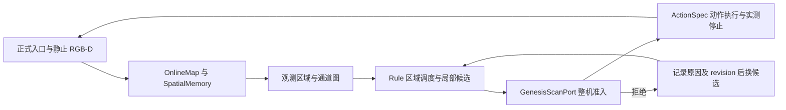

# 多房间探索：场景选择与首阶段设计

状态：**设计，未实施探索功能、未运行跨房间运动验收**。初版：2026-11-14；水平车载相机与实验协议修订：2026-11-15。

本次实验采用独立车载相机 `scan_cam`，以水平安装为基准，并比较安装高度、下俯角及前伸位置，不继承 MOZ1 的头部挂载外参。相机方案与完整实验矩阵见第 7 节；此前 0020 的俯视静态渲染只作为历史方法验证，不是新相机实验结果。[10 个场景预览图](../outputs/multiroom-camera-design-20261115/ten-scenes-preview.png)使用原始历史 RGB，不是新水平相机画面。

## 1. 决策与范围

目标是从历史 15 个场景中**保留所有光照合适的候选，针对整个候选集合设计多房间探索**。光照资格、当前能否启动、机器人能否通行分别记录。

保留 **10 个光照候选**：`kujiale_0004`、`0008`、`0020`、`0025`、`0030`、`0035`、`0038`、`0065`、`0066` 和 **Home 0**。其中 0004、0008、0030、Home 0 的历史采样全部通过；其余 6 个存在少量失败帧，只获得候选资格。0034、0037 列入局部光照问题待复核集合；0003、0021、0026 暂不入选。

**这是已采样单房间的光照筛选，不是整屋光照保证。** 下一阶段对全部候选的目标房间与连接通道做当前配置复核。Home 0 当前灯光加载失败、0008 卧室通行受限属于独立问题，不能据此剔除历史光照资格。

0020 客厅南侧—阳台已有的固定补光与材质离线试验保留为验证方法示例，不再指定唯一首选。默认预览补光位置可能变化，每个场景都需冻结各自配置，不能将历史亮图直接当成下一轮保证。此次只生成诊断资产，没有修改原始 USD、资产索引或运行配置。

沿用 Rule、YOLOE、RGB 直方图与几何身份关联。CLIP、KEV、既有 18 个延期及 1 个待处理任务的算法修复不在本次范围。初期不处理开关门、楼梯、电梯、动态家具或跨会话定位。

## 2. 依据与本轮验证

### 基线与证据

- `main`：`b7a6b69732cd961f23ef4c7df8d0f8a1b58e6556`。其已有文档改动保持原样。
- 本轮几何与渲染代码：迁移分支 `codex/spatial-memory-single-room-migration` 的 `6d847c0b08b751c185aa6722d1b7993d448a4f76`，包含已验证的导航内部实体、出生支撑面和薄片碰撞迁移修复。
- 最终历史队列：[`cohort.json`](../outputs/spatial-memory-identity-15-20261104/cohort.json)。**14 套 InteriorAgent 房屋各采一个房间，加 Home 0 客厅局部，共 15 个场景、1,416 帧**；不是此前已经完成了 15 套房屋的跨房间探索。
- 本轮证据目录：[`outputs/multiroom-design-20261114/`](../outputs/multiroom-design-20261114/)。**当前光照选择以 [`lighting-selection.json`](../outputs/multiroom-design-20261114/lighting-selection.json) 和 [完整表格](../outputs/multiroom-design-20261114/lighting-selection.csv) 为准**。`selection-current.json` 保留此前偏重通行条件的筛选过程，不再作为光照名单；`selection.json` 是更早的历史资料。
- 版本、渲染模式、试验差异和限制：[`evidence-provenance.json`](../outputs/multiroom-design-20261114/evidence-provenance.json)。此前几何/启动限制对照（不决定光照资格）：[`selection-current.csv`](../outputs/multiroom-design-20261114/selection-current.csv)。

### 光照筛选方法与全部结果

全部 1,416 张历史 RGB 图像按相同的全图指标检查：平均亮度 40–210，亮度 <20 的像素占比 ≤20%，亮度 >245 的像素占比 ≤5%，P90−P10 ≥25。四项同时满足才算单帧通过，不针对某个场景调整阈值。

本次修订明确采用以下**候选分组规则**：100% 历史帧通过为稳定组，≥90% 但不足 100% 为存在局部问题的候选组，80%–90% 为待复核组，低于 80% 暂不入选。这是本次制定的筛选口径，不是预注册实验结论，也不是正式验收标准。严格地说只有稳定组的已采样视角全部通过；其余组不得写成无条件光照合格。

正式目标房间、通道的必检视角须全部通过，不能以全屋平均亮度掩盖暗房间。历史全图统计与下文 0020 新渲染的中央 80% 统计分别报告，不混算通过率。历史每套房屋仅采一个房间，未采区域不能推断为合格或不合格。

| 场景 | 历史采样范围 | 通过帧 / 总帧 | 光照分组 |
|---|---|---|---|
| `Home 0` | 客厅沙发/电视局部 | 105/105，100.0% | 稳定，保留 |
| `kujiale_0004` | 客厅 | 98/98，100.0% | 稳定，保留 |
| `kujiale_0008` | 卧室 | 86/86，100.0% | 稳定，保留 |
| `kujiale_0030` | 客厅 | 97/97，100.0% | 稳定，保留 |
| `kujiale_0035` | 客厅 | 111/112，99.1% | 保留候选，有少量问题帧 |
| `kujiale_0066` | 厨房 | 70/72，97.2% | 保留候选，有少量问题帧 |
| `kujiale_0025` | 客厅 | 133/139，95.7% | 保留候选，有少量问题帧 |
| `kujiale_0065` | 卧室 | 69/73，94.5% | 保留候选，有少量问题帧 |
| `kujiale_0020` | 阳台 | 76/81，93.8% | 保留候选，有少量问题帧 |
| `kujiale_0038` | 客厅 | 86/94，91.5% | 保留候选，有少量问题帧 |
| `kujiale_0034` | 阳台 | 52/61，85.2% | 局部问题待复核 |
| `kujiale_0037` | 客厅 | 108/134，80.6% | 局部问题待复核 |
| `kujiale_0026` | 客厅 | 32/85，37.6% | 明显欠曝，暂不入选 |
| `kujiale_0003` | 书房 | 0/102，0.0% | 明显欠曝，暂不入选 |
| `kujiale_0021` | 厨房 | 0/77，0.0% | 明显欠曝，暂不入选 |

0034 的失败来自局部过曝（9 帧），0037 有明显偏暗视角；不能笼统说这两套房屋整体很暗。候选组中 0035 仅 1 帧对比度不足，0066/0025/0065 分别有 2/6/4 帧暗像素偏多，0020/0038 则有局部偏亮或过曝。逐项原因保存在 JSON 中。

### 独立的几何与启动限制

全部场景几何粗筛使用 5 cm 网格、1.95 m 高度、0.53/0.64 m 两档圆形包络。它只用于执行范围比较，不能替代加载后按实际姿态计算的准入。房间多边形仅供离线评价，禁止交给在线探索策略。

| 场景 | 已知执行限制 | 与光照筛选的关系 |
|---|---|---|
| `0020` | 2.5 cm 精筛、0.65 m 半径下客厅南侧—阳台连通；全图 195,880 格 | 已有局部双区域几何和灯光试验，不代表唯一入选 |
| `0066` | 客厅入口—厨房局部连通；全图 253,916 格，超过当前单图上限 | 光照候选保留，准入待解决 |
| `0008` | 卧室分离；全图 322,054 格 | 光照候选保留，通行待解决 |
| Home 0 | 当前 RectLight 锥角被灯光兼容检查拒绝 | 历史光照稳定，当前启动阻塞，分别记录 |
| 其他 | 部分中心可通行区域小或割裂 | 不能因此从光照候选名单删除 |

0020 精筛连通分量总面积约 3.824 m²，其中客厅南侧约 1.103 m²、阳台约 2.448 m²，另有连接段。整间客厅另一大片区域及卧室/厨房/浴室不在该分量。该试验只涉及两个资产标注区域（含阳台），不等于整屋或多间封闭卧室验收。

### 0020 局部光照验证示例

使用当前 Nyx 渲染代码进行静态相机离线测试：960×540、reference、32 spp，离地 1.82 m，俯角 20°，垂直 FOV 60°。客厅南侧 `(-2.2,-4.55)`、连接处 `(-2.2,-5.1)`、阳台 `(-2.0,-5.85)` 各采四个方向，共 12 视角。它们在精筛网格中均属于同一连通分量。上述点仅用于离线评价和候选出生位置审核，不作为在线导航路标输入。

预设图像门槛为中央 80% 图像：平均亮度 40–210，亮度 <20 的像素占比 ≤20%，亮度 >245 占比 ≤5%，P90−P10 ≥25。亮度以 RGB Rec.709 权重计算，范围 0–255；这是本项目提出的可视性筛选条件，**不是照度 lux、检测准确率或通用行业标准**。

- 当前静态预览默认补光位置：**0/12** 通过。此位置不等于正式移动机器人入口的初始补光位置，结果说明对位置敏感，不能外推为所有正式入口都暗。
- 候选固定世界坐标补光 `(-2.2,-4.55,2.6)`，固定曝光 EV `-6.058893689`，沿用 studio HDR；点光强度沿用渲染器公式 `30 × 2^(-EV)` lumen。它不跟随观察相机移动。
- 显式采用配置中声明的 `interioragent` 材质规则后：**12/12 通过**；平均亮度 **96.8–130.9**，暗像素占比最高 **10.32%**，过亮像素占比最高 **0.00121%**。
- 材质转换 543 项、263 个纹理，未转换项为 0，但仍有 50 条近似转换说明。已人工查看图像；不能宣称与源渲染器完全等价。
- 阳台朝外的窗帘仍可见黑色条纹/近似外观，正式阶段需单独核验纹理与深度；亮度通过不等于图像真实性通过，也不能把窗帘反光当作通道证据。
- 当前索引返回的材质规则键为空，而配置声明了 `interioragent`。本轮通过诊断脚本显式选择规则验证候选外观；正式阶段应先刷新并核对索引与配置，而不是默默依赖这种诊断覆盖。

详见 [12 视角报告](../outputs/multiroom-design-20261114/candidate-kujiale_0020-fixed-light-materials/report.json) 与 [0020 示例图](../outputs/multiroom-design-20261114/selected-scene-summary.png)。该结论限于采样视角。正式入口还需在实际 head_cam、加载后的机器人姿态与整条运动轨迹上重验；深度有效率、门口边缘可见性和 YOLOE 可检测性也是独立门槛。出现暗帧时停下补看或标记不可观测，不在线偷偷改变曝光，使直方图身份对比失去可比性。

## 3. 现有职责与需要补齐的能力

当前 `spatial_memory/scan.py::run_scan` 在一次调用中拥有一个 `OnlineMap`、一个 `SpatialMemory` 和总体预算；落盘 RGB-D 后才推理。`OnlineMap` 从 RGB-D 积分观测地图、产生短移动和补看候选，目前没有区域拓扑或跨区域调度。地图中的相机通行候选不能证明整机可通过。

`GenesisScanPort` 借用已连接的 `RobotSession`：捕获静止 head_cam 图像，对每个移动调用正式导航准入与 `SafetyRail`，再经 `session.api.navigate_relative` 执行，核验 measured stop。当前每步平移最多 0.2 m、转向最多 30°。执行侧静态几何可以拒绝动作，不能向策略输出房间真值、暗中绕路或替策略选择目的地。

`SpatialMemory` 是对象身份唯一所有者，跨帧几何与外观证据在同一 `scene_epoch/map_frame/clock` 下融合。已有 scope 校验拒绝把重启仿真后的观察追加到旧记忆。`RobotSession` 和 resident 服务生命周期所有权保持现有规则；房间切换不创建新 Session 或新对象库。

需要新增的是**观测产生的区域/通道拓扑与有界调度**，而不是更换模型或增加一套仿真器规划器。

## 4. 推荐设计

### 区域图与对象记忆

在空间记忆层新增 `RegionGraph`（建议 `spatial_memory/topology.py`），封装由观测自由空间、瓶颈及多视角证据产生的拓扑。语义名称可晚于几何发现，不要求先知道房间叫“卧室”还是“客厅”。开放式客餐厅可先记作功能区域，不凭标签拆成两个封闭房间。

| 数据 | 内容与语义 |
|---|---|
| `Region` | `region_id`、观测边界及未知部分、锚点、证据帧 ID、状态、可选语义标签及置信度；坐标为当前 `map_frame` 米制坐标 |
| `Portal` | 两侧区域引用（未知一侧允许为空）、观测开口、入口法向、宽度/自由空间证据、证据帧 ID、状态、最近准入拒绝原因及其 revision |
| 区域状态 | `discovered / active / locally_exhausted / blocked / deferred`；`locally_exhausted` 只表示当前已知可观测范围内候选耗尽 |
| 通道状态 | `candidate / observed_open / crossing / traversed / blocked / unknown`；观测开口不等于整机准入，只有实际跨越和稳定停靠才可记 `traversed` |
| 对象归属 | 引用已有 `entity_id` 的有证据成员关系，可包含边界/未知归属；区域切换、分裂或合并不重建对象 ID |

初期从已观测可通行栅格的窄连接处形成通道候选，并用两侧新观察支持区域划分；不能把未知格、玻璃反射或投影空洞直接视为门洞。在线图是由证据派生的索引，不是第二份对象状态库。保存图检查点及证据引用，可从同一序列重放；先保持 `SpatialMemory` 的身份算法与数据语义不变。

跨门口时采用位置滞回：越过观测通道平面并在另一侧获得连续稳定观察后才确认区域切换，减少边缘来回抖动。归属不确定时保持 `unknown`，不为了达到“两个房间”的指标强行分区。

### 调度与执行

在现有扫描循环内加入 Rule 调度器；由它维护当前区域、待探索通道、返回栈与区域预算。沿用 `OnlineMap` 生成观测支持的局部候选，选择目标区域后仍分短步执行。第一阶段采用简单的深度优先探索与已走通道返回，暂不引入复杂全局最优规划。



1. 当前区域先获取基本几何和必要视角，不以“所有旧记忆任务全部清零”作为出门条件。
2. 补看获得有界额度，例如每轮最多 2 个成功补看动作，再给前沿/新通道一次机会；安全所需的观察不受此公平额度削减。旧任务未解决时仍保留原状态，不能把延期当完成。
3. 选择最近的未访问观测通道；在门口采新 RGB-D，规划与准入绑定当前地图 revision、机器人包络/姿态和起始状态。
4. 每次只发一个有界动作，执行后确认停止并重新观察。整机准入拒绝则记录障碍及可重试条件，不调用仿真器暗中绕行。
5. 进入新区域后继续使用同一记忆与地图；局部探索达到额度后，沿观测支持且重新准入的路径返回上一层。
6. 回到旧区域验证已有对象关联，输出本次新增区域、跨越事件、对象变化和未解决任务；不重跑历史整屋路径来替代自主选择。

入口兼容建议：保留单区域默认行为，用显式探索范围配置启用区域图和调度。初期不新增机器人动作词汇；新调度仍使用已有移动、观察契约。图更新和预算属于 Agent/扫描层，碰撞准入与执行反馈属于 Genesis 端。

### 内部接口和一致性

- `RegionGraph.integrate(observation, observed_map_revision) -> topology_delta`：只接收观测派生地图；验证同一 scope、有限坐标和递增证据。旧帧可幂等重放，不得重复确认跨越。
- `scheduler.choose(topology, local_candidates, view_tasks, budgets) -> choice | terminal_reason`：输出既有短步候选及选择原因，不下发整段不可取消路线。
- `ScanPort.capture/execute/confirm_stopped` 保持职责；可扩充结果中的起终点实测底盘位姿、准入 revision 和阶段耗时，使跨越与路径长度不依赖相机运动估计。
- 当前距离预算累计相机平移，后续跨区域预算应采用实测底盘位姿增量，并分别保留相机轨迹；否则头部动作可能被误计为底盘路程。
- checkpoint 包含 scope、最后提交帧、地图/拓扑 revision 和调度状态。只有同一仍存活的物理会话、姿态可重新确认时才能恢复；仿真重启创建新 scope。失败后重放用于诊断，不能把旧执行状态当新会话的事实。

### 地图与资源

0020 当前全图低于上限，可沿用现有静态准入地图。其他光照候选应逐项评估地图容量，不能为了避开容量问题只保留 0020。在线地图跨区域持续保留，不因切换清空。

若后续选择 0066/0008 等更大场景，应设计有重叠边缘的局部地图块与有界缓存：内存只驻留当前区域和必要邻块，边界未知保持不可通行，路径段完整扫掠范围必须由准入端覆盖。不要直接扩大现有 250,000 格全局上限，也不要缩小整机包络来换取过门。分块属于后续扩展，首轮只记录资源峰值及阶段时间。

YOLOE、仿真和材质缓存各只初始化一次，跨区域不重启服务。分别记录资产解析、静态阶段、碰撞准备、物理构建、机器人准入、材质处理、渲染器建立和首帧时间；冷启动与缓存命中分开比较。此次纯渲染时间不能推断复杂场景完整机器人启动耗时。

### 失败和结束语义

- 准入拒绝不是探索完成；保存区域、通道、动作及具体拒绝原因。仅当新观察、地图、姿态或障碍 revision 变化时再试，避免无限撞同一门口。
- 图像暗、深度不足、检测超时：保留原帧与失败证据，停留补看或结束为部分完成；不得把推理失败写成“没有物体”。
- 停止未知、运动执行失败、scope 变化：立即终止本次动作链，沿用失败停止处理；禁止自动开始下一步或自动回撤。
- 返回路径受阻：停在最近可确认安全的位置，报告无法返回；不因为预算剩余就尝试未观测捷径。
- 到达帧数、时间、距离或区域上限：返回 `budget_exhausted` 及部分成果，保留未解决任务。指定范围探索结束、几何覆盖和对象清单完整性分别报告；闭环行为通过也不代表 `scan_complete=true`。

## 5. 实施顺序与验收门槛（均为下一阶段，尚未执行）

### 阶段 A：全部光照候选的房间与通道复核

为全部 10 个候选建立统一矩阵：`场景 × 目标房间 × 连接通道 × 观察方向`。每个房间至少选中心与入口视点，通道检查两侧及中央；每点覆盖四个方向，使用第 7 节的独立水平 scan_cam 和冻结的场景灯光/材质配置。统计每点指标，人工查看物体边缘、暗角、窗边过曝与镜面/窗帘伪影。房间或通道无法加载、没有安全视点、未采样时明确记为未验证，不能记为光照失败或通过。

只有某个多房间范围的全部必检视角通过，才将该范围标为可用于正式探索。若只有部分房间合格，则保留明确范围，不给整屋盖章。0034/0037 是额外待复核集合，局部修正后按同一标准重新判断；失败结果和原配置均保留。候选筛选不启动自主探索，也不授权修改原始资产。

之后独立检查加载、出生支撑、整机准入与路径可达性：形成“光照合格且可执行”“光照合格但执行阻塞”“光照待复核”三类，分别报告。


将每个场景的候选灯光形成显式、版本化的实验配置，刷新并核验材质索引；记录资产依赖、机器人、姿态、渲染/检测模型与配置摘要。加载迁移修复后的代码，通过模型、出生支撑面、整机包络、实测停止检查。以第 7 节的独立水平 scan_cam 在目标区域和通道重复光照检查，并核验深度有效率、物体边缘、反光伪影。若不通过，在这里修正实验条件，不开始自主探索。

本轮的 0.65 m 圆形精筛只是保守离线证据；最终包络、地面高度和门口扫掠必须来自加载后的机器人及正式执行入口。需要人工指定出生位置时，只在已审核连通分量内选择合法起点，不向策略提供房间真值图或预定路线。

### 阶段 B：观测拓扑与跨区域调度

先用冻结 RGB-D 序列验证通道发现、区域边缘滞回、图重放和调度公平性，再接现有 `run_scan` 与 `GenesisScanPort`。补充“通道看起来开放但整机拒绝”“所有候选拒绝”“会话变化”“停止未知”“补看任务持续产生”等测试。保持现有单区域扫描回归通过。

### 阶段 C：首个自主往返闭环

最初的局部试验曾建议 160 帧/8 m/20 分钟；本次水平相机的跨场景主实验统一采用第 7 节的 300 帧/15 m/30 分钟上限，最多 2 个目标区域，初始化另记，单步上限沿用 0.2 m / 30°。预算不是完整覆盖保证。

验收必须同时满足：

1. 在线策略从 RGB-D 发现连接处并决定跨越；审计输入中无资产房间多边形、GT 对象身份或离线路线。
2. 底盘真实进入另一侧、获得稳定观察，再回到原区域；至少一次往返、两次有实测位姿和停止证据的跨越。原区域/目标区域的内部观察点分别距离通道至少 0.5 m；具体可行性由正式准入复核。
3. 所有运动都保留准入、命令、反馈与停止证据；无非支撑碰撞或未确认停止。不得用“发送过移动命令”代替测得平移。
4. 同一个 scope 和对象数据库贯穿往返。对事先人工标注、可见且不全被遮挡的至少 5 个静态对象检查回访；分别报告 ID 保持、碎片化、错误合并和 unresolved，不合成一个掩盖错误的百分比。若该范围没有 5 个合格对象，先扩大人工审核样本范围或调整验收样本，不凭空凑数。
5. 正式采样视角通过冻结光照条件；报告新增观测面积、各区域可观测覆盖、未探索连接处、延期任务、时间及内存/显存峰值。不得因为仍有历史质量任务就伪报完整，也不在此顺手扩展其修复范围。

在当前复核后获得执行资格的每个场景上，使用同一闭环协议：先完成一轮，再以不同初始朝向做至少 3 次独立会话复验，每次 scope 独立。可以串行控制 GPU 资源，但不能把串行执行顺序变成只验收一个场景；其他光照候选若因通行或加载阻塞，保留在矩阵中并明确原因。三房间与分块地图根据各场景约束分阶段设计。

## 6. 取舍、回归与交付

| 方案 | 决策理由 |
|---|---|
| 逐房间重新运行单间扫描，再拼接结果 | 拒绝：割裂会话/身份，无法验证通道发现、往返和统一记忆 |
| 给 Rule 房间真值图及固定路线 | 仅可用于离线评价；不能充当自主探索策略 |
| 全局前沿打分但没有区域图 | 保留为对照；容易反复回到同一片前沿，缺少可审计的跨区域和返回语义 |
| 观测区域图 + 有界局部前沿 + 返回栈 | 采用：复用现有循环与执行准入，足以支持首个可解释闭环 |
| 立即增加 CLIP 或调身份阈值 | 本轮不做，避免与探索能力变化混在一起，且用户明确暂缓 CLIP |

| 关键约束 | 所有者 | 应使用/扩充的检查 |
|---|---|---|
| 不从未知深度产生可行移动；拓扑仅来自观测 | `OnlineMap` / `RegionGraph` | `test_exploration.py` + 新增通道、玻璃/空洞、区域滞回测试 |
| 补看公平性、预算及 blocked 不报 complete | 扫描调度 / completion | `test_scan.py`：保留原单区优先级语义，多区模式另验有界公平 |
| 跨区不重建对象 ID，同 scope 才允许写入 | `SpatialMemory` | `test_memory.py` 的平移复识别、scope、幂等和身份冲突用例；新增跨区回访序列 |
| 短步准入、停止未知终止、拒绝暗中绕路 | `GenesisScanPort` / SafetyRail | `tests/unit_tests/simulators/genesis/` 下现有 scan、navigation、spawn 检查及正式入口实测 |
| 生命周期和取消有唯一所有者 | `RobotSession` / resident / CLI | Session cleanup 与现有捕获、取消测试；检查外部 resident 不被扫描器误关闭 |
| 光照固定且可追溯，材质缺失不能静默换外观 | 场景实验配置 / renderer | 多点 RGB、depth 有效率、配置和资产摘要；人工查看纹理、门口与反光 |

最终保留：配置与版本摘要、原始 RGB-D/位姿、检测结果、身份关联 receipts、动作准入与停止反馈、区域图检查点、跨越事件、回访人工标注、覆盖/未完成任务及资源时间报告。测试通过、灯光离线通过、跨区域行为通过和完整记忆验收必须分开报告。

本轮交付仅包括此设计与离线筛选证据；不包含探索代码、正式入口跨区域运动、CLIP 接入或已有质量任务修复。

## 7. 水平车载相机与跨房间空间记忆实验协议

本节落实 2026-11-15 的要求：全部 10 个光照候选均纳入实验矩阵，相机独立安装、不沿用 MOZ1 外参；按第 7.8 节系统比较不同外参，水平组始终保留为主基准。第 5 节的入口光照复核改用本节的 `scan_cam`；旧 `head_cam` 数据只用于识别场景和追溯历史，不能换一份位姿标签后充当新相机数据。

### 7.1 要回答的问题与实验变量

主要问题分两层：不同外参怎样影响可观测性、平移候选、过门和身份保持；在每一套冻结外参内，区域/通道拓扑能否进一步改善跨房间探索与回访。以“外参配置 × 探索策略”配对比较，避免将两者收益混为一谈。

每一套外参都由 P0/P1 两组共用，不把外参与探索策略改动混作一项收益。两组都不使用 MOZ1 头部外参、CLIP 或 KEV；不新增误检清理或身份阈值调优。历史俯视单房间结果不是配对对照，不能直接用它证明水平相机提升多少。

| 组别 | 相机 / 感知 / 对象关联 | 探索策略 | 目的 |
|---|---|---|---|
| P0 | 当前比较的同一套 `scan_cam` 外参；YOLOE；几何 + RGB 直方图关联 | 现有局部前沿与补看 Rule，无区域图调度 | 判断仅更换观察条件后现有方法能做到什么 |
| P1 | 与 P0 完全相同 | 第 4 节的区域/通道图、有界补看与返回调度 | 测量跨房间调度的增益、代价和失败原因 |

相机接入、底盘位姿口径、标定版本与采样一致性修正应在公共基线上完成，P0/P1 都使用；不能只给 P1 修正运动映射。P0 缺少区域图时，其跨房间事件由离线评价器判定，不能仅因未输出 RegionGraph 就计失败。

### 7.2 独立相机安装方案

以下是参考组配置，不是预先认定的最佳外参。安装高度是设计值；第 7.8 节将明确比较不同高度、下俯角和前伸位置。每个 profile 统一冻结，不能按场景或策略临时调整。

| 参数 | 本轮方案 |
|---|---|
| 传感器名 / 配置 ID | `scan_cam` / `cart-horizontal-v1` |
| 安装方式 | 刚性挂在经审计的车体坐标系上，不从 `camera0_link` 或原头部相机读取挂载外参 |
| 朝向 | 相对车体前向 yaw=0°、pitch=0°、roll=0°；光轴水平向前 |
| 光心离支撑地面高度 | 建议 **1.20 m**，先做安装与可观测性预检 |
| 水平安装位置 | 中线 y=0；x 为冻结车体包络前缘 +0.10 m，避免光心位于车体内；计算后固化为数值 |
| 车体运动 | 使用真实加载载体的底盘运动、姿态和整机准入；相机改变不改变车体碰撞尺寸 |
| 图像 / 深度 | 640×480，沿用当前已校验的投影内参，输出 rectified RGB-D、光学 Z 深度（m），采样 stride=4 |
| 曝光与灯光 | 每个场景固定一套配置，P0/P1 相同；不让补光跟随观察视角或策略改变 |

前伸相机/支架如果作为实体建模，必须加入整体扫掠包络后重新准入；如果只使用仿真虚拟传感器，报告必须注明虚拟安装，不能宣称物理安装已验证。遮挡预检失败时修订统一安装配置并重做准入，不删除车体网格或忽略碰撞以露出视野。

车体坐标 B 为 x 前、y 左、z 上，光学坐标 C 为 x 右、y 下、z 前。水平安装的旋转矩阵为：

```text
R_BC = [[ 0,  0, 1],
        [-1,  0, 0],
        [ 0, -1, 0]]

T_WC(t) = T_WB_measured(t) × T_BC_fixed
p_W = T_WC(t) × [ (u-cx)·z/fx, (v-cy)·z/fy, z, 1 ]
```

这里 `T_BC` 将光学坐标变到车体坐标；它的 z 平移应为 `1.20 m - 车体坐标原点相对名义支撑面的高度`，不是盲目写成 1.20。车体命令坐标与物理根 link 的坐标可能不同，应使用驱动已定义的前/左/上轴映射，不能直接把根 link 四元数解释成车体前向。该映射是载体坐标定义，不是复用 MOZ1 相机外参。

“水平”指相对车体的刚性安装；平地静止时光轴应水平。真实车体轻微俯仰/侧倾仍应体现在每帧实测位姿中。主实验不增加隐式稳定云台，也不每帧用场景地面真值把相机强制拉平。

为控制变量，先保留已有送达 RGB-D 的 K：`fx=389.8809204, fy=389.9339600, cx=332.7503967, cy=252.7602234`，D=0，分辨率 640×480。保留内参与复用头部挂载外参是两回事。该内参来源和设计矩阵保存在[相机方案数据](../outputs/multiroom-camera-design-20261115/proposed-camera-profile.json)，该文件**不是可直接加载的运行配置**。

### 7.3 必须一起改动的数据链路

当前实现事实：

- `robot_cameras.py::RobotCamera.pose` 以实测 link 位姿乘挂载矩阵；`rendering.py` 使用它驱动传感器，`rgbd.py::sample_depth` 用同一光学位姿发射深度射线。这些所有权可以复用。
- `GenesisScanPort.capture`、`preview.py`、`worker.py`、`spatial_capture.py` 的空间记忆采集仍显式要求 `head_cam`。不是只改一个俯仰数字即可使用独立相机。
- `spatial_capture.py` 的 `calibration_id` 当前仅哈希 K/D、图像尺寸、深度定义等，不包含固定挂载外参；动态世界位姿另存在观察中。
- `OnlineMap` 候选位置以相机为中心，`GenesisScanPort.execute` 也按相机位置求平移增量。前伸安装后，相机转动产生的位置变化不等于底盘平移，需要明确两者关系。

建议接入方式：在 Genesis 场景配置中显式注册 `cart-horizontal-v1`，把独立 `RobotCamera` 挂到审计后的车体 link，包含固定的 link→车体轴转换；保持源机器人 USD 的头部标定不变。扫描入口通过 `camera_name=scan_cam` 选择已注册、带标定且支持同步 RGB-D 的传感器，默认旧配置仍可选择原 `head_cam`。

相关采集校验从硬编码名称改为校验指定传感器的注册身份、标定、模式和同步证据；不能因此放行自由 `observer` 视角。`SpatialMemory` 核心继续消费标准 `Observation`，不在核心里加入 MOZ1 或车体型号判断。Rule 实验不依赖聊天专用 `CameraObservation` rail，不扩大聊天工具的可见相机范围。

必须保持以下条件：

1. RGB 渲染、depth ray、每帧 `T_world_camera` 和用于重投影的 K 属于同一物理时刻与同一相机。不能只改保存的外参或把旧图像旋转后重用。
2. 固定挂载矩阵、传感器 ID、父坐标定义、内参和深度定义共同形成标定摘要；动态 `T_world_camera(t)` 不进入固定标定摘要。摘要、profile revision、场景 revision 随帧持久化，变更后新开 episode/数据库。
3. 规划状态同时包含实测底盘位姿与相机位姿。导航路径和距离预算以底盘为基准，相机视点通过固定挂载关系推导；转动前伸相机不能增加“底盘平移”成绩。候选视点必须经底盘可执行性转换和独立整机准入。
4. 改外参不放宽停止、出生支撑、过门扫掠或 scope 校验。失败停止未知时立即结束，不尝试下一动作。

新增检查应覆盖水平光轴、米/毫米边界、车体前向与 link 轴差、刚体变换正交性、相机前伸下的原地旋转、外参 revision 失配和非注册相机拒绝；已有 `test_robot_cameras.py`、`test_rgbd.py`、`test_memory_scan.py` 及捕获同步测试作为扩展点。

### 7.4 水平相机的地面盲区与预检

水平放置可以增加门口、墙面和远处物体在画面中的比例，但不自动保证机器人能平移。按上述 K，最下方像素的向下夹角约 **30.12°**；若光心离地 1.20 m，理想平地首次进入视野的距离约为：

```text
d_near = 1.20 / tan(30.12°) ≈ 2.07 m
```

这只是平面与针孔模型的几何推导，未计遮挡、车体或镜面。它说明相机前方约 2 m 内的地面可能不可见。当前 `OnlineMap` 的地面估计要求足量低水平面，改变朝向后必须检查是否仍能建立观测支持的候选；不能把眼睛高度的自由射线当作已验证地面，也不能扩大起点“已知自由”范围来解锁动作。

预检需验证：在合法出生位置做水平转向采样后，能否从真实深度建立足量局部自由空间并提出平移；若不成立，标记为 `insufficient_observed_support`。先检查安装高度/遮挡及候选投影逻辑，不归因于马达故障。按第 7.8 节执行高度/下俯角/前伸位置对比，保留参考水平、优选水平和优选下俯 profile 进入配对闭环；每个 episode 内不得改变外参。如果仍不足，额外地面传感器或重新设计观测策略属于新方案，不在本轮偷偷加入。

### 7.5 实验阶段与规模

**A0：相机链路校验（不做探索）**

在简单几何测试场中检查中心光轴、水平线、若干已知距离的平面/立方体与同一地标的平移/转向重投影。建议预设门槛：稳定停靠时光轴相对该 profile 的名义方向偏差 ≤1°（水平组才要求相对水平 ≤1°）；解析变换重投影误差 ≤1 px；0.5–5 m 范围有效非边缘深度点的平面误差 P95 ≤2 cm。分别保存解析测试与真实 Nyx 采样结果；只有前者通过不能进入探索阶段。

**A1：全部 10 个场景的多外参光照和可执行范围预检**

使用新 `scan_cam` 对每个目标房间、连接处两侧和通道中央多方向采样，执行第 2 节光照指标，并单独检查深度有效率、反光/窗帘伪影和车体遮挡。指定必检视角须全部通过；全图、下部地面 ROI、通道 ROI 分别留指标，不能只裁掉暗处。新的光照结果独立建表，不能沿用旧 90% 候选通过率。

每个场景记录：`启动状态 / 相机校验 / 光照 / 可通行连通范围 / 可观测性 / 可执行房间数 / 阻塞原因`。房间真值、多边形和已知几何仅供预检与离线评分，不向在线 Rule 提供导航目标或房间布局。若房屋只有一个可执行区域，保留为“当前不具备跨房间条件”；阳台—客厅等区域转换与两个封闭房间之间的转换分栏报告，不混成一个房间数。

**B：配对探索试验**

加入外参对比后，计划上限为 **10 场景 × 最多 3 套去重后的外参 × 2 策略 × 3 个初始朝向 = 180 个 episode**。原 60 次是单套外参的规模，不是新增试验的总数。候选外参筛选先做静态/有界探针，不把所有参数组合直接铺成自主长跑。每个场景采用同一合法起点，朝向为 θ、θ+120°、θ+240°，均先通过姿态准入。若因包络/支撑限制需改起点，先记录并冻结适用于两组的规则；不能为某一策略临时找更容易的起点。P0/P1 分别重建相同初态，禁止重用另一组的对象库、地图或路线。冷/热启动单独记录，并交替 P0/P1 的执行次序以减小缓存偏差。

每个 episode 的目标：从初始房间 A 观察建图，自主发现通道，进入 B 继续记忆构建，再返回 A 完成复识别；可达第三房间作为后续扩展，不与双区域主结果混算。房间图和策略只用在线 RGB-D、实测自身位姿及记忆证据。

建议共同上限：**300 帧、15 m 实测底盘路程、30 分钟扫描时间**；初始化时间另记。每步 ≤0.2 m 或 30°，移动后稳定取图。预算包括往返和补看；预留返回预算不足时不继续扩张。上限用来界定部分结果，不能作为完成标志；不得只给失败一组加预算。

因 A1 阻塞未运行的场景仍在 10 场景矩阵中，不换场景、不静默缩分母。分别报告预检可运行数、已尝试 episode 数、完成数；最多 180 次不是当前已承诺能运行 180 次；实际数量由合格场景数与去重后 profile 数决定。

**C：冻结检测重放与人工审核**

保存每次实际路线的 RGB-D、检测掩码、位姿、动作、区域图及 receipts；离线重放检查记忆生成可复现，评估器可使用人工 GT 身份与资产空间真值，探索策略不能读取这些标签。至少审核所有跨越前后身份变化和回访样本；旧记忆的 unresolved/延期任务完整保留。

### 7.6 指标与验收判定

先看安全与行为，再看记忆质量，最后比较效率。逐场景展示，汇总采用场景宏平均并同时给出原始计数，避免大房间或长轨迹主导结论。

| 指标 | 定义 / 口径 |
|---|---|
| 自主跨房间与往返完成率 | 实测底盘进入另一区域且稳定观察，再经观测支持的路径返回；至少两次跨越事件。全量 10 场景状态与可执行子集结果同时报告 |
| 几何探索覆盖 | 实际观察到的表面体素 / 离线可达且可观测参考表面体素；统一 0.10 m 评价网格，参考视点/分母在比较前冻结，GT 仅用于评分。未经建立参考分母时只报告新增观测面积 |
| 对象有效性与覆盖 | 人工审核真实对象、误检实体、漏检、2D-only/unresolved；对象清单覆盖与路线覆盖分别计算 |
| 回访身份保持 | 正确复用原 ID 的对象数 / 预先标注且在往返中有足够可见证据的对象数；未匹配、碎片化、错误合并分别列数，不能只在已匹配项中算准确率 |
| 跨房间混淆 | 不同房间同类对象的错误合并，门口多视图的重复实体，房间切换导致的批量 ID 重建 |
| 空间/场景图 | Region–Portal 连通边与跨越事件；对象到区域的归属正确性；对象位置/可见表面一致性。不额外声称支持/包含等关系已实现 |
| 资源与效率 | 底盘路程、纯转向比例、成功平移数、补看收益、推理时间、冷/热初始化时间及内存/显存峰值 |

每个 P1 episode 的建议行为验收门槛：至少一个完整 A→B→A；所有动作准入与停止证据完整；无非支撑碰撞；同一 scope 与数据库贯穿全程；真实回访样本中 ID 保持率 ≥90%，错误合并为 0。回访可审核对象目标至少 5 个；样本不足单列“证据不足”，不得补进重复帧凑分母。阈值须在主实验前冻结，现阶段是提案，不是已有成绩。

几何覆盖建议目标 ≥80%，仅对预先定义的可达且可观测参考范围计算。覆盖不足、存在未探索通道或延期任务时，行为往返即使通过，也不能宣称完整扫描/完整物体清单。P1 相对 P0 的收益以同场景同初态的差值报告；3 次朝向复验用于发现不稳定性，不声称足以证明统计显著或真实世界泛化。

### 7.7 交付、失败归因与本轮状态

每次实验保留：场景及依赖摘要、车体与相机 profile、完整 K/D/T 定义、实际姿态、光照预检矩阵、RGB-D/检测、底盘动作与实测停止、区域图/对象库、回访人工标签、逐场景指标、资源曲线和失败日志。失败归因至少区分：`load / calibration / lighting / observation_support / admission / motion / perception / association / budget`，避免把“只转向”一律归到运动执行。

本轮完成的是：10 场景历史预览图、独立车载相机基准、多外参对比矩阵、解析坐标/地面盲区计算及本实验协议。**尚未修改生产相机配置、尚未重新渲染水平相机 RGB-D、尚未运行跨房间探索。** 解析检查见[相机解析检查](../outputs/multiroom-camera-design-20261115/camera-analytic-check.json)，图像来源见[预览清单](../outputs/multiroom-camera-design-20261115/preview-manifest.json)。

### 7.8 多外参对比矩阵（新增要求）

外参对比成为独立实验阶段，不只保留一个 1.20 m 水平配置。每个 profile 都独立构造刚性挂载变换，不加载或混入 MOZ1 相机外参。优先给出最佳水平安装建议，同时量化少量下俯带来的地面可见性收益及远处物体/门口视野代价，不预先认定某个角度最好。

#### 参数与组合

| 因素 | 测试水平 | 固定/变化方式 |
|---|---|---|
| 光心离名义支撑地面高度 | **0.80、1.20、1.50 m** | 与下俯角全组合 |
| 相机下俯角 | **0°、向下 10°、向下 20°** | 0° 为水平基准；不恢复原 MOZ1 大幅俯视挂载 |
| 光心超出冻结车体前缘的余量 | **0.05、0.10、0.20 m** | 初筛统一 0.10 m；在优选水平/下俯设置上补测 0.05、0.20 m |
| 左右偏移、偏航、横滚 | **0 m、0°、0°** | 本轮固定，避免扩成没有明确需求的完整六自由度搜索 |

第一步 **3 高度 × 3 俯仰角 = 9 组**；第二步在优选水平、优选下俯各补测两个前伸位置，**最多新增 4 组，共最多 13 组不同配置**。这是高度—俯仰的完整小网格与局部前伸敏感性试验，不是完整 27 组析因试验，不能据此声称找到所有高度—俯仰—前伸组合的全局最优。

参考组为 `H120_D00_F10`：1.20 m 高、水平、超前缘 0.10 m。参数 ID 中 D 明确定义为“向下的角度”，避免不同软件 Euler pitch 正负号不同。B/C 坐标仍沿用第 7.2 节，旋转用 `R_BC(α)=R_y(α)×R_BC(0)` 构造，α>0 时光轴在 B 中为 `[cos α,0,-sin α]`。高度、前伸最终都转成相对真实车体原点的数值并进入 profile 摘要。

[机器可读实验矩阵](../outputs/multiroom-camera-design-20261115/camera-extrinsics-experiment-plan.json)包含九组旋转矩阵、理想地面盲区距离、二阶段规则和闭环次数上限；它是计划数据，不是已生成的运行配置或测试结果。

#### E0：在相同底盘位姿下比较观测条件

全部 10 个场景都保留在配置矩阵中。对每个候选范围预先定义相同的底盘位置、朝向和观察点集合，各 profile 在这些相同状态重新渲染 RGB-D。位置应覆盖房间内部、物体附近和门口两侧；不同高度的相机不能各自换更有利的底盘位姿。

- 固定车辆、车体姿态、K/D、分辨率、深度采样、材质、场景灯光/曝光、YOLOE 权重/阈值和关联参数。
- 安装导致自遮挡、支架碰撞或某个姿态不可准入时，记录该配置在该测试点失败；比较共同可执行点时同时报告交集大小及被排除的点，不能隐藏损失。
- 使用同一份预先定义的目标物体和通道审核清单。报告地面可见范围、有效深度、车体遮挡比例、通道可见性、目标物体覆盖和误检。视角改变造成某个对象不可见属于实验影响，不按每组自己的可见清单重置分母。
- 每个配置先校验完整采集链路；新的 RGB 必须重新检测。只有同一配置、同一原始捕获才可冻结检测重放，不能把另一外参的检测掩码套过来。
- 进行标准化“观察—候选生成—准入”探针，记录产生且获准执行平移的测试点比例、纯转向比例、拒绝原因。若要执行短步测量，仍按正式执行/停止流程；这些固定状态探针属于控制试验，不能算自主跨房间成绩。

固定灯光的含义是一个场景的所有相机配置共用同一套灯光，而不是按相机位置跟随补光。若某组画面欠曝，记录结果；如果必须统一修改场景灯光，则所有 profile 重测该场景，不能只修有利的一组。

#### E1：确定对照配置，并避免在验证场景上调参

预先指定 **0004（客厅）、0008（卧室）、0066（厨房）**作为安装参数开发集；其余 **0020、0025、0030、0035、0038、0065、Home 0**作为独立验证集。全部场景的准入/可用性都可预检，但外参选型只使用开发集的观测与受控探针指标，不根据验证集表现修改外参或更换场景。开发场景阻塞时如实报告，先解决其准入条件；不能为获得理想成绩改成别的场景。

预先冻结选型顺序：先排除标定/同步错误、未确认停止、实体挂载不可用等硬失败；其余配置按开发集“能够提出并准入平移的观测点比例”的场景宏平均排序，再以固定物体审核清单的覆盖率打破平局。地面可见性、门口观察、误检和资源代价一并列出，不仅展示一个综合分。局部失败点和光照不合格范围保留，不能写成全域通过。

按此规则选出优选高度—俯仰设置，进行前伸位置敏感性补测后冻结最终对照配置：

1. **C_ref**：原定 1.20 m 水平参考组，始终留在对照状态表中。
2. **C_horizontal**：开发集选出的优选水平安装，包含其冻结高度与前伸位置。
3. **C_tilted**：开发集选出的优选向下 10°/20°安装，作为视野/地面权衡对照。

相同配置去重；没有合格下俯配置时，不为凑三组强行运行。C_ref 若不可执行，标为阻塞，仍报告其配置与失败原因。推荐结果首先回答“最佳水平安装是什么”，再说明与下俯方案的差别；验证集结果不用于第二轮偷偷选型。

#### E2：外参与探索策略的配对跨房间闭环

将上述最多三套外参分别与 P0/P1 组合。每个“场景、初始底盘位置/朝向、外参”下比较 P0 与 P1；每个固定策略下再比较外参。统一按第 7.5 节预算执行 A→B→A，不更改物体身份算法。

最多 **10 × 3 × 2 × 3 = 180 次**自主 episode；一套外参对应最多 60 次。静态/受控筛选不算在自主 episode 数中。每次新建 scope、地图和记忆库，不从其他外参组继承证据；相机外参在一次 episode 内不能变。

配对分析同时报告：

- **外参效应**：固定 P0 或固定 P1 时，平移比例、门口发现、往返、覆盖和身份质量怎样变化。
- **策略效应**：固定外参时，P1 相对 P0 的变化。
- **交互现象**：例如某种高度只对 P1 有利，或下俯改善平移但削弱远处物体识别；不能把这些一概归到某个因素。
- **可用性损失**：每套外参在全部 10 场景中的合格/阻塞数，以及共同可执行配对样本的明确分母。

开发集和七场景验证集分别汇总；重复初始朝向属于同一场景内复验，不能把三次当作三个独立场景。3 个朝向样本不足以保证统计显著，只报告配对原始值、方向一致性和不确定性。

最终交付一张“高度 × 下俯角”的指标表、前伸位置敏感性表，以及外参 × 策略的逐场景闭环结果；给出最佳水平配置与备选配置及适用范围。当前仅完成矩阵和协议更新，**没有执行参数扫描，也没有把任何方案称为测得的最佳外参**。
