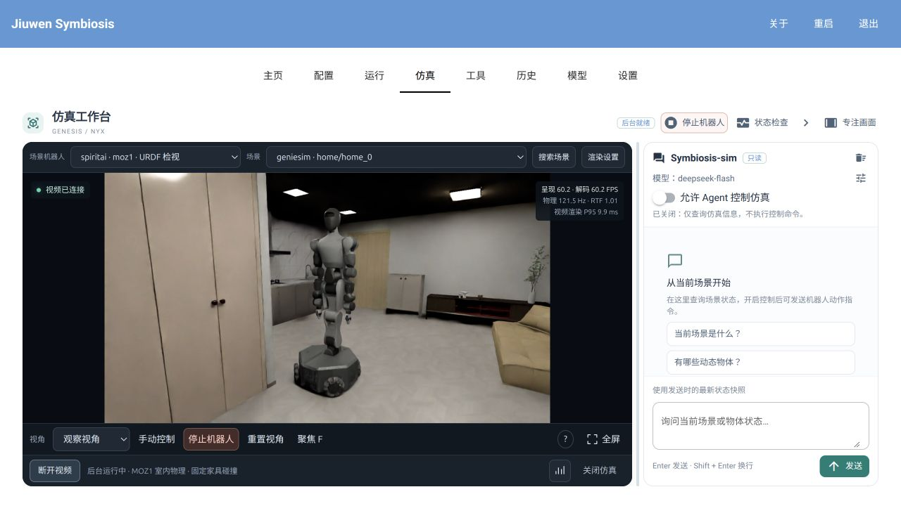

# Simulation Guide (simulaiton-guide)

[中文](../../zh/how-to/simulaiton-guide.md)

The simulation workbench shares video streaming, Agent tools, control leases and cancellation.
Choose **Genesis** or **MuJoCo** in the backend selector. Genesis remains the default;
Jumper and Microduck use MuJoCo. An engine change ends control, closes the old worker and
creates a fresh world. Requests bound to the old world cannot control the replacement.
Changing video quality within an engine retains the world. USD/MJCF conversion is outside this integration.

- [Install](#install)
- [Start and stop simulation](#start-and-stop-simulation)
- [Add assets](#add-assets)
- [Workbench controls](#workbench-controls)
- [Agent observations and control](#agent-observations-and-control)
- [Jumper control](#jumper-control)
- [Microduck control](#microduck-control)
- [Inspect Genesis assets and rendering](#inspect-genesis-assets-and-rendering)
- [Python interfaces and controller integration](#python-interfaces-and-controller-integration)
- [Repeatable acceptance](#repeatable-acceptance)

## Install

Create a fresh Python 3.12 environment for the minimal MuJoCo workbench:

```bash
python3.12 -m venv .venv-sim4
.venv-sim4/bin/python -m pip install -e '.[gui,mujoco]'
```

This selects `mujoco-core[rendering]==4.0.1`, classic OpenGL and software H264.
It does not require Genesis, Torch, CUDA or MuJoCo Studio. To enable both robot controllers:

```bash
.venv-sim4/bin/python -m pip install -e '.[gui,mujoco,jumper,microduck]'
```

For both backends on Apple Silicon, install
`.[gui,genesis-macos,mujoco,jumper,microduck]` instead. Genesis brings its own SDK dependencies.
Keep core `.[dev]` tests in a separate environment because their Pillow requirement conflicts
with Genesis's pinned version. Linux Genesis retains its documented NVIDIA installation.
Use a new environment for MuJoCo 4: its distribution split can cause file conflicts when
upgrading an existing 3.x installation in place.

### Linux / NVIDIA Genesis

MuJoCo is independent of Genesis on Linux as well. Full Genesis/Nyx rendering still requires
Linux x86_64 and an NVIDIA device/driver supporting CUDA, OptiX and NVENC:

```bash
conda create -n symbiosis_genesis python=3.12 pip
conda activate symbiosis_genesis
python -m pip install -e '.[gui,genesis]' --extra-index-url https://download.pytorch.org/whl/cu130
python -m pip check
python -c 'import torch; assert torch.cuda.is_available(), "CUDA unavailable"'
```

On Mac, Genesis uses CPU physics and the Rasterizer. Set `JIUWEN_GENESIS_MACOS_BACKEND=metal`
before startup to compare Metal. Mac Genesis supports the dynamic demo and observer view;
USD/URDF rooms and MOZ1 mounted cameras use the Linux/NVIDIA path. Native MuJoCo robot
cameras work independently. First Genesis startup compiles kernels and can take minutes.

## Start and stop simulation

```bash
.venv-sim4/bin/python -m jiuwensymbiosis_gui --gui workbench --port 8771 --no-browser
```

Open `http://127.0.0.1:8771`, select MuJoCo and the dynamic demo, start the backend and connect
video. The demo uses project-generated primitives and needs no external models. If the default
Genesis startup fails because it is absent, select MuJoCo and start it directly.
Start with 540p / 30 FPS on an M4 with 16 GB RAM.

Stop Robot cancels motion. Release Backend Resources destroys the world and stops the resident
simulation service. To close everything, release those resources, then click Exit at the top
of the workbench or press Ctrl+C in its terminal. Closing the workbench alone retains the resident world.

The resident world can also be released from another terminal:

```bash
.venv-sim4/bin/python -c 'from jiuwensymbiosis.simulators.common.resident import ResidentPreview; print(ResidentPreview().stop()["state"])'
```

If the background service is already absent, the command reports that explicitly.

## Add assets

The source distribution includes integration code and scripts, without robot models, meshes,
weights or native controller binaries. Explicitly download the tested official revisions:

```bash
.venv-sim4/bin/python -m jiuwensymbiosis.simulators.assets register-robot jumper --fetch --source outputs/vendor/jumper
.venv-sim4/bin/python -m jiuwensymbiosis.simulators.assets register-robot microduck --fetch --source outputs/vendor/microduck_rl
```

The scripts fetch runtime files at pinned commits, verify the Jumper bundle and its file hashes,
and verify the pinned Microduck policy downloads. They retain upstream license files and refuse
to overwrite an existing destination. Failed downloads are not registered. Existing complete
checkouts can be registered with the same commands without `--fetch`, using their local paths.
Registration appends to the local asset configuration and rebuilds the index without modifying models.
Use `--home` to select a simulator data root. Without `--source`, the destination is
`outputs/vendor/jumper` or `outputs/vendor/microduck_rl` under that data root. Startup never downloads assets.

Refresh the workbench, select MuJoCo and the robot, choose RGB-only observation, configure a
model and enable Agent control. The [Jumper](#jumper-control) and [Microduck](#microduck-control)
sections below describe the supported commands and control limits.
Microduck STL files have CC BY-NC-SA 4.0 terms; downloading or registration does not change them.
Code and model licensing remain separate, as recorded in the project's third-party notice.

### Other MJCF, USD and URDF assets

Add an explicit local root to `configs/simulators/assets.yaml`:

```yaml
version: 1
index: ../../outputs/simulator-assets/index.sqlite
roots:
  - id: local-mjcf
    path: /absolute/path/to/models
    scanner: mjcf
    entries: [scene.xml, rooms/another.xml]
```

For the first manual configuration, run `python -m jiuwensymbiosis.simulators.assets init-config`,
then edit its roots. Keep only roots that exist on the local machine. For Genesis, use the
`geniesim`, `spiritai` or `content_tree` scanners; robot entries need an associated URDF or
export manifest. The [advanced asset configuration](#advanced-asset-configuration-and-queries)
describes those formats.

Run `.venv-sim4/bin/python -m jiuwensymbiosis.simulators.assets build`, then refresh the workbench.
Search with `python -m jiuwensymbiosis.simulators.assets search Microduck` and load the returned
`library://...` identifiers. Configuration lives in `configs/simulators/assets.yaml`; the index
is `outputs/simulator-assets/index.sqlite`. Data-root priority is the absolute
`JIUWENSYMBIOSIS_SIMULATOR_HOME`, the source checkout, then `~/.jiuwensymbiosis/simulators/`
for installed wheels. Do not commit local paths or downloaded assets.
Entries and referenced includes, meshes and textures must stay within that root. Files are
rechecked before loading; compilation may still reject unsupported model elements.
Generic MJCF scenes expose physics, the observer and named model cameras, plus reset.
Registration grants no locomotion, jump or gripper actions. This backend currently provides
RGB without depth, truth navigation or object picking.

### Advanced asset configuration and queries

The YAML top level accepts `version`, `index` and `roots`. Root and index paths support
absolute paths, paths relative to the YAML directory, and `~`; environment variables in values
are not expanded. `content_path` is relative to the asset root and references cannot leave it.
Declare `material_rules`, such as `interioragent`, to choose material conversion independently
of the root ID. Rebuild after changing source files or scan rules; failed builds keep the old index.

```bash
.venv-sim4/bin/python -m jiuwensymbiosis.simulators.assets status
.venv-sim4/bin/python -m jiuwensymbiosis.simulators.assets --config /absolute/path/assets.yaml build
.venv-sim4/bin/python -m jiuwensymbiosis.simulators.assets --index /absolute/path/index.sqlite search --kind environment
```

Global options precede the subcommand. Queries read SQLite without reading YAML or scanning;
`show <library-id>` displays an entry, and `probe <library-id> --usd` inspects USD references
with `usd-core`. The source-directory entry point, `python jiuwensymbiosis/simulators/assets`,
requires only Pydantic and PyYAML and returns JSON without initializing Agent or engine SDKs.
It supports the same arguments, including `register-robot`.

#### Scan and reference contracts

Supported scanners are `geniesim`, `spiritai`, configurable `content_tree`, `jumper`, `microduck`, and `mjcf`.
Each root declares `id`, `path`, `scanner`, and optionally `exclude`. A
`content_tree` root also declares `families`, with `kind`, `min_depth`,
`preview_depth`, and optional first-level `preview_depth_overrides`.

Identifiers use `library://<root-id>/<relative-entry-without-extension>` with
URL-escaped path components. Auxiliary mesh/material directories are excluded;
ambiguous entries are diagnosed rather than guessed. Queries support keyword,
root, kind, category and preview-candidate filtering, with bounded pagination.

Robot USD entries may associate an URDF using a matching `export_manifest.json`
or an unambiguous same-stem URDF. Material bundles use `materials/manifest.json`
to identify the render URDF and SHA-256 hashes. Associated files must remain
inside the configured root. SQLite stores associations, options and checksums;
source asset files remain necessary. `resolve` checks entry locations and file
fingerprints; `probe` additionally validates URDF references and material hashes.

`preview_mode` describes the catalog candidate; available workbench controls depend on the selected backend and runtime.
USD probing reports units, axes and unresolved dependencies. Neither indexing
nor probing establishes rendering quality, collision validity or robot control.
USD-to-URDF conversion is not provided. Scanning never downloads assets or executes asset scripts; only explicit `register-robot --fetch` downloads the pinned robot assets.

## Workbench controls

Choose the backend before choosing a compatible scene. Genesis indoor scenes can attach a MOZ1;
MuJoCo policy scenes select Jumper/Microduck's controller automatically. Generic MJCF inspection
exposes no robot actuation. Changing engines ends the old control session and waits for the old
worker to exit before constructing the new world; stale scene requests cannot cross the switch.
Changing scenes reloads them. Adjusting resolution within an engine retains physical poses.

The top toolbar selects backend, scene, attached robot and render settings. The bottom toolbar
selects the camera, opens manual controls, resets the view/world and releases the service.
The side panel configures the model, observation mode and Agent permission. Focus View and
collapsing chat enlarge the video without restarting simulation. Screenshots below show
Genesis/Nyx and MOZ1; available assets depend on your local index.



### Observer and robot cameras

| Input | Effect |
|---|---|
| Right drag | Look around. |
| Right button + W/A/S/D; Q/E | Move the observer; down/up with Q/E. |
| Wheel while holding right button; Shift | Change observer speed; temporarily accelerate. |
| Alt + left drag / arrow keys | Orbit. |
| Middle / Shift + left drag | Pan. |
| Wheel | Zoom. |
| F / Focus | Focus the selection, or show the scene if nothing is selected. |
| H/Home / Reset View | Restore the initial observer view. |
| Esc | Clear selection and cancel current navigation. |

Moving the observer does not move the robot or establish a traversable route. Object picking
is limited to supported Genesis/Nyx scenes. MuJoCo and Mac Rasterizer do not expose picking.
Mounted cameras cannot be dragged like the observer. MOZ1's head and hand cameras require
the supported Genesis configuration. Jumper/Microduck expose head_cam at 640×480;
other MJCF scenes can expose named model cameras. Their intrinsics come from the model,
not hardware calibration.

### Manual movement and rendering

With a controllable robot and video connected, manual buttons command forward/backward,
lateral motion and rotation in the robot's body frame. A click lasts at most one second;
a new direction replaces it. Stop Robot requests braking. Disconnecting video or expiring
a manual command revokes it. Robot commands and observer controls are separate.
Manual movement is refused while an Agent owns control; the stop button remains available.
The shared manual controls read the current robot's `command_limits`; undeclared robots use
the generic defaults, and the backend enforces the same envelope.

| Robot | Translation command | Yaw command |
|---|---|---|
| Jumper | 0.15 m/s | 0.3 rad/s |
| Microduck | 0.4 m/s | 1.5 rad/s |

Microduck uses its declared policy range because small commands fall in a startup dead zone.
These are policy commands, not measured speeds. Manual rates do not change Agent navigation tuning.

Observer resolution is 540p/720p/1080p; robot cameras retain their sensor resolution.
Nyx uses Reference with 64 samples, Mac Genesis uses Rasterizer and MuJoCo uses classic OpenGL.
The FPS setting (30 or 60) is an upper bound. Read actual presented/decoded FPS, physics Hz,
real-time factor and render P95 in the HUD or Stream Details. Resolution changes retain the
world and robot pose, but configuration changes interrupt active control.

## Agent observations and control

Apply a model supporting both image input and tool calls in the workbench Model page.
Choose an observation mode, load a controllable robot and enable Allow Agent Control.
Enter sends a request; Shift+Enter inserts a newline. Stop Task, Stop Robot or disabling
control cancels the task. Wait for measured stopping rather than interpreting an accepted
command or a model reply as completed motion. Clearing chat does not reset the scene.

RGB-only mode is supported by the native policy robots. It exposes capture_camera(head_cam)
without falling back to an observer or hand camera. The model receives head images and action
feedback, without scene IDs, world coordinates, truth state, depth, calibration or contact data.
After movement it needs a new image. Operator status diagnostics are not sent to the model.
A single RGB image cannot establish exact three-dimensional positions.

RGB-D perception and truth navigation are supported only by the appropriate Genesis/Nyx scenes.
RGB-D uses aligned head RGB/depth plus GroundingDINO and SAM2 for locate_target / approach_target.
It requires both models to be ready; failures do not become an empty successful detection or a
fallback to truth. Visible-cloud median positions differ from full object centers. Approach
uses fresh stopped observations and conservative steps; unobserved turn clearance is rejected.

Truth mode explicitly exposes sim_list_entities, sim_get_robot_state, sim_get_entity_state,
navigate_to_pose and navigate_to_entity. It can include objects outside the camera view and is
not detector evidence. Coordinates are metres and angles radians; base X/Y mean forward/left
in a gravity-aligned navigation frame. Keep related reads on one snapshot_id, acquire a fresh
snapshot after movement, and discard old identities after reset. Switching observation mode
starts new chat context. It does not change the physical scene.

### RGB-D inference service

Prefer a separate inference environment so its Pillow/Torch constraints do not conflict with Genesis:

```bash
conda create -n symbiosis_vision python=3.12 pip
conda activate symbiosis_vision
python -m pip install -e '.[vision-server]'
python -m jiuwensymbiosis.serving.grounding_dino_sam2_server \
  --host 127.0.0.1 --port 8114 --device cuda \
  --gdino-model-id IDEA-Research/grounding-dino-base \
  --sam2-model-id facebook/sam2.1-hiera-large
```

Choose compatible Torch wheels for the inference host. Configure Remote Service at
http://127.0.0.1:8114 in the workbench's GroundingDINO + SAM2 panel; a manually started local
server is externally managed. Session cleanup does not stop it. Local Model mode instead owns
its subprocess and needs an already compatible environment. The Nyx alignment guard covers
the documented SDK versions. Detailed perception and stopping semantics remain in the
[Chinese section of this guide](../../zh/how-to/simulaiton-guide.md#查询状态与使用-agent).

## Jumper control

Choose MuJoCo and jumper · Jumper. It uses the official MJCF, native FSM and ONNX policies,
without a training stack. Body +X is forward, +Y left and positive yaw turns left; a combined
relative command turns before translating. The model's onboard camera is 640×480 with 95.7° vertical FOV.

Ask: “Look through the head camera, move forward 15 cm, jump once, close and open the left
gripper, then close and open the right gripper, and stop.” The shared tools are:

```python
jump()
close_gripper(effector="left")
open_gripper(effector="left")
close_gripper(effector="right")
open_gripper(effector="right")
```

Jump follows the official fixed trajectory and succeeds only after observed takeoff, landing
and settling. Cancelling an already triggered jump waits for landing and starts no further jump.
Only one claw is active at a time. Explicitly open the current claw before switching sides,
walking or jumping; closing remains in effect across task exit and stop. Completion does not
prove a grasp or establish payload.held. Recovery does not automatically open a closed/unknown
claw or blindly home the robot. Multi-payload state, object carrying and dance remain outside
this integration. Policies retain the official gains, torque/speed and thermal limits.

The official checkout is pinned to 198686eac0d188815d0943e9fee50de415edc80a. The loader verifies
consumed file hashes and replays the official reference; this validates the integration path,
not arbitrary behaviors or real hardware. Current locomotion settles within 3 cm / 0.08 rad
for one second. A command acknowledgement is not a successful movement.

## Microduck control

Choose MuJoCo and microduck · Microduck, RGB-only observation and a model with image/tool support.
Ask: “Look through the head camera, walk forward 20 cm, turn left 0.5 radians, stop and look again.”
It uses capture_camera(head_cam), navigate_relative and rotate_base; jump, gripper and dance tools
are not exposed for this body.

The pinned official checkout is 0daab160d3fb1c2cbaba16a4a19052f36709dd9e and velstand policy
revision is 283771bcb3690a0a94a288c108365d9b630d21e4. Script and policy SHA256 are verified
before executing the official CPU reference. The 61-element observation, 14-element action,
50 Hz inference and 200 Hz physics retain official semantics. BAM 1.0.3 supplies actuator
physics and the corrected DOF friction implementation, with a 0.1 Ω supply resistance and 7.4 V nominal voltage.

Validated native commands retain their requested magnitude, up to 0.4 m/s translation and
1.5 rad/s yaw. Manual buttons use this declared range to overcome the policy's startup
dead zone; other robots retain the generic limits unless they declare their own. Relative navigation uses measured arrival and
stopping, with a 4 cm / 0.1 rad settling region for one second. Falling or non-finite state
fails rather than teleporting the robot. The camera corrects the CAD lens direction and offsets
it outward by 5 mm for rendering, without changing body mass, inertia or collision geometry.

## Reset, shutdown and diagnosis

Stop Robot brakes the controller. Disconnect Video releases the viewer without destroying physics.
Closing the workbench releases that GUI's task/client leases; the resident world remains.
Reset World requires idle control/sensing and invalidates old observation identities. Genesis
restores its checkpoint; native policy robots confirm stopping and rebuild their world.
Release Backend Resources destroys the shared world. Only one video owner and one robot-control
owner are allowed at a time.

If video is absent, wait for backend readiness and connect it. If a scene is absent, rebuild
its local index and refresh. If controls are unavailable, check the selected body's controller
and video connection; generic MJCF does not acquire motion tools. Observer controls do not drag
mounted cameras. Initial Genesis compilation can take time; startup progress reports measured
phases without invented overall percentages. Worker logs are in
~/.jiuwensymbiosis/genesis-preview/worker.log; service transport errors use resident.log.
After changing backend code, release the service before reopening the workbench.

## Inspect Genesis assets and rendering

Install CPU scene inspection and surface picking without Genesis/Torch:

```bash
python -m pip install -e ".[simulator-scenes]"
python -m jiuwensymbiosis.simulators.genesis.usd_probe --inventory --output outputs/usd-inventory
```

Build the asset index first. The probe accepts indexed `library://...` IDs and does not
scan or download assets automatically. Inventory mode reads USD metadata without starting
a renderer. With editable source installation, appearance/lighting YAML files are read
from the source package data directory. Generated static scene layers
and reports go to the explicit output directory, preserving source assets.

Use a dedicated Python 3.12 environment for GPU rendering:

```bash
python -m pip install -e ".[genesis]" --extra-index-url https://download.pytorch.org/whl/cu130
python -m jiuwensymbiosis.simulators.genesis.usd_probe --scene <asset-id> --output outputs/usd-preview
```

This pins Torch 2.11.0+cu130, Genesis 1.4.4, Nyx plugin 0.1.9/Nyx 0.1.7 and Pillow 11.3.0.
A supported NVIDIA GPU/driver is required; successful installation is not GPU acceptance.
Do not combine this profile with `full`, `vision-server` or `voice-local` (different Torch),
or `dev`/`remote` (Pillow>=12). CPU tests can use `.[dev,gui,simulator-scenes]`.
Source USD and texture files stay unchanged; roots that declare `material_rules` get a
non-destructive material conversion and texture bake before rendering (see the
[source material rendering section](../../zh/how-to/simulaiton-guide.md#源材质渲染)), with per-material details in
the output directory's `material-repair.json`.
Exposure and tone mapping affect only the camera display; conversions are explicit
approximations, and USD/geometry tests are not physics or robot-task acceptance.

Companion batch and export tools (in the `.[genesis]` environment; output directories are
keyed by asset ID):

```bash
python scripts/simulator/genesis/genesis_interioragent_batch.py --output outputs/interioragent-batch
python scripts/simulator/genesis/genesis_material_acceptance.py --output outputs/material-acceptance
python scripts/simulator/genesis/genesis_scene_occupancy.py --scene <asset-id> --output outputs/scene-map
```

The batch renders and maps each scene in its own process; the acceptance script
aggregates converted/remaining/baked counts and exits non-zero when any scene fails
to render; the occupancy script exports png/pgm/npz/yaml plus a dependency-hash
report (it also runs in the CPU `.[simulator-scenes]` environment).

### Robot model preparation and admission

Use `.[simulator-collision]` for CPU preparation (POSIX locking, Linux x86_64); load auditing also needs Genesis 1.4.4.
Run `python jiuwensymbiosis/simulators/genesis/robot_model.py <source.urdf> --output outputs/robot-audit/example`;
`--load-audit` builds and reads back without stepping. Assets require single-root URDF trees, acyclic mimic,
fixed/revolute/continuous/prismatic joints, positive scales and box/sphere/cylinder or OBJ/STL/PLY collisions.
The runtime supplies no package URI mapping: resolve resource paths before admission. Unsupported assets fail startup;
reports are in the state directory’s `robot-models/<robot_model_instance_id>/loaded-model.json`.
[MOZ1 policies](../../../configs/simulators/collision/README.md) are examples, not GUI defaults. See the
[admission guide](audit-robot-models.md) for lifecycle and acceptance limits.

## Python interfaces and controller integration

`jiuwensymbiosis.simulators.common` owns hosting, IPC, video, camera interfaces and the Agent bridge.
Genesis-specific USD/material/collision code stays in `simulators.genesis`; native MJCF and policy
runtimes stay in `simulators.mujoco`. `PreviewSettings.backend` selects `genesis` (default) or
`mujoco`; `robot_mode` selects a controller and the indexed asset supplies body identity.
Only the selected engine is imported by the worker.

| Entry | Purpose |
|---|---|
| `common.preview.SimulationPreview` | Owns one active physics worker, configuration, status, controls and cameras. |
| `common.resident.ResidentPreview` | Attaches to the user's resident service shared by workbenches. |
| `common.stream.PreviewStream` | Owns one WebRTC viewer lease without binding an HTTP listener. |
| `common.runtime.SimulationRuntime` | Defines the world interface consumed by the worker. |
| `mujoco.mujoco_runtime.MujocoPolicyRuntime` | Shares native policy clocks, observations, cameras and rendering lifecycle. |

`genesis.preview.GenesisPreview` and `/genesis` remain compatibility forwards; new callers use
neutral interfaces and `/simulation`. Disconnecting video retains the world; the owning host
must call `stop()` and confirm worker exit. Failed dependency checks retain the old world;
a real engine change ends control and waits for the old worker before creating the replacement.

### Register a model and integrate a controller

- Model inspection: register MJCF and rebuild the index, then select it under MuJoCo. Physics,
  named cameras and reset are available; registering a model alone grants no movement tools.
- Agent control: implement the body runtime with measured pose, motion, stopping and capability
  reporting, then register its mode and scanner. See `mujoco/jumper_runtime.py`,
  `mujoco/microduck_runtime.py` and `common/preview_backends.py`. Reuse shared `ActionSpec`
  contracts, capability gating, one control lease, scene binding and cancellation.
- Manual control: the runtime declares `command_limits`; both UI and backend consume those
  values. Undeclared bodies retain the default rates and limits. Parameters belong to the
  body policy while the controls and transport are shared.
- Acceptance: validate joint order, timestep, gains and policy files, then measure arrival,
  stopping and camera output through real physics and Agent tools. A deterministic local model
  fixture does not establish online-model quality or physical-device reliability.

Jumper retains its 200 Hz FSM and 1 ms physics clock, 22 named joints, official torque-speed
and thermal limits, collision parameters, mass and inertia. Startup verifies the bundle and
replays reference frames. Jump/claw key edges occupy different control ticks; input modes
switch only after the claw is stowed and locomotion is stable. Microduck owns its BAM/ONNX
steps rather than sharing Jumper's FSM. Video frame rate does not change either control clock.

### Genesis-specific interfaces and state semantics

The cache, in-world checkpoint, RGB-D, truth and mesh-navigation sections below apply to
Genesis/Nyx. MuJoCo's generic MJCF and policy worlds do not supply depth or truth interfaces;
native reset rebuilds a replacement while retaining the old world if construction fails.
Use `backend_features` and scene capabilities to determine support.

#### Scene cache

`RoomSceneCache.prepare()` caches fixed room collision entities and original meshes, excluding
robots, dynamic objects and live world state. Robots must still be added and the scene built.
Static USD backgrounds also load collision geometry.

The default is `$XDG_CACHE_HOME/jiuwensymbiosis/genesis/scenes`, falling back to
`~/.cache/jiuwensymbiosis/genesis/scenes`. Override with an absolute
`JIUWENSYMBIOSIS_GENESIS_SCENE_CACHE`; relative paths are rejected.
Keys include source/USD dependency content, physics options, relevant SDK versions and
cache/collision processor code. Hits validate the manifest and payload checksums; corrupt
entries rebuild under a per-key process lock. Publication is atomic, and source changes
during preparation prevent publication. `scene.scene_cache` reports `hit`/`built` and rebuild reasons.
Cache reuse does not establish collision equivalence or physical acceptance.

#### Reset within the current world

`SimulationPreview.reset_scene()` retains the physical scene and renderer while restoring the
initial settled checkpoint. Motion ownership, capture or scene query activity prevents reset.
Mobile robots require measured low speed for 0.6 simulated seconds (linear below 0.008 m/s,
angular below 0.02 rad/s). Unconfirmed stopping or cancellation prevents checkpoint restoration.

Restoration changes `scene_instance_id` and `reset_generation`, clearing selection and truth
snapshots. The host confirms completion only after a fresh restored-world frame. A 15-second
host timeout means completion is unconfirmed, without automatic retry or guaranteed worker
cancellation. Old frames, queries and control sessions cannot cross a reset. Changing only
observer resolution retains world state and pose.

#### RGB-D capture

`SimulationPreview.capture_image(camera_name, include_depth=True, depth_stride=8)` accepts only
robot cameras on a supported mobile robot without active motion. It needs no video connection;
callers remain responsible for establishing measured stopping. The scene-owning worker samples
without advancing physics, checking cancellation, deadlines and configuration changes in blocks.

Results include JPEG, aligned `rgb`/`depth_m`, calibration, `base_sample`, `body_bounds_m` and
scene/frame binding metadata. Depth is optical Z in metres; `T_base_camera_mm` uses millimetre
translation; body bounds use forward/left/up base metres. Integer sampling strides are 4–32.
Unsampled pixels and missing hits remain NaN and cannot imply free space. The projection guard
accepts the validated Nyx SDK 0.1.7 / plugin 0.1.9 pair; other versions require new validation.
The host rejects stale/mismatched results, invalid array shapes/dtypes and RGB-D payloads over 32 MiB.

#### Explicit truth and navigation plans

`SimulationPreview.query_scene(operation, params=None, cancelled=None)` executes between physics steps:

| operation | Parameters and behavior |
|---|---|
| `list_entities` | Filter by `query`/`kind`; integer `limit` 1–50, nonnegative `offset`; returns next offset. |
| `robot_state` | Measured mobile-robot state; unsupported scenes fail explicitly. |
| `entity_state` | `entity_id` with `frame="world"` or `"base"`; transforms origin, orientation and bounds together. |
| `plan_navigation` | Exact `x_m/y_m/yaw_rad`, or a static bounded `entity_id` plus `stand_off_m`; plans without executing. |

Every result states `source="simulation_ground_truth"`, units, scene/reset identity, step and time.
Entity names are authored asset names, not model recognition. Reuse `snapshot_id` for data from
one step across queries. At most 16 snapshots are retained; they expire after 60 seconds or reset.
Host query parameters are capped at 2048 bytes, with a 60-second deadline. Truth snapshots and
mesh-derived maps must not substitute for RGB-D, exploration or measured motion completion.

Navigation separates support from obstacles and erodes free space by the body envelope plus
grid margin. Unsupported/blocked positions, oversized maps and dynamic targets are rejected.
A path does not prove execution, stopping or arrival. MOZ1 holds initial upper-body joints
through physics control; payload/contact behavior still requires separate physical acceptance.

#### Robot model admission and materials

Mobile mode prepares and audits collision geometry before initializing motors; failure prevents motion.
No MOZ1 example policy is loaded by default. `info.model_admission` exposes the report path;
`robot_model_instance_id` survives reset. Evidence persists under the state directory’s `robot-models/`,
with a `closed` marker after shutdown for operator-managed archival. See the
[model admission guide](audit-robot-models.md) for import settings and retention requirements.
Source asset manifests pair physical and visual URDFs; derived model manifests identify loaded collisions.
Visual materials are handled separately by `material_surface.py`; visual appearance is not collision evidence.

## Repeatable acceptance

With pytest installed, run:

```bash
JIUWEN_MUJOCO_INTEGRATION=1 JIUWEN_MUJOCO_EVIDENCE="$PWD/outputs/mujoco4-check" \
  .venv-sim4/bin/python -m pytest tests/integration/test_mujoco_preview.py -q
```

The switching case requires both engines. With matching assets, verify robot integration using:

```bash
JIUWEN_JUMPER_INTEGRATION=1 JIUWEN_JUMPER_SOURCE="$PWD/outputs/vendor/jumper" \
JIUWEN_JUMPER_EVIDENCE="$PWD/outputs/jumper" \
  .venv-sim4/bin/python -m pytest tests/integration/test_jumper_macos.py -k 'not microduck' -q

JIUWEN_MICRODUCK_INTEGRATION=1 JIUWEN_SIM_RESIDENT_INTEGRATION=1 \
JIUWEN_MICRODUCK_SOURCE="$PWD/outputs/vendor/microduck_rl" \
JIUWEN_MICRODUCK_EVIDENCE="$PWD/outputs/microduck" \
  .venv-sim4/bin/python -m pytest tests/integration/test_jumper_macos.py -k microduck -q
```
 Automated Agent acceptance uses a controlled model service with real tools and physics;
planning quality with your configured model requires separate local acceptance.

### Media and NVIDIA regression checks

CPU media tests need no Genesis/CUDA and can use an independent test environment:

```bash
python -m pip install -e '.[dev,simulator-scenes,simulator-media]'
python -m pytest tests/unit_tests/simulators/genesis/test_stream.py -q
node --test tests/unit_tests/simulators/genesis/metrics.test.mjs
```

Pinned aiortc/PyAV versions are in `pyproject.toml`. PyAV's binding license does not replace
FFmpeg/codec binary licenses; inspect installed versions with `python -m av --version`.
This repository does not bundle those binaries. Run opt-in Linux/NVIDIA checks in the
separate Genesis environment:

```bash
JIUWEN_GENESIS_INTEGRATION=1 JIUWEN_GENESIS_EVIDENCE="$PWD/outputs/genesis-gpu" \
python -m pytest tests/integration/test_genesis_preview.py -q \
  -k 'real_nyx_motion_camera_reconnect_and_cleanup or real_nvenc_quality_and_forced_idr'
```

These checks cover dynamic video, cameras, reconnection, cleanup and encoding, not acceptance
of indoor contacts, robot tasks or browser behavior.

Agent tools use the upstream `effector` selector. Direct Jumper Python calls still accept legacy `side`; omitting a selector defaults to the left claw.


### Genesis arm planning

`planning_profile` is supported only for Genesis physical robot mode. Upstream cuRobo planning, named effectors and measured grasp evidence remain available; see [Genesis arm planning](genesis-arm-planning.md). Native MuJoCo policies do not enable these arm interfaces.
