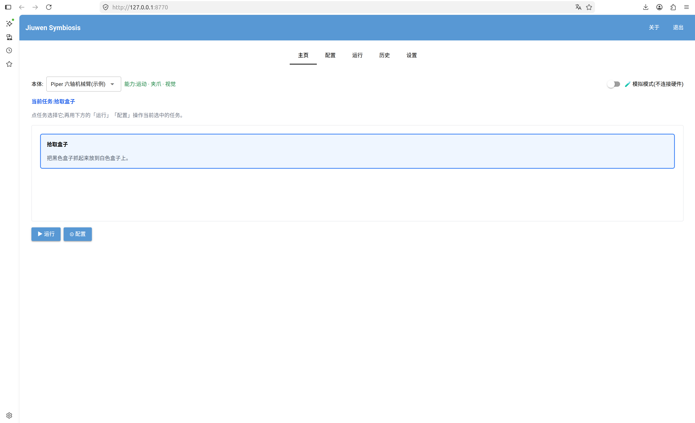
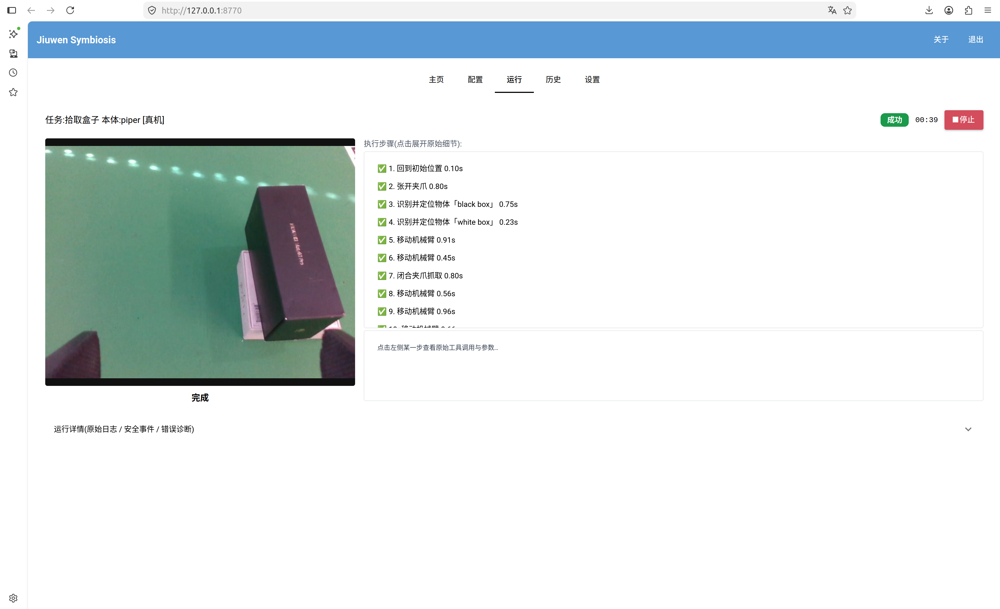

# JiuwenSymbiosis 图形界面使用指南

> 类别：How-to。本文说明如何安装、启动和操作浏览器 GUI。

**JiuwenSymbiosis 图形界面**是浏览器里的可视化操作台：不用命令行，选本体、点任务、改配置、
一键运行，执行过程对非研发人员也能清晰理解。



顶部标签在 **主页 / 配置 / 运行 / 工具 / 历史 / 模型 / 设置** 七页间切换（上图为旧版六页布局）。上图的**主页**是主入口：左侧下拉选
**本体**（如 *Piper 六轴机械臂*），中间点选**任务**卡片，下方用「▶ 运行 / ⚙ 配置」操作
当前任务，点击运行按钮一键运行任务。

---

## 目录

- [1. 功能一览](#1-功能一览)
- [2. 安装](#2-安装)
  - [安装图形界面依赖](#安装图形界面依赖)
  - [选择 GUI 插件](#选择-gui-插件)
  - [安装成“点击就能打开”的桌面应用（推荐）](#安装成点击就能打开的桌面应用推荐)
- [3. 运行示例](#3-运行示例)
  - [运行任务](#运行任务)
- [4. 其他功能](#4-其他功能)
  - [看每一步的详情](#看每一步的详情)
  - [历史回放](#历史回放)
  - [自动错误诊断（一键修复）](#自动错误诊断一键修复)
- [5. 提示](#5-提示)

---

## 1. 功能一览

界面分七页（顶部标签切换）：

| 页面 | 作用 |
|---|---|
| **主页** | 选本体（如 *Piper 六轴机械臂*）、点选任务，再用「▶ 运行 / ⚙ 配置」操作当前任务。 |
| **配置** | 按类别分组的常用表单 + 「原始 YAML」兜底（双向同步）。 |
| **运行** | 实时监看：相机画面 + 当前动作一句话 + 右侧逐步时间线（点某步看原始工具调用/参数）；底部抽屉放原始日志、安全事件、错误诊断。 |
| **工具** | 任务无关的运维工具：感知测试（点击重投影）、手眼标定（四步向导，需 `pip install -e ".[calib]"`）和硬件控制（释放力矩手摆臂后恢复，仅支持实现 `HandGuidingDriver` 的驱动）。 |
| **历史** | 列出已记录的执行轨迹，用内置自包含 HTML 在浏览器**回放**（含相机帧）。 |
| **模型** | 统一选择模型、获取服务端模型列表，并将连接与 Key 保存到系统钥匙串。 |
| **设置** | 运行记录保存位置（工作区目录）、界面语言。 |

> 界面基于 [NiceGUI](https://nicegui.io) 的**浏览器模式**，只监听本机 `127.0.0.1`，不使用
> `native=True`，因此无需任何系统级显示库，几乎没有安装门槛。

---

## 2. 安装

### 安装图形界面依赖

现有工作台独立于其它的重型 GPU 栈，可单独安装（包含 `nicegui`、`pillow`、`httpx` 和 `keyring`）。在你的
conda 环境（默认名 `jiuwensymbiosis`）里：

```bash
pip install -e ".[gui]"
```

> 所选工作台缺 NiceGUI 时，启动预检会弹出提示 `pip install -e ".[gui]"` 的对话框
>（即便从桌面图标启动、没有终端也能看到）。

### 选择 GUI 插件

统一启动器默认启动现有 `workbench`。可以列出已安装的 GUI 插件，或明确选择工作台：

```bash
jiuwensymbiosis-gui --list-guis
jiuwensymbiosis-gui --gui workbench
python -m jiuwensymbiosis_gui --gui workbench
```

选择其它插件时，先按该插件说明把它及其依赖安装到同一 Python 环境，再运行
`jiuwensymbiosis-gui --gui <plugin-key>`。每个插件自行管理界面框架和前端依赖；安装某个插件不会让它的
界面框架变成所有 GUI 的依赖。启动器只启动所选插件。

开发新的界面请参阅 [接入一个 GUI 插件](add-gui.md)，其中包含可安装的最小示例和测试规则。

`python -m jiuwensymbiosis.gui` 暂时保留为兼容转发入口。新脚本请使用
`python -m jiuwensymbiosis_gui` 或 `jiuwensymbiosis-gui`。

### 安装成“点击就能打开”的桌面应用（推荐）

```bash
bash scripts/install_desktop_entry.sh
```

装好后在系统的**应用菜单 / 活动列表**里搜 **“Jiuwen Symbiosis”** 即可点开，也可右键
**固定到 Dock**。图标与启动路径都按本机实际路径动态生成，换机器/换克隆目录都不用改。

卸载：

```bash
bash scripts/install_desktop_entry.sh --uninstall
```

> 桌面图标经 `scripts/launch_gui.sh` 启动，会自动激活 conda 环境 `jiuwensymbiosis`
> （本地用别的名字就设 `JIUWEN_CONDA_ENV=你的环境名`），并跑仓库的**实时源码**——
> 改代码或升级版本（`git pull` / 换分支）下次点开即生效，**既不用重装、也不用先卸载**。
> 只有移动 / 改名了仓库目录，才需重跑安装脚本让路径重新生成。

---

## 3. 运行示例

任选一种方式启动（都会自动打开默认浏览器到 `http://127.0.0.1:8770`）：

```bash
# 1) 桌面图标：应用菜单里点 “Jiuwen Symbiosis”
# 2) 控制台脚本
jiuwensymbiosis-gui --gui workbench
# 3) 模块入口
python -m jiuwensymbiosis_gui --gui workbench
# 4) 启动脚本（自动激活 conda 环境、跑仓库源码）
bash scripts/launch_gui.sh
```

### 运行任务

1. 启动后停在**主页**，本体默认 *Piper 六轴机械臂*、任务默认「拾取盒子」。选好本体与任务。
2. 进顶部**模型**页设置模型连接；进**配置**页填写腕部相机序列号、CAN 口等硬件参数（也可切「原始 YAML」整体编辑）。
3. 确认真机前置就绪：CAN 已激活、腕部 RealSense 已接、视觉检测模型（GroundingDINO +
   SAM2）本机可用。硬件与标定细节见仓库根 `README` 与 `configs/piper/`。
4. 在「配置 → 任务指令」里填你希望 agent 执行的动作，如“把黑盒子放到白盒子上”。抓取/放置的步骤与高度算法都不需要细写，均由内置 SKILL.md 决定。
5. 点 **▶ 运行**。若视觉模型缺失等常见问题，界面会直接给出**错误诊断 + 一键修复**
   （见 [4.3](#自动错误诊断一键修复)），而不是空跑到超时。



---

## 4. 其他功能

### 统一模型设置

1. 在顶部「模型」页选择服务商预设，或手动填写接口适配器、API 基础地址、模型 ID 和 API Key。
2. 可点击「获取模型列表」查看当前接口支持的模型；该操作不改变已生效模型。服务不支持列表、网络失败或列表为空时，仍可手动输入模型 ID。
3. 点击「仅本次应用」，只在当前页面内存中生效，不访问钥匙串；也可点击「应用并保存模型」，在保存成功后应用并于下次打开时恢复。两者均影响当前页面之后启动和重新执行的任务；已经启动的任务保留自己的快照。任务的温度、Token 上限和额外请求参数仍来自任务配置。
4. 点击「使用任务自身模型」取消当前页面的统一覆盖。此后每个任务使用自己的完整模型配置，包括各自的连接与 Key；不会删除已保存设置或应用表单草稿。
5. 「忘记已保存设置」删除工作台保存的记录，并清空表单及当前统一模型的 Key；不会修改任务自身配置，也不会改变已经启动的任务。使用统一模型的后续任务需要重新配置 Key。

未恢复或应用统一设置时，运行继续使用各任务 YAML 中的模型配置。「读取任务模型到表单」只更新草稿，仍需点击应用才会覆盖统一选择。任务配置中的模型连接字段由顶部模型页编辑；温度等任务参数仍在配置页。

「仅本次应用」指当前页面生命周期，允许该页面连续启动多个任务；刷新或重新打开时临时选择失效，重新读取已保存设置（没有保存记录时使用任务配置）。「使用任务自身模型」同样只影响当前页面，刷新后按上述规则恢复。其他已打开的页面保留各自生效快照，刷新后重新读取保存记录。

Key 与服务地址作为一个记录保存在系统钥匙串中，不写入 YAML、浏览器存储或普通配置文件。更换协议、主机或端口会清空表单中的旧 Key，并重新启用 TLS 证书验证；同一服务的版本路径修改保留 Key。开启 HTTPS 时应保持证书验证启用。

保存失败时，当前生效模型保持不变；钥匙串不可用或锁定时，可使用「仅本次应用」，不会回退到明文保存。Linux 的持久保存需要可用且已解锁的 Secret Service 或 KWallet；页面恢复不会主动弹出解锁对话框。自动恢复完成前不能启动任务或切换生效配置。测试和演示使用独立的内存凭据后端，不读写个人钥匙串。

本功能使用独立的工作台凭据记录；已有其他功能保存的记录保持不变，不会自动导入。首次使用请重新填写并保存。本功能接入工作台普通任务启动和重跑，不改变 CLI 的配置选择方式。

### 看每一步的详情

**运行**页右侧时间线里每一步都能点开：显示该步的**原始工具名、参数、AI 说明、用时、
返回值 / 报错**。点历史某步还会把相机画面切回**当时那一帧**（「↩ 回到实时画面」切回实时）。

### 历史回放

**历史**页扫描工作区 `traces/` 目录，列出每次运行的摘要，点「🌐 在浏览器打开回放」用
自包含 HTML（内联相机帧）复盘整条执行轨迹。

> 回放依赖执行轨迹：需在**配置**的 `agent` 段开启 `modules.tracing.enabled: true`（默认关闭，
> 零开销）。开启后轨迹 JSON 落在 `<工作区>/traces/`。工作区位置在**设置**页可改。

### 自动错误诊断（一键修复）

运行失败时，底部「运行详情」抽屉会自动切到**错误诊断**页，把技术报错翻成一句人话 +
处理步骤，并对常见问题给出**一键修复**：

- **视觉检测模型未就绪 / 下载超时**：可「自动检测」本机已下好的 GroundingDINO / SAM2 等等视觉模型
  目录直接填入，或「一键更换」国内镜像重新下载。
- 其它可识别项：检测器启动失败 / 端口被占用、大模型鉴权失败（API Key）、连不上大模型
  服务、显存不足、机械臂连接失败等，均给出定位与建议。

---

## 5. 提示

- **端口**：默认 `8770`，仅绑定回环地址、不对外暴露。
- **conda 环境**：`launch_gui.sh` / 桌面图标默认用 `jiuwensymbiosis`，可用
  `JIUWEN_CONDA_ENV` 覆盖。
- **语言**：界面为简体中文。
- 工作台是在进程内调用库函数（不 shell 调 CLI）；实时反馈经线程安全事件队列回传。Python 模块位于
  `jiuwensymbiosis_gui.workbench`，无硬件工作台测试位于 `tests/gui/workbench/`。
