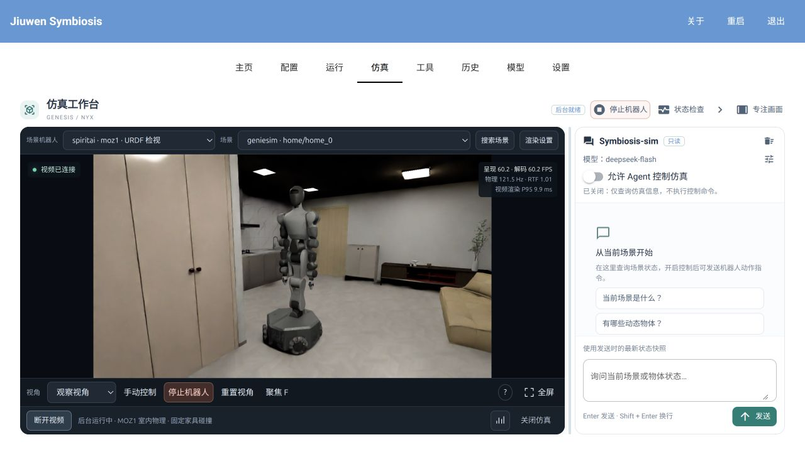
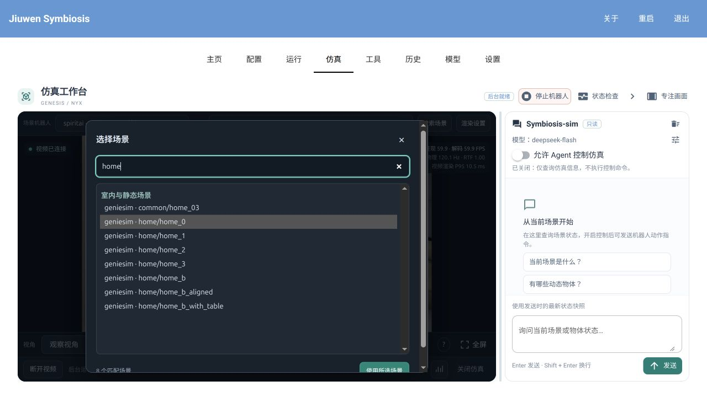
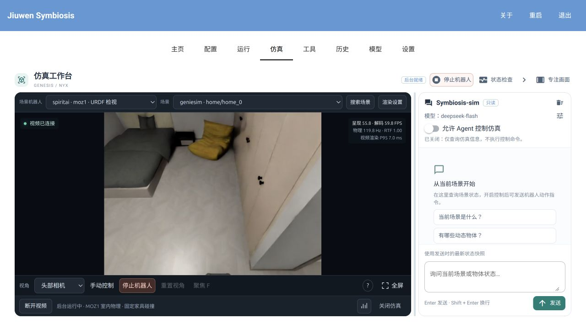
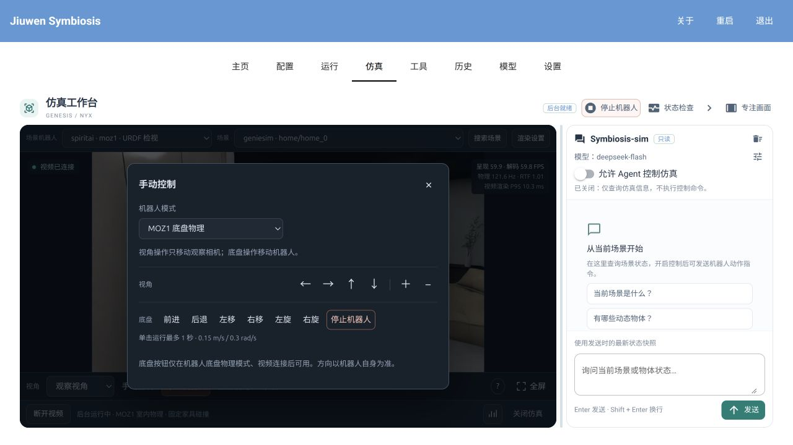
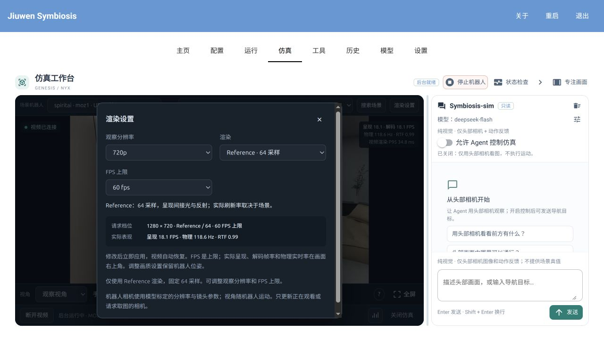
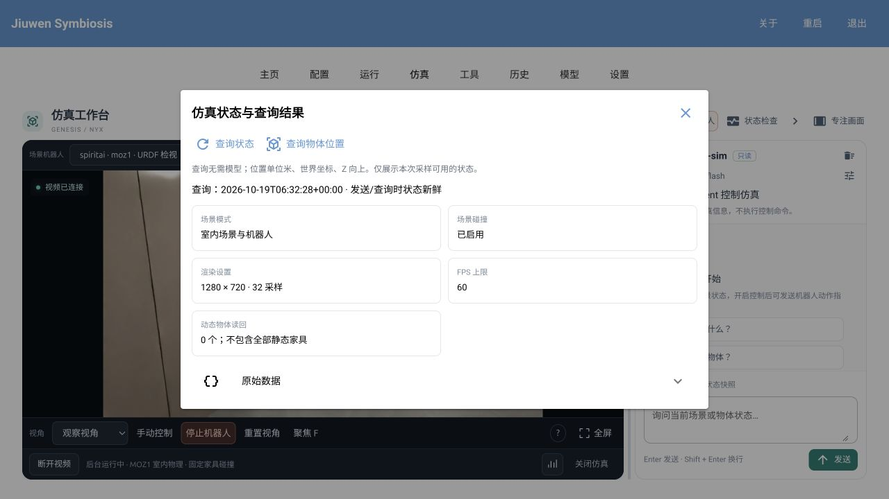
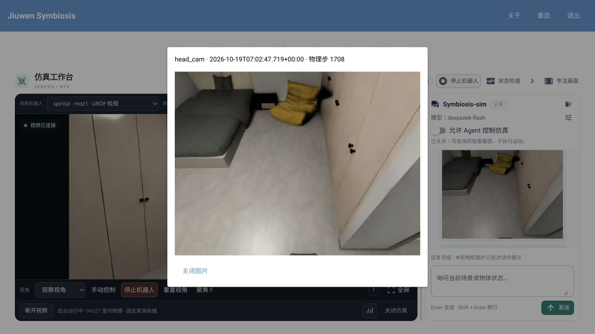

# GUI 仿真器使用指南

工作台的「仿真」页用于加载场景、观察机器人、切换相机，以及手动或通过 Agent 控制底盘。
当前使用 Genesis 物理仿真与 Nyx 渲染。首次使用先完成 [Genesis 安装教程](../tutorial/03-install-genesis.md)，
在独立仿真环境中启动工作台；本页只介绍界面操作。

## 打开仿真页面

```bash
conda activate symbiosis_genesis
python -m jiuwensymbiosis_gui --gui workbench
```

打开 <http://127.0.0.1:8770/>，点击顶部「仿真」。第一次可选择「动态物理演示」，
点击「启动仿真」，等待后台就绪，再点击「连接视频」。内置演示无需外部资产，首次加载可能需要数分钟。



| 区域 | 用途 |
|---|---|
| 画面上方 | 选择场景和场景机器人、搜索资产、调整渲染设置。 |
| 画面右上角 | 查看实际呈现与解码帧率、物理步进速度和渲染耗时。 |
| 画面下方 | 切换相机、打开手动控制、重置或聚焦视角、查看操作说明、全屏。 |
| 左下与右下 | 启动或关闭仿真、连接或断开视频、查看串流详情。 |
| 页面右上与右侧 | 查询状态、与模型对话，以及允许 Agent 控制仿真。 |

「专注画面」扩大仿真区域；右上角箭头收起或展开对话。两者都不重启仿真。
以下截图使用本机室内场景与 MOZ1；可选资产取决于本机索引，截图中的数值仅代表拍摄时的状态。

## 选择场景与机器人



1. 在「场景」选择背景；列表较长时，点「搜索场景」，输入名称或来源，再点「使用所选场景」。
2. 室内场景可在「场景机器人」选择 MOZ1；选择「无」则只预览背景。
3. 打开「手动控制」，确认「机器人模式」：查看模型用「姿态检视」，控制 MOZ1 底盘用「MOZ1 底盘物理」。
4. 启动仿真并连接视频。运行中更换场景、机器人或机器人模式会重新加载场景，原位置与动作不会保留。

本地资产需先按[资产配置说明](../../../configs/simulators/README.md)建立索引，随后刷新页面。
室内底盘模式会寻找可站立的出生点；家具作为固定碰撞体，不会被机器人推动。

## 观察与切换相机

在「观察视角」下，先把鼠标移到画面内，再使用下列操作；它们只移动观察相机，不移动机器人。

| 操作 | 鼠标或快捷键 |
|---|---|
| 原地环顾 | 按住右键拖动。 |
| 自由移动 | 按住右键配合 W/A/S/D；Q 下降，E 上升。 |
| 调整移动速度 | 按住右键滚动滚轮；Shift 临时加速，也可在「操作说明」中选择速度。 |
| 绕目标旋转 | Alt + 左键拖动，或方向键。 |
| 平移视角 | 中键或 Shift + 左键拖动。 |
| 拉近、拉远 | 滚轮，或「手动控制」中的 ＋/−。 |
| 选择与聚焦 | 左键点选物体，黄色包围框表示已选；按 F 或「聚焦 F」。 |
| 重置与取消 | 「重置视角」或 H/Home 回到初始视角；Esc 取消选择和当前导航。 |

未选物体时，F 显示整个场景。观察相机可以穿过背景几何；视角移动不等同于机器人可通行路线。



加载 MOZ1 后，「相机视角」可切换以下画面，无需重新加载物理场景：

| 视角 | 用途 |
|---|---|
| 观察视角 | 自由导航、点选和聚焦；分辨率由渲染设置决定。 |
| 头部相机 | 从头部挂载位置观察，640×480。 |
| 左手相机、右手相机 | 从对应手部挂载位置观察，均为 640×480。 |

机器人相机随连杆运动，使用模型中的镜头参数，不能用观察视角的拖动、点选或聚焦功能。
当前上身锁定在初始姿态，手部画面可能被夹爪或身体遮挡。

## 手动控制底盘



选择 MOZ1、使用「MOZ1 底盘物理」模式并连接视频后，打开「手动控制」：

- 「前进／后退」「左移／右移」「左旋／右旋」驱动机器人，方向以机器人自身为准。
- 每次点击最多运行 1 秒；新方向替换旧指令。需要停止时点击「停止机器人」。
- 断开视频、切换配置或指令超时会撤销手动运动；制动需要时间，不保证精确位移。

面板中的视角箭头与底盘按钮是两组不同操作。当前支持底盘移动与旋转，上身锁定，
不提供机械臂或抓取控制。Agent 可实验性地根据头部图像逐步导航，尚不提供可靠的自动避障保证。

## 调整画质与查看流畅度



点「渲染设置」，修改后自动应用，视频可能短暂停顿后恢复：

| 设置 | 说明 |
|---|---|
| 观察分辨率 | 720p 或 1080p；仅作用于观察视角，机器人相机使用标定分辨率。 |
| Reference | 唯一渲染类别，固定 64 采样，呈现间接光与反射。 |
| FPS 上限 | 30 或 60；这是请求上限，实际帧率受场景和 GPU 负载影响。 |

室内场景、机器人相机和内置动态演示均默认使用 Reference · 64 采样。调整分辨率或 FPS 上限保留物理世界和机器人位姿，但会中断正在执行的动作。

画面右上角的「呈现／解码 FPS」分别表示浏览器呈现速度和视频解码速度；「物理 Hz」表示实际步进速度，
「RTF」约为 1 时表示仿真与现实时间同步；「视频渲染 P95」是渲染耗时的 95 分位值。
不要只看 FPS 上限判断流畅度；需要更多信息时打开底部「串流详情」。

## 查询状态与使用 Agent



点「状态检查」可查看场景、碰撞、渲染设置等信息；「查询物体位置」显示当前可用的动态物体读回，
单位为米、世界坐标、Z 向上，不包含所有静态家具。「原始数据」可展开查看详细结果。
这些查询无需模型，后台未就绪或状态过期时不会提供当前物体坐标。


右侧 `Symbiosis-sim` 使用工作台的[统一模型设置](configure-gui.md#统一模型设置)：

1. 点模型设置图标，或进入顶部「模型」页，应用可用模型。
2. 默认「允许 Agent 控制仿真」关闭，Agent 仅能按需获取头部相机图像，不执行运动。看图需要当前模型同时支持图片输入与工具调用。
3. 需要控制时，加载 MOZ1 底盘物理场景，开启该开关，再输入如“向左移动 20 厘米”或“逆时针旋转 30 度”。
4. Enter 发送，Shift + Enter 换行；运行中可点「停止任务」或「停止机器人」。关闭控制开关也会取消任务。

Agent 控制期间手动运动按钮的请求会被拒绝，手动停止仍可用。取消后需等待制动与任务退出，
不要把“请求已接受”或模型的一句回复当作机器人已经到位。右侧清空按钮只清空对话，不重置场景。

**让 Agent 看图**：输入“用头部相机看看前方有什么”。网页对话固定使用严格纯视觉模式，
无论控制开关是否打开，相机工具都只开放 `capture_camera(head_cam)`。没有头部相机时报告无法观察，不回退到外部或手部视角。
模型输入不包含场景名称、资产标识、世界坐标、物体真值位置、相机内外参、接触对象或结构化状态。
运动工具只返回成功、停稳、失败原因和可恢复状态；测量位置、目标世界坐标及位置误差留在内部验收记录。
内部物理读回仍用于执行、停车确认和新鲜度检查；人工诊断面板不向 Agent 发送数据。
只重放本模式下产生的对话，旧的状态驱动对话不进入模型上下文。
对话展示实际送入模型的同一张头部图像，点击可放大。网页视频视角可独立切换，不会改变 Agent 的视角。
取图无需连接视频；只读任务最多 4 张，允许运动的任务最多 40 张；聊天保留最近 12 张缩略图。
图片只代表采样时刻，移动后应重新取图。看不清、取图失败或场景切换时不使用旧图替代。
单张 RGB 图像不能提供精确距离或三维位置。

单次移动有 40 秒仿真时间的执行上限。若返回 `motion_timeout` 且 `settled=true`，
说明动作未完成、但底盘已确认停稳：任务不会因此直接取消。Agent 必须调用 `capture_camera(head_cam)`，
新的停车后图像送入模型后，才能再次调用运动工具。路线、步长及后续工具调用由 Agent 决定；
仿真只提供观察、执行、停车和结果反馈，不自动绕行或重放失败动作。
停车未确认、控制会话失效或用户取消时仍停止执行。运动任务最多 80 次模型迭代，达到预算时应报告未完成的进度。



## 停止与常见问题

| 操作 | 结果 |
|---|---|
| 停止机器人 | 请求底盘制动，仿真和视频继续。 |
| 断开视频或离开仿真页 | 断开当前视频连接，后台继续运行；手动底盘指令被撤销。 |
| 关闭仿真 | 结束物理仿真和渲染，释放 GPU 资源。结束使用时选择这一项。 |

- **没有画面**：先确认后台就绪，再点「连接视频」；视频断开不等于仿真已关闭。
- **找不到场景**：检查本机资产配置与索引，完成后刷新页面。
- **底盘按钮不可用**：确认已选 MOZ1、模式为底盘物理且视频已连接。
- **机器人相机不能拖动**：切回「观察视角」进行自由导航。
- **加载失败或长时间未就绪**：查看页面提示及 `~/.jiuwensymbiosis/genesis-preview/worker.log`；
  依赖与 CUDA 检查见安装教程。修改后台代码后，需要关闭并重新启动仿真。

## 执行预算、诊断和进程边界

所有场景使用 Reference 64 采样。物理调度每批最多补64步，同时受8ms时间预算限制，
逐步检查停止请求，批间处理控制消息；上限不是保证每次执行64步，也不是实时因子承诺。
单模型聊天/识别请求默认90秒；连接 preview 的共享 Agent 整轮预算为240秒，
其中包含只读看图及可选动作。状态快照仅用于操作者诊断，不送入纯视觉模型输入。

`genesis.motion.failed`、`genesis.camera.capture_failed`、`genesis.camera.delivery_failed`
日志分别定位运动调用、取图、图像注入失败，并附固定异常类别。日志不记录原始异常正文、
图片内容或凭据；运动状态未知仍终止本轮，图像注入失败仍停止后续模型执行。

独立 worker 只继承显式列出的设备、动态库、显示、缓存、临时目录和语言环境变量，
另传入固定的仿真数据根；不继承模型密钥、代理凭据及任意宿主变量。
停止流程逐级等待、terminate、kill；最终等待仍失败时保留进程及 mailbox 供重试，
不能把未确认退出标记为已停止。IPC 状态超限会拒绝写入并保留上一份完整状态；
支持场景的容量余量仍需按实际状态测量。

相机指令接受、worker 应用和浏览器视频呈现是三个阶段。当前 pick 等待 worker 应用相机，
但浏览器选择框与视频帧的 revision 未同步，不能保证错位只持续一帧；该风险仍需实际浏览器验收。

共享 `navigate_relative` 现在按 `supports_lateral` 表达横移能力：MOZ1 支持横移，
Cruzr 会拒绝非零 `dy_m`，不再静默忽略。旧调用方需改为旋转后前进或其他有效运动组合。
