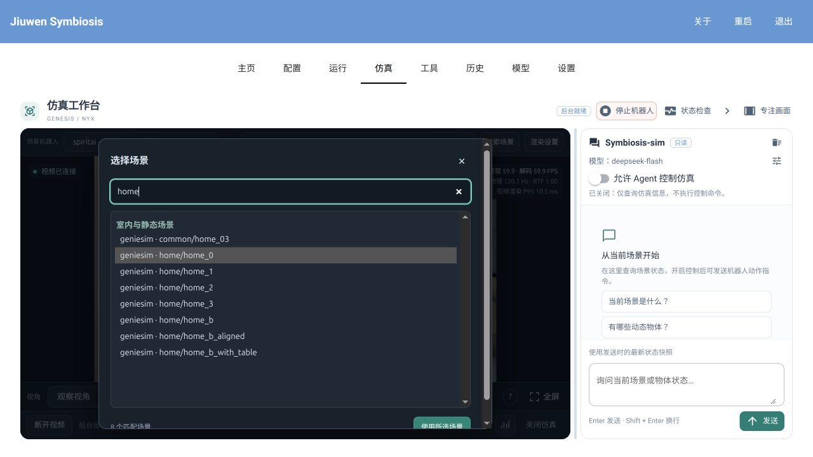
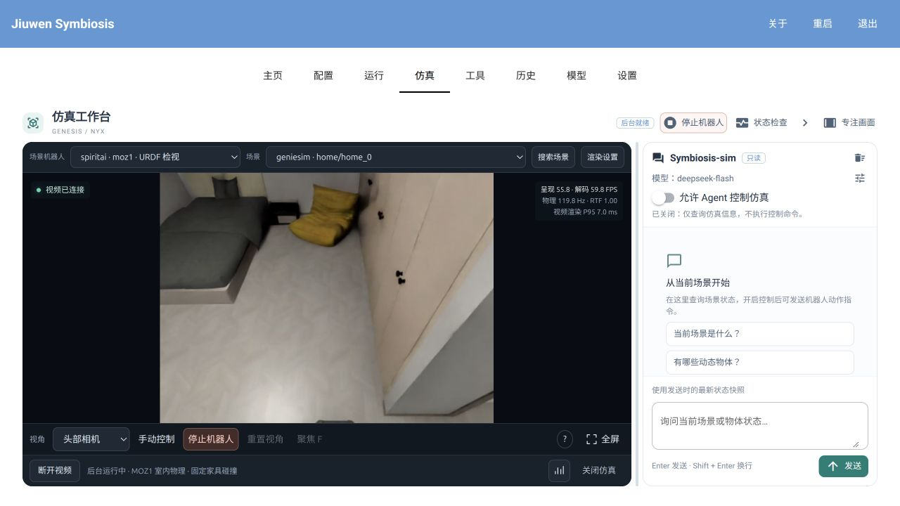
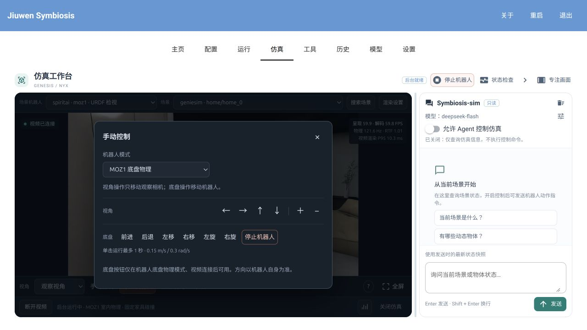
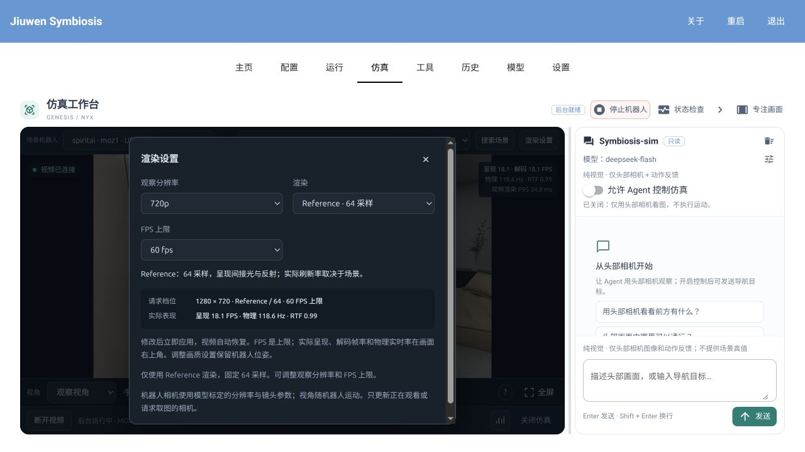
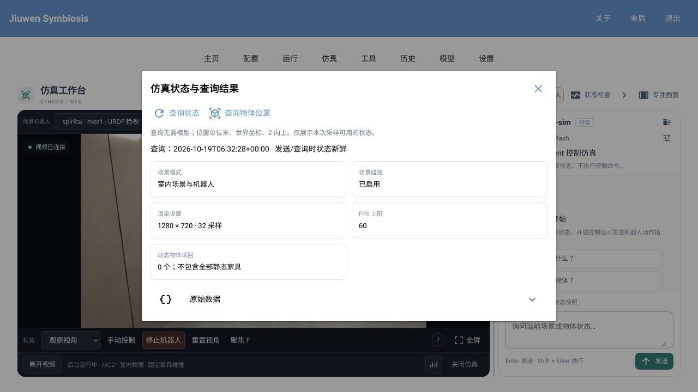
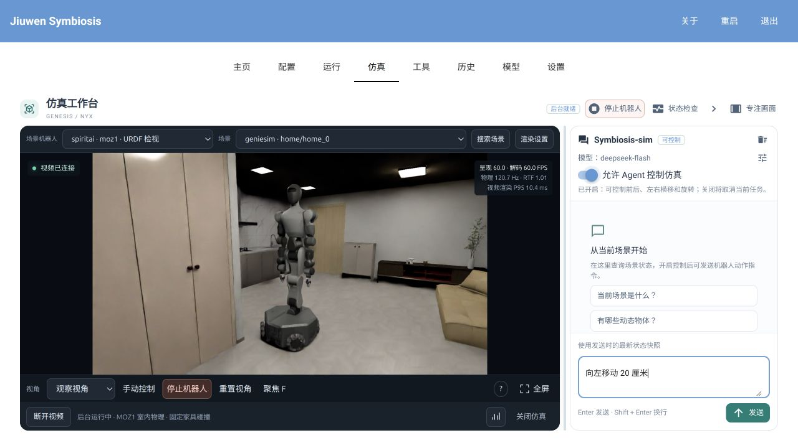
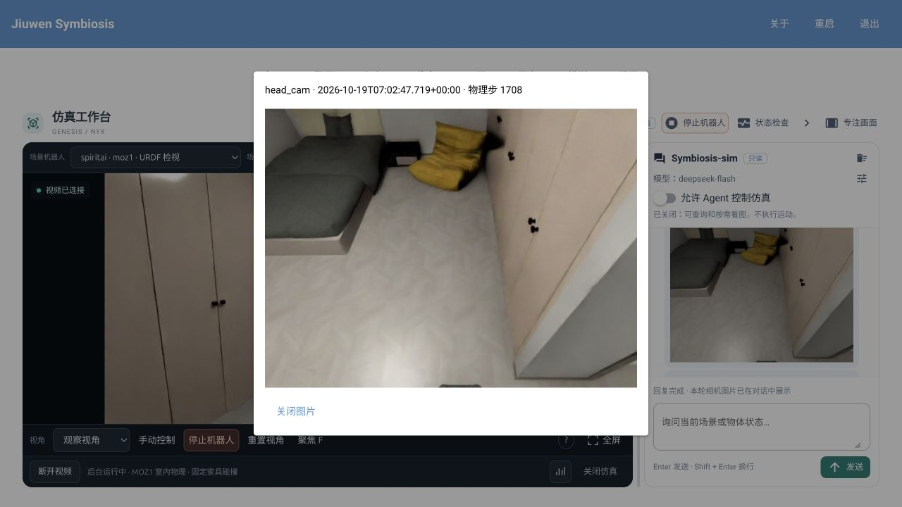

# GUI 仿真器使用指南

工作台的「仿真」页用于加载场景、观察机器人、切换相机，以及手动或通过 Agent 控制底盘。
Genesis 场景使用物理仿真与 Nyx 渲染；Apple Silicon 基础演示使用 Rasterizer，Jumper/Microduck 使用原生 MuJoCo。首次使用先完成 [Genesis 安装教程](../tutorial/03-install-genesis.md)，
在独立仿真环境中启动工作台；本页只介绍界面操作。

## 打开仿真页面

```bash
conda activate symbiosis_genesis
python -m jiuwensymbiosis_gui --gui workbench
```

打开 <http://127.0.0.1:8770/>，点击顶部「仿真」。工作台启动时会连接本用户的常驻后台；
首次启动会加载「动态物理演示」。等待后台就绪，再点击「连接视频」。内置演示无需外部资产，首次加载可能需要数分钟。
再次打开工作台会沿用后台当前的场景、机器人及状态。后台已被释放时，可点击「启动仿真」重新启动。


| 区域 | 用途 |
|---|---|
| 画面上方 | 选择场景和场景机器人、搜索资产、调整渲染设置。 |
| 画面右上角 | 查看实际呈现与解码帧率、物理步进速度和渲染耗时。 |
| 画面下方 | 切换相机、打开手动控制、重置或聚焦视角、查看操作说明、全屏。 |
| 左下与右下 | 启动仿真、复位世界、释放后台资源、连接或断开视频、查看加载进度及串流详情。 |
| 页面右上与右侧 | 查询状态、与模型对话，以及允许 Agent 控制仿真。 |

「专注画面」扩大仿真区域；右上角箭头收起或展开对话。两者都不重启仿真。
以下截图使用本机室内场景与 MOZ1；可选资产取决于本机索引，截图中的数值仅代表拍摄时的状态。

## 选择场景与机器人



1. 在「场景」选择背景；列表较长时，点「搜索场景」，输入名称或来源，再点「使用所选场景」。
2. 室内场景可在「场景机器人」选择 MOZ1；选择「无」则只预览背景。
3. 打开「手动控制」，确认「机器人模式」：查看模型用「姿态检视」，控制 MOZ1 底盘用「MOZ1 底盘物理」；Jumper/Microduck 由场景选择对应步态物理模式。
4. 启动仿真并连接视频。运行中更换场景、机器人或机器人模式会重新加载场景，原位置与动作不会保留。

本地资产需先按[资产配置说明](../../../configs/simulators/README.md)建立索引，随后刷新页面。
室内底盘模式会寻找可站立的出生点；家具作为固定碰撞体，不会被机器人推动。

USD 场景首次加载时自动生成只包含固定场景碰撞体的 `.gscene` 缓存，机器人随后单独加入。
场景源文件、引用资产、物理设置或相关处理代码/依赖版本变化会生成新的缓存；损坏缓存会重建。
缓存位于 `$XDG_CACHE_HOME/jiuwensymbiosis/genesis/scenes`（默认 `~/.cache/jiuwensymbiosis/genesis/scenes`），
可用绝对路径环境变量 `JIUWENSYMBIOSIS_GENESIS_SCENE_CACHE` 指定其他目录。
缓存命中仍需构建组合后的物理世界、Nyx 场景和首帧，换机器人不保证瞬时完成。

加载进度显示当前实际阶段与已用时间。碰撞体构建显示已完成数量；物理内核构建、Nyx 初始化等
无法计数的阶段使用不定进度条，不估算总百分比。失败时保留失败阶段。

## 观察与切换相机

在「观察视角」下，先把鼠标移到画面内，再使用下列操作；它们只移动观察相机，不移动机器人。

| 操作 | 鼠标或快捷键 |
|---|---|
| 原地环顾 | 按住右键拖动。 |
| 自由移动 | 按住右键配合 W/A/S/D；Q 下降，E 上升。 |
| 调整移动速度 | 按住右键滚动滚轮；Shift 临时加速，也可在「操作说明」中选择速度。 |
| 绕目标旋转 | Alt + 左键拖动，或方向键。 |
| 平移视角 | 中键或 Shift + 左键拖动。 |
| 拉近、拉远 | 滚轮，或「手动控制」中的 ＋/−。 |
| 选择与聚焦 | 左键点选物体，黄色包围框表示已选；按 F 或「聚焦 F」。 |
| 重置与取消 | 「重置视角」或 H/Home 回到初始视角；Esc 取消选择和当前导航。 |

未选物体时，F 显示整个场景。观察相机可以穿过背景几何；视角移动不等同于机器人可通行路线。



加载 MOZ1 后，「相机视角」可切换以下画面，无需重新加载物理场景：

| 视角 | 用途 |
|---|---|
| 观察视角 | 自由导航、点选和聚焦；分辨率由渲染设置决定。 |
| 头部相机 | 从头部挂载位置观察，640×480。 |
| 左手相机、右手相机 | 从对应手部挂载位置观察，均为 640×480。 |

机器人相机随连杆运动，使用模型中的镜头参数，不能用观察视角的拖动、点选或聚焦功能。
底盘物理模式中的上身关节保留自由度，由位置控制保持初始姿态；手部画面可能被夹爪或身体遮挡。

## 手动控制底盘



选择 MOZ1、使用「MOZ1 底盘物理」模式并连接视频后，打开「手动控制」：

- 「前进／后退」「左移／右移」「左旋／右旋」驱动机器人，方向以机器人自身为准。
- 每次点击最多运行 1 秒；新方向替换旧指令。需要停止时点击「停止机器人」。
- 断开视频、切换配置或指令超时会撤销手动运动；制动需要时间，不保证精确位移。

面板中的视角箭头与底盘按钮是两组不同操作。当前支持底盘移动与旋转，上身主动保持初始姿态，
不提供机械臂或抓取控制。Agent 可实验性地根据头部图像逐步导航，尚不提供可靠的自动避障保证。

MOZ1 的 36 个上身关节保留原始关节限位：6 个躯干关节、14 个双臂关节和 16 个夹爪关节。
其中 22 个驱动关节使用有限力矩的 PD 位置控制，14 个夹爪从动关节使用原始 mimic 约束。
停车、指令到期和场景重置均保留原始上身目标；运行期间不通过重写关节位置保持姿态。
源资产中的躯干和手臂 effort 为零，因此控制器明确使用仿真调参，不能视为实机电机规格：
躯干 `kp=30000, kv=1500, effort=500 N·m`，双臂 `8000/200/120`，夹爪驱动 `120/5/16.5`。
状态中的 `upper_body=position_hold` 与 `upper_body_state` 提供关节目标、实测位置、误差和速度。

底盘物理模式开启自碰撞，保留 Genesis 默认的相邻连杆和初始重叠碰撞对过滤。
`collision_settings` 从实际求解器读取开关；验收同时记录自接触的连杆、数量和接触力。
检查移动与姿态保持时，应同时核对实测位移、上身关节误差、底座倾斜、制动与重置结果。
平地移动检查不能代替复杂场景或抓取验收。

## 调整画质与查看流畅度



点「渲染设置」，修改后自动应用，视频可能短暂停顿后恢复：

| 设置 | 说明 |
|---|---|
| 观察分辨率 | 540p、720p 或 1080p；仅作用于观察视角，机器人相机使用标定分辨率。 |
| Reference | 唯一渲染类别，固定 64 采样，呈现间接光与反射。 |
| FPS 上限 | 30 或 60；这是请求上限，实际帧率受场景和 GPU 负载影响。 |

室内场景、机器人相机和内置动态演示均默认使用 Reference · 64 采样。调整分辨率或 FPS 上限保留物理世界和机器人位姿，但会中断正在执行的动作。

画面右上角的「呈现／解码 FPS」分别表示浏览器呈现速度和视频解码速度；「物理 Hz」表示实际步进速度，
「RTF」约为 1 时表示仿真与现实时间同步；「视频渲染 P95」是渲染耗时的 95 分位值。
不要只看 FPS 上限判断流畅度；需要更多信息时打开底部「串流详情」。

## 查询状态与使用 Agent



点「状态检查」可查看场景、碰撞、渲染设置等信息；「查询物体位置」显示当前可用的动态物体读回，
单位为米、世界坐标、Z 向上，不包含所有静态家具。「原始数据」可展开查看详细结果。
这些查询无需模型，后台未就绪或状态过期时不会提供当前物体坐标。



右侧 `Symbiosis-sim` 使用工作台的[统一模型设置](configure-gui.md#统一模型设置)：

1. 点模型设置图标，或进入顶部「模型」页，应用可用模型。
2. 在「观测模式」选择「感知 · RGB-D 目标定位与接近」「仿真真值 · 场景查询」或「相机观察 · RGB-only（兼容）」。默认保留 RGB-only 兼容模式；「允许 Agent 控制仿真」独立控制运动权限，关闭后仍可查询和看图。看图需要模型同时支持图片输入与工具调用。
3. 需要控制时，加载 MOZ1 底盘物理场景，开启该开关，再输入如“向左移动 20 厘米”或“逆时针旋转 30 度”。
4. Enter 发送，Shift + Enter 换行；运行中可点「停止任务」或「停止机器人」。关闭控制开关也会取消任务。

Agent 控制期间手动运动按钮的请求会被拒绝，手动停止仍可用。取消后需等待制动与任务退出，
不要把“请求已接受”或模型的一句回复当作机器人已经到位。右侧清空按钮只清空对话，不重置场景。

**相机观察 · RGB-only（兼容）**：输入“用头部相机看看前方有什么”。选择兼容模式后，
无论控制开关是否打开，相机工具都只开放 `capture_camera(head_cam)`。没有头部相机时报告无法观察，不回退到外部或手部视角。
模型输入不包含场景名称、资产标识、世界坐标、物体真值位置、相机内外参、接触对象或结构化状态。
运动工具只返回成功、停稳、失败原因和可恢复状态；测量位置、目标世界坐标及位置误差留在内部验收记录。
内部物理读回仍用于执行、停车确认和新鲜度检查；人工诊断面板不向 Agent 发送数据。
只重放本模式下产生的对话，旧的状态驱动对话不进入模型上下文。
对话展示实际送入模型的同一张头部图像，点击可放大。网页视频视角可独立切换，不会改变 Agent 的视角。
取图无需连接视频；只读任务最多 4 张，允许运动的任务最多 64 张；聊天保留最近 12 张缩略图。
图片只代表采样时刻，移动后应重新取图。看不清、取图失败或场景切换时不使用旧图替代。
单张 RGB 图像不能提供精确距离或三维位置。

**感知 · RGB-D 目标定位与接近**：使用 Nyx 头部 RGB、对齐深度和 GroundingDINO + SAM2，
通过 `locate_target` 和 `approach_target` 完成定位与接近；当前仅接入仿真中的 MOZ1，
不改变 Cruzr 真机的动作、相机采集或底盘控制流程。
检测模型预测可能错误，Agent 需要先核对同帧原图和分割覆盖图，不能把查询词当作已验证的物体类别。

1. 展开「GroundingDINO + SAM2 配置」，选择「连接已有服务」，填写服务地址并点击「应用感知配置」。
   手动启动在本机的 HTTP 服务也属于此模式；Session 不会停止它。
2. 「本地启动模型」由 Session 启动并清理模型子进程，需要当前 Python 环境已有完整推理依赖和可用模型。
   它不替用户安装依赖。仿真与标准推理安装的 Pillow 约束不同，首次部署推荐使用
   [独立推理环境](../tutorial/03-install-genesis.md#接入-rgb-d-检测服务)。
3. 首次请求检查 GroundingDINO 和 SAM2 均已就绪；模型未加载、服务失败不会伪装成“没有目标”。
   「关闭检测，仅看图」不提供目标定位和接近工具。
4. 先输入“定位头部画面中的 chair，报告距离和方位”。目标明确、深度足够且允许控制时，
   可输入“用 RGB-D 接近 chair，停在距可见点定位结果 2.5 米的位置”。英文颜色修饰可以帮助区分外观；
   重复实例需要可见参考物及空间关系，不能任意挑选一个。

`locate_target` 返回基座坐标中的**可见点云中位位置**，不是完整物体中心。
`point_base_mm` 的单位是毫米，`distance_m` 是基座原点到定位点的水平距离，`bearing_rad` 是方位弧度（左正）。
`target_distance_m` 当前接受 0.8–3.0 米；它不表示机器人外缘与物体的净空。
Nyx 深度是与去畸变 RGB 对齐的光轴 Z，单位米；未采样或无效位置保留缺失，不能当作自由空间。

接近动作在每步前确认停稳并采集两帧关联观测，按较近测量值选择保守前进量，再停稳重测。
每步前进最多 0.25 米；单次动作最多 16 步、180 秒，并共用最多两次额外静止重观测预算。
只有两帧新观测各自满足距离误差 5 cm、方位误差 3°，且 `stop_confirmation=measured`，才会报告抵达。
`ok`、`goal_reached`、`settled` 必须同时为真。漏检、目标身份变化、深度不足、障碍、
过近、观测持续不稳定、取消或停车未确认都会保留失败状态；不会后退盲找、自动换目标或回退到真值。

转向只依赖当前头部 RGB-D 验证全身扫过的空间。后方、上身区域不可见或采样有空洞时，返回
`turn_clearance_unobserved` 并保持停稳；当前头部安装无法提供完整转向净空证据。
这意味着目标即使可见，也可能因需要转向而无法接近。不能用较小转角、另一个动作入口或口头许可绕过。
当前适用范围是有足够观测的静态室内局部接近，不是全局导航或动态避障。
实验验收记录位于 `outputs/genesis-perception-v2/`；单次成功和单元测试不代表所有目标已通过多用例验收。

**仿真真值模式**：可以输入“列出场景中的物体”“查询机器人当前位置和朝向”，
开启控制后可输入“导航到沙发旁边并面向沙发”。这是直接读取仿真状态，包含视野外信息；
它不代表 GroundingDINO/SAM2 感知结果，其导航距离语义与 RGB-D 接近不同。

| 工具 | 作用 |
|---|---|
| `sim_list_entities` | 按名称或实体种类筛选并分页；重名实体有不同 ID，未知语义类别返回空值。 |
| `sim_get_robot_state` | 底盘根坐标、机身朝向以及实际线速度和角速度。 |
| `sim_get_entity_state` | 物体原点位姿、包围盒和中心；支持 `world` 或 `base` 坐标系。 |
| `navigate_to_pose` | 导航到世界坐标 `x_m, y_m`，最终机身朝向 `yaw_rad`。 |
| `navigate_to_entity` | 根据实体 ID 选择可达的周边停车点，最终面向包围盒中心。 |

坐标单位为米、角度为弧度。`base` 是重力对齐的导航坐标系：X/Y 为机身朝向在水平面的前/左，
Z 向上，原点位于机器人 authored root；不包含机身倾斜的 roll/pitch。
`body_yaw_rad` 表示实际机身前方，根节点四元数仍描述资产根坐标轴。物体模型原点、包围盒中心
和停车点是不同位置。`stand_off_m`（默认 0.4，范围 0.1–2）表示物体包围盒到保守机器人包络的间距。

查询携带来源、场景实例、重置代数、快照 ID、物理步和时间。比较机器人和物体时使用同一
`snapshot_id`；分页也应复用该 ID。最多保留 16 份、60 秒内的快照，重置后立即失效。
移动后省略 ID 获取新观测。切换观测模式会清空 Agent 上下文并开始新对话，保留物理场景；
任务运行时不可切换。RGB-only 和 RGB-D 感知模式均无法访问真值工具，失败时不会自动回退到真值。

真值导航参考 RoboSim 的栅格导航流程：用固定场景的世界空间几何确认同一层地面支撑，
按保持初始上身姿态的全身包络加余量扩张障碍，以 2.5 厘米栅格做 A* 搜索并检查连续路径，再通过真实轮速逐段执行。
未知地面不可通行，不处理楼梯、跨层或动态目标；规划失败时不移动、不暗中更换目标。
每段不超过 0.6 米，整条路线限制为 20 米、64 段；最终分别检查位置、朝向和停稳。
导航成功要求 `ok`、`goal_reached`、`settled` 全为真，`stop_confirmation=measured`。
位置误差容差为 0.04 米，朝向误差容差为 0.04 弧度；停稳沿用底盘持续 0.6 秒低速测量。
该规划模型是保守的单层静态导航，不构成所有场景的无碰撞保证。

单次移动有 40 秒仿真时间的执行上限。若返回 `motion_timeout` 且 `settled=true`，
说明动作未完成、但底盘已确认停稳：任务不会因此直接取消。视觉模式下 Agent 必须调用 `capture_camera(head_cam)`，
新的停车后图像送入模型后，才能再次调用运动工具。路线、步长及后续工具调用由 Agent 决定；
视觉模式由 Agent 逐步选择路线；真值模式可执行一次栅格规划路径，超时后需先调用
`sim_get_robot_state` 获取停车后的新快照，再由 Agent 决定后续操作。两种模式都不重放失败动作。
停车未确认、控制会话失效或用户取消时仍停止执行。运动任务最多 80 次模型迭代，达到预算时应报告未完成的进度。



## 停止与常见问题

| 操作 | 结果 |
|---|---|
| 停止机器人 | 请求底盘制动，仿真和视频继续。 |
| 断开视频或离开仿真页 | 断开当前视频连接，后台继续运行；手动底盘指令被撤销。 |
| 关闭整个工作台 | 断开该 GUI 的连接，取消其任务并确认停车；后台和当前世界保留。异常退出的连接在租约到期后撤销。 |
| 复位世界 | 当前无任务或感知请求时，确认停车并恢复初始物理状态；保留已构建的世界和 Nyx 渲染器。观察视角保留，旧选择与观测失效。 |
| 释放后台资源 | 结束所有 GUI 共享的物理仿真和渲染，释放 GPU 资源。结束使用时选择这一项。 |

同一用户的多个 GUI 共享一个后台，视频控制连接同一时间只允许一个 GUI 持有。
Agent 运动任务同一时间只有一个所有者；持有期间不能切换配置或复位。
后台通过本用户私有 Unix socket 连接，WebUI 仍通过现有本机 HTTP/WebRTC 路由访问。

- **没有画面**：先确认后台就绪，再点「连接视频」；视频断开不等于仿真已关闭。
- **找不到场景**：检查本机资产配置与索引，完成后刷新页面。
- **底盘按钮不可用**：确认已选 MOZ1、模式为底盘物理且视频已连接。
- **机器人相机不能拖动**：切回「观察视角」进行自由导航。
- **加载失败或长时间未就绪**：查看页面提示及 `~/.jiuwensymbiosis/genesis-preview/worker.log`；
  页面加载进度与 worker 日志提供阶段耗时；依赖与 CUDA 检查见安装教程。
  后台服务连接问题另见同目录的 `resident.log`。修改后台代码后，需要「释放后台资源」再重新启动工作台。

## 执行预算、诊断和进程边界

所有场景使用 Reference 64 采样。物理调度每批最多补64步，同时受8ms时间预算限制，
逐步检查停止请求，批间处理控制消息；上限不是保证每次执行64步，也不是实时因子承诺。
单模型聊天/识别请求默认90秒；连接 preview 的共享 Agent 整轮预算为240秒，
其中包含只读看图及可选动作。状态快照仅用于操作者诊断，不送入纯视觉模型输入。

`genesis.motion.failed`、`genesis.camera.capture_failed`、`genesis.camera.delivery_failed`
日志分别定位运动调用、取图、图像注入失败，并附固定异常类别。日志不记录原始异常正文、
图片内容或凭据；运动状态未知仍终止本轮，图像注入失败仍停止后续模型执行。

独立 worker 只继承显式列出的设备、动态库、显示、缓存、临时目录和语言环境变量，
另传入固定的仿真数据根；不继承模型密钥、代理凭据及任意宿主变量。
停止流程逐级等待、terminate、kill；最终等待仍失败时保留进程及 mailbox 供重试，
不能把未确认退出标记为已停止。IPC 状态超限会拒绝写入并保留上一份完整状态；
支持场景的容量余量仍需按实际状态测量。

相机指令接受、worker 应用和浏览器视频呈现是三个阶段。当前 pick 等待 worker 应用相机，
但浏览器选择框与视频帧的 revision 未同步，不能保证错位只持续一帧；该风险仍需实际浏览器验收。

共享 `navigate_relative` 现在按 `supports_lateral` 表达横移能力：MOZ1 支持横移，
Cruzr 会拒绝非零 `dy_m`，不再静默忽略。旧调用方需改为旋转后前进或其他有效运动组合。
