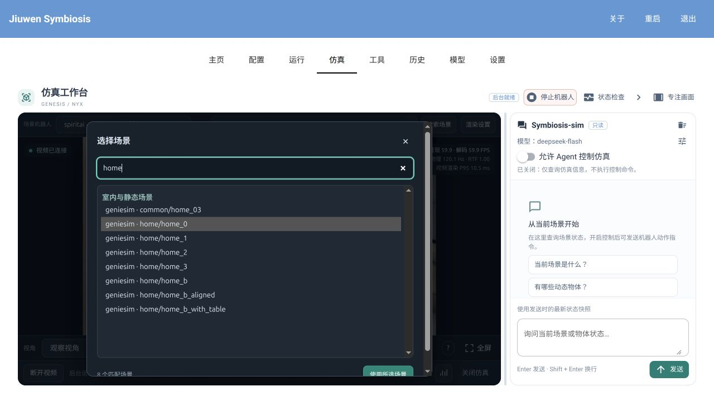
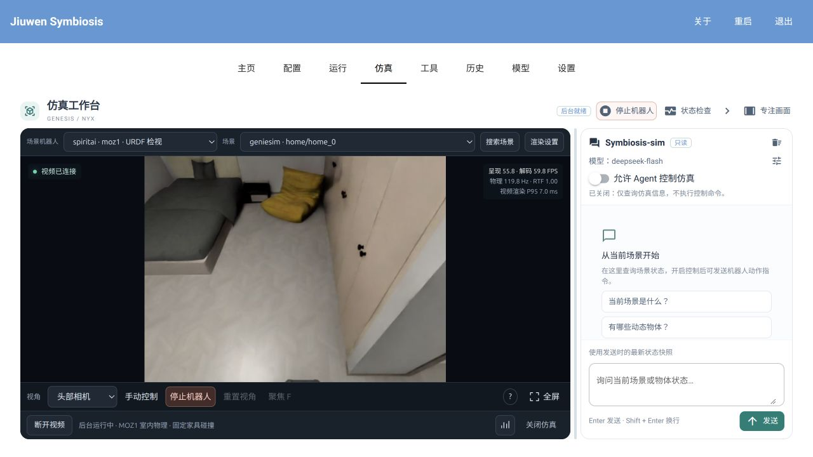
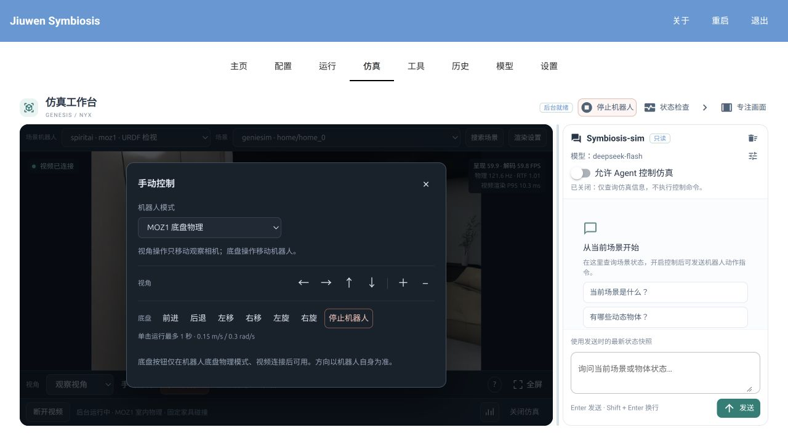
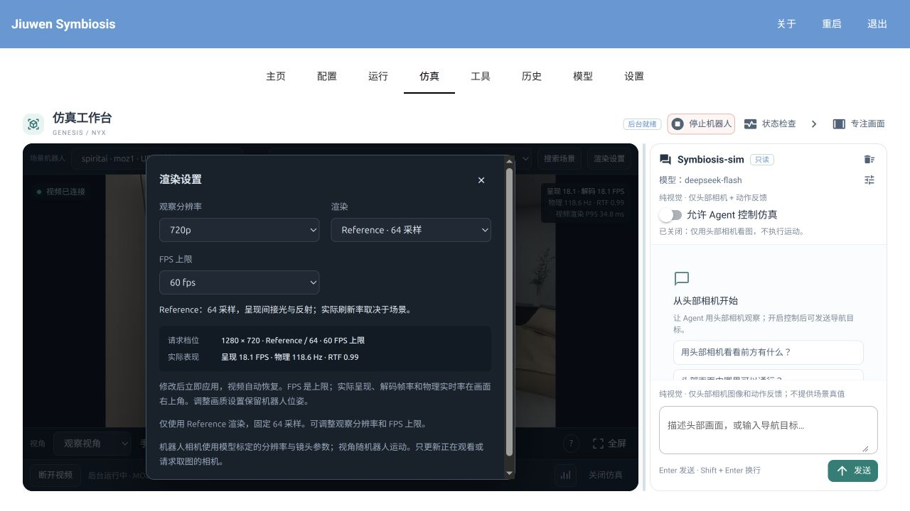
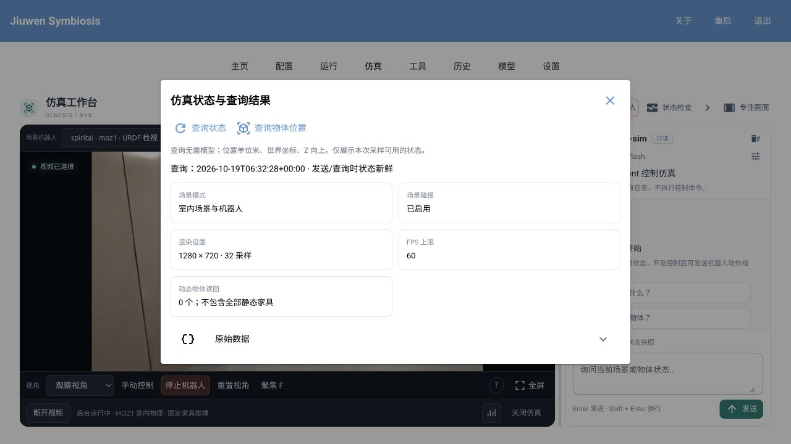
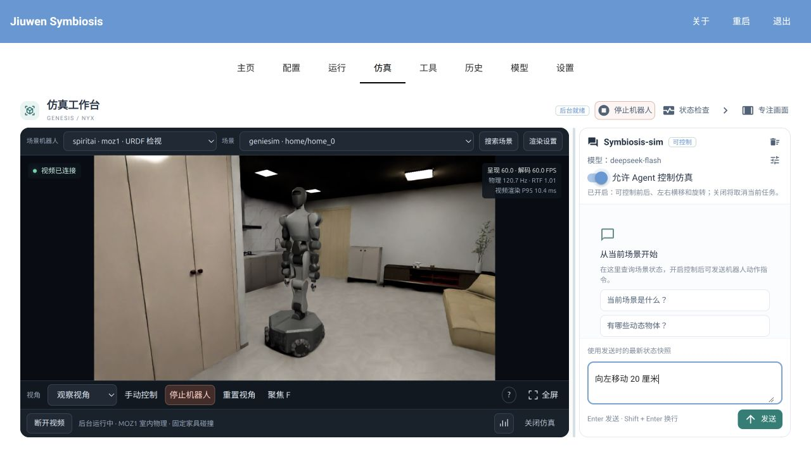
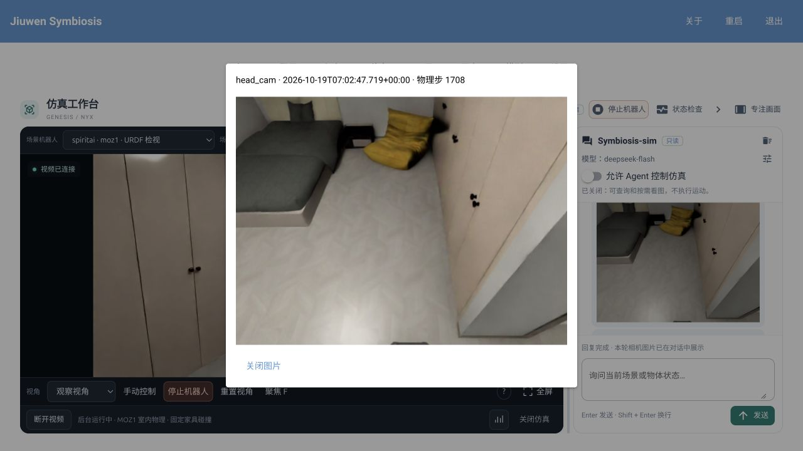

# 仿真指南（simulaiton-guide）

[English](../../en/how-to/simulaiton-guide.md)

本页统一说明仿真后端安装、资产接入、工作台操作、Jumper/Microduck 控制和本地验收。
Genesis 与 MuJoCo 共用工作台、视频、Agent 工具、控制租约和取消机制，在「后端」中选择。
默认后端为 Genesis；Jumper、Microduck 使用 MuJoCo 4.0.1 的官方模型和策略。

- [安装](#安装)
- [添加资产](#添加资产)
- [启动与关闭仿真](#启动与关闭仿真)
- [选择场景与机器人](#选择场景与机器人)
- [手动移动机器人](#手动移动机器人)
- [查询状态与使用 Agent](#查询状态与使用-agent)
- [Jumper 控制](#jumper-控制)
- [Microduck 控制](#microduck-控制)
- [检视 Genesis 资产与渲染结果](#检视-genesis-资产与渲染结果)
- [编程接口与控制器接入](#编程接口与控制器接入)
- [可重复验收](#可重复验收)

## 安装

在仓库根目录使用 Python 3.12 独立环境；Mac 使用原生 arm64 Python。
M4 / 16 GB 建议从 540p / 30 FPS 开始，FPS 设置只是上限。

```bash
python3.12 -m venv .venv-sim4
.venv-sim4/bin/python -m pip install --upgrade pip
```

`genesis` 统一作为 Mac 与 Linux 的安装项，通过标准平台条件选择依赖，支持 pip。
Mac 使用普通 Torch 与 Rasterizer；Linux 保留 `torch==2.11.0+cu130` 与 Nyx。
平台条件不检测 GPU 或驱动，Linux 仍须使用下方 CUDA 下载源；缺少 CUDA 包时安装失败，不会回退到 CPU 版。

按需要选择安装组合：

| 目标 | 安装项 |
|---|---|
| MuJoCo 最小工作台与 MJCF 检视 | `.[gui,mujoco]` |
| MuJoCo + Jumper / Microduck 控制 | `.[gui,mujoco,jumper,microduck]`（机器人 extra 可按需保留） |
| Mac Genesis 演示 | `.[gui,genesis]` |
| Mac 两套后端与两款机器人 | `.[gui,genesis,mujoco,jumper,microduck]` |

Mac 仅使用 Genesis 时安装 `.[gui,genesis]`；例如，同时使用两套后端及机器人控制：

```bash
.venv-sim4/bin/python -m pip install -e '.[gui,genesis,mujoco,jumper,microduck]'
.venv-sim4/bin/python -m pip check
```

MuJoCo 使用 `mujoco-core[rendering]==4.0.1`、经典 OpenGL 和软件 H264；仅安装 MuJoCo
组合不需要 Genesis、Torch、CUDA 或 MuJoCo Studio，也不安装机器人训练环境。
MuJoCo 4.0 拆分了 Python 发行包，请新建环境，避免直接覆盖旧 3.x 安装造成文件冲突。

Mac Genesis 默认使用 CPU 物理、Rasterizer 和软件 H264；首次启动会编译内核。
需要比较 Metal 时，在启动前设置 `JIUWEN_GENESIS_MACOS_BACKEND=metal`。
Mac Genesis 仅支持动态演示与观察视角；USD/URDF 和 MOZ1 机载相机使用 Linux/NVIDIA。
Jumper、Microduck 的 MuJoCo 场景与头部相机不受此限制。

### Linux / NVIDIA

MuJoCo 使用上述独立的 `mujoco` 组合，不再要求 Genesis 初始化。
完整 Genesis/Nyx 渲染仍需要 Linux x86_64、支持 CUDA/OptiX/NVENC 的 NVIDIA GPU 与驱动：

```bash
conda create -n symbiosis_genesis python=3.12 pip
conda activate symbiosis_genesis
python -m pip install -e '.[gui,genesis]' --extra-index-url https://download.pytorch.org/whl/cu130
python -m pip check
python -c 'import torch; print(torch.__version__); assert torch.cuda.is_available(), "CUDA unavailable"'
```

Genesis 的已验证依赖以 [`pyproject.toml`](../../../pyproject.toml) 为准；安装成功后仍需验收画面。
仿真环境不要混装 `dev`、`remote`、`full`、`vision-server` 等 Pillow/Torch 约束不同的组合。
核心 UT 与推理服务使用各自环境。若已有 uv 环境执行 `python -m pip` 提示 `No module named pip`，
可用该环境的 `python -m ensurepip --upgrade` 补装 pip，或按上文重新创建独立 venv。软件 H264 的第三方二进制许可见
[`Open_Source_Software_Notice.txt`](../../../Open_Source_Software_Notice.txt)。

## 添加资产

内置「动态物理演示」由代码生成，无需外部模型。资产索引只保存路径与元数据，加载仍需本地文件。
本机配置为 `configs/simulators/assets.yaml`，默认索引为 `outputs/simulator-assets/index.sqlite`；
不将本机路径或下载资产纳入 Git。数据根优先使用绝对路径环境变量
`JIUWENSYMBIOSIS_SIMULATOR_HOME`，其次为源码仓库；wheel 安装默认使用
`~/.jiuwensymbiosis/simulators/`，不向 site-packages 写数据。

### Jumper 与 Microduck

正式源码和发布包保留控制代码，不包含两款机器人的模型、网格、权重和原生控制器。
首次使用，通过现有资产 CLI 显式下载、校验并登记固定官方版本：

```bash
.venv-sim4/bin/python -m jiuwensymbiosis.simulators.assets register-robot jumper --fetch --source outputs/vendor/jumper
.venv-sim4/bin/python -m jiuwensymbiosis.simulators.assets register-robot microduck --fetch --source outputs/vendor/microduck_rl
```

已有完整 checkout 时省略 `--fetch`：

```bash
.venv-sim4/bin/python -m jiuwensymbiosis.simulators.assets register-robot jumper --source /绝对路径/jumper
.venv-sim4/bin/python -m jiuwensymbiosis.simulators.assets register-robot microduck --source /绝对路径/microduck_rl
```

命令追加本机资产根并重建索引，不修改上游模型或覆盖已有根。`--fetch` 拒绝覆盖已有目录，
下载失败不会登记残缺目录；上游许可证留在下载目录。省略 `--source` 时使用仿真数据根下的
`outputs/vendor/jumper` 或 `outputs/vendor/microduck_rl`；可用 `--home` 指定本机仿真数据根。
导入模块、启动工作台和加载场景都不会自动下载资产。

| 来源 | 固定版本 | 校验与许可 |
|---|---|---|
| [KingKongRobotics/jumper](https://github.com/KingKongRobotics/jumper) | `198686eac0d188815d0943e9fee50de415edc80a` | 校验 bundle 和所引用文件的 SHA256；保留 LICENSE/NOTICE。 |
| [Pollen Robotics/microduck_rl](https://github.com/pollen-robotics/microduck_rl) | `0daab160d3fb1c2cbaba16a4a19052f36709dd9e` | 代码/MJCF 按上游 Apache-2.0；STL 单独适用 CC BY-NC-SA 4.0。 |
| [Microduck velstand 策略](https://huggingface.co/pollen-robotics/microduck-policies) | `283771bcb3690a0a94a288c108365d9b630d21e4` | 下载并校验 velstand.onnx 与 manifest.json。 |

资产登记不改变原许可；Microduck STL 的非商业限制仍然有效。索引可识别仅有模型的
Microduck，但需要完整策略才能进入可运行场景列表。其索引身份为 `robot_walk`，运行时加载
官方 `scene.xml` / `robot_groundcontact.xml`。

### 其他 MJCF、USD 与 URDF

首次需要手动配置资产根时生成示例；已有配置不必重复初始化：

```bash
.venv-sim4/bin/python -m jiuwensymbiosis.simulators.assets init-config
```

修改本机 YAML，只保留本机真实存在的根。例如显式登记 MuJoCo 场景：

```yaml
version: 1
index: ../../outputs/simulator-assets/index.sqlite
roots:
  - id: local-mjcf
    path: /绝对路径/我的模型目录
    scanner: mjcf
    entries: [scene.xml, rooms/another.xml]
```

Genesis 资产也在同一配置中登记：GenieSim 使用 `scanner: geniesim`，SpiritAI 使用
`scanner: spiritai`，其他 USD 目录按 `content_tree` 声明分类；机器人需要匹配 URDF 或
`export_manifest.json`，文件级入口与材质关联格式见本页[高级资产配置与查询](#高级资产配置与查询)。
Mac Genesis 不开放这些 USD/URDF 场景。

```bash
.venv-sim4/bin/python -m jiuwensymbiosis.simulators.assets build
.venv-sim4/bin/python -m jiuwensymbiosis.simulators.assets search --kind environment
.venv-sim4/bin/python -m jiuwensymbiosis.simulators.assets search Microduck
```

加载使用查询返回的 `library://...` ID。更换路径或文件后重新 build，再刷新工作台。
MJCF 入口、include、网格和贴图引用必须留在资产根内，加载前再次检查索引文件。
普通 MJCF 支持物理、外部相机、模型命名相机和复位，不自动获得机器人运动工具。
MuJoCo 当前提供 RGB，不提供深度、真值导航或物体点选；本轮不做 USD/MJCF 跨引擎转换。

### 高级资产配置与查询

配置顶层仅接受 `version`、`index`、`roots`。`root.path` 和 `index` 可使用绝对路径、
相对于 YAML 的路径或 `~`，不展开环境变量；`content_path` 相对于资产根，引用不能越界。
`material_rules` 声明材质转换规则，例如 `interioragent`；规则由声明决定，不依赖根 ID。
更改源文件、位置或扫描配置后重新 `build`；失败时保留上一份完整索引。

```bash
.venv-sim4/bin/python -m jiuwensymbiosis.simulators.assets status
.venv-sim4/bin/python -m jiuwensymbiosis.simulators.assets --config /绝对路径/assets.yaml build
.venv-sim4/bin/python -m jiuwensymbiosis.simulators.assets --index /绝对路径/index.sqlite search --kind environment
```

全局参数位于子命令之前；查询只读 SQLite，不接受 `--config`，也不会自动扫描。
`show <library-id>` 查看条目，`probe <library-id> --usd` 检查 USD 元数据及引用，后者需安装 `usd-core`。
需要纯 JSON 时，源码 checkout 可用 `python jiuwensymbiosis/simulators/assets` 替换模块入口；
该轻量入口只需 Pydantic 和 PyYAML，不初始化 Agent 或引擎 SDK，且同样支持 `register-robot`。

#### 扫描规则

顶层仅接受 `version`、`index`、`roots`。每个根声明 `id`、`path`、`scanner`，以及可选的
`exclude`。支持 `geniesim`、`spiritai`、`content_tree`、`jumper`、`microduck` 和 `mjcf` 扫描器。
所有调用使用查询返回的 `library://...` ID，不转换旧短 ID。
ID 由库 ID 和相对入口路径生成，去掉入口扩展名并对特殊字符作 URL 编码。

`content_tree` 由本机配置声明目录分类，例如：

```yaml
scanner: content_tree
content_path: content
families:
  Scenes:
    kind: environment
    preview_depth: 2
    preview_depth_overrides: {Campus: 3}
  Machines: {kind: robot, min_depth: 1}
```

深度相对于各分类目录，包含文件名；默认 `min_depth: 1`、`preview_depth: 2`。
辅助材质、网格、物理目录不作入口；环境下的 Props 收录为物体，深层组件保守归为 `other`。
同名 USD 后缀变体按固定规则选入口，不代表它们等价。GenieSim 的 `Aligned.usda`
只有明确引用同目录 `Aligned.usd` 且声明 Z-up 时才优先。SpiritAI 优先采用机器人
`config.yaml` 的 `asset_path`；入口不明确时记录诊断，不执行资产目录内的 Python 脚本。

#### 机器人关联与校验

扫描器在 USD 同目录及 `urdf/` 中查找 `export_manifest.json`，以 `source` 匹配 USD，
再读取 `urdf` 指向的模型。无匹配清单时，只关联同目录或 `urdf/` 下的同名 URDF；
多个候选会报错。清单可使用不同文件名，例如：

```json
{"source": "../robot.usda", "urdf": "kinematics.urdf", "file_meshes_are_zup": true}
```

`file_meshes_are_zup` 描述导出网格坐标；导出清单缺省为 `true`，普通同名 URDF 为 `false`。
物理 URDF 旁的 `materials/manifest.json` 通过 `physics_urdf_sha256`、`render_urdf` 和
`files_sha256` 关联并校验渲染 URDF、网格及贴图。清单损坏、引用越界或摘要不符会使构建失败。
关联和摘要写入索引；加载时按快照校验资源，不再解析清单或构建 YAML。

#### Python 查询

```python
from jiuwensymbiosis.simulators.assets import AssetLibrary

library = AssetLibrary()  # 可显式传入其他索引路径
page = library.search(root_id="geniesim", kind="environment", limit=20, offset=0)
if page.items:
    asset = library.get(page.items[0].id)
    source_usd = library.resolve(asset.id).paths["source"]
```

`search` 支持关键词、`root_id`、`kind`、`category`、`preview_mode` 过滤，返回
`total/items/limit/offset`；`resolve` 重新检查入口位置、大小和修改时间。
`preview_mode` 标记候选类型：USD 环境为 `static_usd`，关联 URDF 的机器人为 `urdf`，
普通 MJCF 为 `mjcf`，两款策略机器人分别为 `jumper`、`microduck`；可用控制仍取决于运行时能力。
`probe` 检查本地资源引用和材质摘要；USD 未解析列表也可能包含 SDK 自带的 MDL 模块。
索引成功或预览可用不代表碰撞、控制、规划或画质已经通过验收。

#### 资产准备边界

Genesis 机器人物理加载需提供上述 export manifest 或匹配 URDF；MuJoCo 使用 MJCF。
扫描不会下载资产或执行资产脚本。两款策略机器人的下载仅由显式 `register-robot --fetch` 触发；运行时只加载通过摘要校验的官方参考实现。当前不提供 USD→URDF 转换器。

## 启动与关闭仿真

从仓库根目录启动工作台；如使用 Conda，激活相应环境后将命令中的 Python 换为 `python`：

```bash
.venv-sim4/bin/python -m jiuwensymbiosis_gui --gui workbench --port 8771 --no-browser
```

打开 <http://127.0.0.1:8771/> →「仿真」，选择后端和「动态物理演示」，启动后连接视频。
默认保持 Genesis；仅安装 MuJoCo 时可在 Genesis 缺依赖后直接改选 MuJoCo 并启动。
工作台会复用本用户常驻后台已有的场景，关闭页面不会销毁它。


截图主要为 Genesis/Nyx 与 MOZ1；当前可用资产取决于本机索引和后端。
画面上方选择后端、场景、机器人及画质；下方切换相机、手动控制、复位和释放后台资源；
右侧配置模型和 Agent 权限。「专注画面」或收起对话可扩大视频，不重启仿真。

从另一个终端关闭仿真后台：

```bash
.venv-sim4/bin/python -c 'from jiuwensymbiosis.simulators.common.resident import ResidentPreview; print(ResidentPreview().stop()["state"])'
```

也可在页面点「释放后台资源」。之后在启动终端按 Ctrl+C，或点工作台顶部「退出」，关闭工作台。
「停止机器人」只取消动作；「断开视频」只断开画面。若后台未运行，关闭命令会明确报告未运行。
切换后端会结束旧控制、关闭旧 worker 后再创建新世界；旧任务不能继续控制新场景。

## 选择场景与机器人



1. 先选择 Genesis 或 MuJoCo 后端，再在「场景」选择兼容的场景；列表较长时，点「搜索场景」，输入名称或来源，再点「使用所选场景」。
2. Genesis 室内场景可在「场景机器人」选择 MOZ1；选择「无」则只预览背景。
3. 在「渲染设置」确认「机器人模式」：查看模型用「姿态检视」，控制 MOZ1 底盘用「MOZ1 底盘物理」；Jumper/Microduck 由场景选择对应步态物理模式。需要移动机器人时再展开「手动控制」。
4. 启动仿真并连接视频。运行中更换场景、机器人或机器人模式会重新加载场景，原位置与动作不会保留。

本地资产需先按本页「添加资产」建立索引，随后刷新页面。
室内底盘模式会寻找可站立的出生点；家具作为固定碰撞体，不会被机器人推动。

USD 场景首次加载时自动生成只包含固定场景碰撞体的 `.gscene` 缓存，机器人随后单独加入。
场景源文件、引用资产、物理设置或相关处理代码/依赖版本变化会生成新的缓存；损坏缓存会重建。
缓存位于 `$XDG_CACHE_HOME/jiuwensymbiosis/genesis/scenes`（默认 `~/.cache/jiuwensymbiosis/genesis/scenes`），
可用绝对路径环境变量 `JIUWENSYMBIOSIS_GENESIS_SCENE_CACHE` 指定其他目录。
缓存命中仍需构建组合后的物理世界、Nyx 场景和首帧，换机器人不保证瞬时完成。

加载进度显示当前实际阶段与已用时间。碰撞体构建显示已完成数量；物理内核构建、Nyx 初始化等
无法计数的阶段使用不定进度条，不估算总百分比。失败时保留失败阶段。

## 观察与切换相机

在「观察视角」下，先把鼠标移到画面内，再使用下列操作；它们只移动观察相机，不移动机器人。

| 操作 | 鼠标或快捷键 |
|---|---|
| 原地环顾 | 按住右键拖动。 |
| 自由移动 | 按住右键配合 W/A/S/D；Q 下降，E 上升。 |
| 调整移动速度 | 按住右键滚动滚轮；Shift 临时加速，也可在「操作说明」中选择速度。 |
| 绕目标旋转 | Alt + 左键拖动，或方向键。 |
| 平移视角 | 中键或 Shift + 左键拖动。 |
| 拉近、拉远 | 滚轮，或「手动控制」中的 ＋/−。 |
| 选择与聚焦 | 左键点选物体，黄色包围框表示已选；按 F 或「聚焦 F」。 |
| 重置与取消 | 「重置视角」或 H/Home 回到初始视角；Esc 取消选择和当前导航。 |

物体点选仅在支持该能力的 Genesis/Nyx 场景开放，MuJoCo 和 Mac Rasterizer 不支持点选。
未选物体时，F 显示整个场景。观察相机可以穿过背景几何；视角移动不等同于机器人可通行路线。



Linux / NVIDIA 的 Genesis 加载 MOZ1 后，「相机视角」可切换以下画面，无需重新加载物理场景：

| 视角 | 用途 |
|---|---|
| 观察视角 | 自由导航、点选和聚焦；分辨率由渲染设置决定。 |
| 头部相机 | 从头部挂载位置观察，640×480。 |
| 左手相机、右手相机 | 从对应手部挂载位置观察，均为 640×480。 |

Jumper、Microduck 还提供 640×480 的 head_cam；普通 MJCF 可选择模型中命名的相机。
Mac Genesis 仅提供演示的观察视角。机器人相机随连杆运动，使用模型中的镜头参数，不能用观察视角的拖动、点选或聚焦功能。
底盘物理模式中的上身关节保留自由度，由位置控制保持初始姿态；手部画面可能被夹爪或身体遮挡。

## 手动移动机器人



选择可控制的机器人场景并连接视频后，打开「手动控制」；Genesis 的 MOZ1 使用「MOZ1 底盘物理」，MuJoCo 的 Jumper/Microduck 使用对应步态物理模式：

- 「前进／后退」「左移／右移」「左旋／右旋」驱动机器人，方向以机器人自身为准。
- 每次点击最多运行 1 秒；新方向替换旧指令。需要停止时点击「停止机器人」。
- 断开视频、切换配置或指令超时会撤销手动运动；制动需要时间，不保证精确位移。

手动栏读取当前机器人的 `command_limits`，按本体策略选择指令速度；未声明时使用通用默认值。
界面与通信逻辑共用，后台按同一份范围校验，以下是当前两款机器人的按钮参数：

| 机器人 | 平移指令 | 转向指令 |
|---|---|---|
| Jumper | 0.15 m/s | 0.3 rad/s |
| Microduck | 0.4 m/s | 1.5 rad/s |

Microduck 的官方策略对小指令有明显启动死区，所以按钮使用其已声明的策略范围。
表中是策略指令，实际速度由控制策略和物理状态决定；手动参数不改变 Agent 的闭环导航参数。

面板中的视角箭头与移动按钮是两组不同操作。MOZ1 当前支持底盘移动与旋转，上身主动保持初始姿态，
不提供机械臂或抓取控制。Agent 可实验性地根据头部图像逐步导航，尚不提供可靠的自动避障保证。

MOZ1 的 36 个上身关节保留原始关节限位：6 个躯干关节、14 个双臂关节和 16 个夹爪关节。
其中 22 个驱动关节使用有限力矩的 PD 位置控制，14 个夹爪从动关节使用原始 mimic 约束。
停车、指令到期和场景重置均保留原始上身目标；运行期间不通过重写关节位置保持姿态。
源资产中的躯干和手臂 effort 为零，因此控制器明确使用仿真调参，不能视为实机电机规格：
躯干 `kp=30000, kv=1500, effort=500 N·m`，双臂 `8000/200/120`，夹爪驱动 `120/5/16.5`。
状态中的 `upper_body=position_hold` 与 `upper_body_state` 提供关节目标、实测位置、误差和速度。

底盘物理模式开启自碰撞，保留 Genesis 默认的相邻连杆和初始重叠碰撞对过滤。
`collision_settings` 从实际求解器读取开关；验收同时记录自接触的连杆、数量和接触力。
检查移动与姿态保持时，应同时核对实测位移、上身关节误差、底座倾斜、制动与重置结果。
平地移动检查不能代替复杂场景或抓取验收。

## 调整画质与查看流畅度



点「渲染设置」，修改后自动应用，视频可能短暂停顿后恢复：

| 设置 | 说明 |
|---|---|
| 观察分辨率 | 540p、720p 或 1080p；仅作用于观察视角，机器人相机使用标定分辨率。 |
| 渲染类别 | Linux Genesis/Nyx 使用 Reference 64 采样；Mac Genesis 使用 Rasterizer，MuJoCo 使用经典 OpenGL。 |
| FPS 上限 | 30 或 60；这是请求上限，实际帧率受场景和 GPU 负载影响。 |

Nyx 的室内场景、机器人相机和动态演示使用 Reference · 64 采样；该采样设置不适用于 Rasterizer 或 MuJoCo。调整分辨率或 FPS 上限保留物理世界和机器人位姿，但会中断正在执行的动作。

画面右上角的「呈现／解码 FPS」分别表示浏览器呈现速度和视频解码速度；「物理 Hz」表示实际步进速度，
「RTF」约为 1 时表示仿真与现实时间同步；「视频渲染 P95」是渲染耗时的 95 分位值。
不要只看 FPS 上限判断流畅度；需要更多信息时打开底部「串流详情」。

## 查询状态与使用 Agent



点「状态检查」可查看场景、碰撞、渲染设置等信息；「查询物体位置」显示当前可用的动态物体读回，
单位为米、世界坐标、Z 向上，不包含所有静态家具。「原始数据」可展开查看详细结果。
这些查询无需模型，后台未就绪或状态过期时不会提供当前物体坐标。



右侧 `Symbiosis-sim` 使用工作台的[统一模型设置](configure-gui.md#统一模型设置)：

1. 点模型设置图标，或进入顶部「模型」页，应用可用模型。
2. 在「观测模式」选择「感知 · RGB-D 目标定位与接近」「仿真真值 · 场景查询」或「相机观察 · RGB-only（兼容）」。默认保留 RGB-only 兼容模式；「允许 Agent 控制仿真」独立控制运动权限，关闭后仍可查询和看图。看图需要模型同时支持图片输入与工具调用。
3. 需要控制时，加载 MOZ1、Jumper 或 Microduck 的物理控制场景，开启该开关，再输入如“向左移动 20 厘米”或“逆时针旋转 30 度”。
4. Enter 发送，Shift + Enter 换行；运行中可点「停止任务」或「停止机器人」。关闭控制开关也会取消任务。

Agent 控制期间手动运动按钮的请求会被拒绝，手动停止仍可用。取消后需等待制动与任务退出，
不要把“请求已接受”或模型的一句回复当作机器人已经到位。右侧清空按钮只清空对话，不重置场景。

**相机观察 · RGB-only（兼容）**：输入“用头部相机看看前方有什么”。选择兼容模式后，
无论控制开关是否打开，相机工具都只开放 `capture_camera(head_cam)`。没有头部相机时报告无法观察，不回退到外部或手部视角。
模型输入不包含场景名称、资产标识、世界坐标、物体真值位置、相机内外参、接触对象或结构化状态。
运动工具只返回成功、停稳、失败原因和可恢复状态；测量位置、目标世界坐标及位置误差留在内部验收记录。
内部物理读回仍用于执行、停车确认和新鲜度检查；人工诊断面板不向 Agent 发送数据。
只重放本模式下产生的对话，旧的状态驱动对话不进入模型上下文。
对话展示实际送入模型的同一张头部图像，点击可放大。网页视频视角可独立切换，不会改变 Agent 的视角。
取图无需连接视频；只读任务最多 4 张，允许运动的任务最多 64 张；聊天保留最近 12 张缩略图。
图片只代表采样时刻，移动后应重新取图。看不清、取图失败或场景切换时不使用旧图替代。
单张 RGB 图像不能提供精确距离或三维位置。

**感知 · RGB-D 目标定位与接近**：使用 Nyx 头部 RGB、对齐深度和 GroundingDINO + SAM2，
通过 `locate_target` 和 `approach_target` 完成定位与接近；当前仅接入 Linux Genesis/Nyx 仿真中的 MOZ1，
不改变 Cruzr 真机的动作、相机采集或底盘控制流程。
检测模型预测可能错误，Agent 需要先核对同帧原图和分割覆盖图，不能把查询词当作已验证的物体类别。

1. 展开「GroundingDINO + SAM2 配置」，选择「连接已有服务」，填写服务地址并点击「应用感知配置」。
   手动启动在本机的 HTTP 服务也属于此模式；Session 不会停止它。
2. 「本地启动模型」由 Session 启动并清理模型子进程，需要当前 Python 环境已有完整推理依赖和可用模型。
   它不替用户安装依赖。仿真与标准推理安装的 Pillow 约束不同，首次部署推荐使用
   [独立推理环境](#接入-rgb-d-检测服务)。
3. 首次请求检查 GroundingDINO 和 SAM2 均已就绪；模型未加载、服务失败不会伪装成“没有目标”。
   「关闭检测，仅看图」不提供目标定位和接近工具。
4. 先输入“定位头部画面中的 chair，报告距离和方位”。目标明确、深度足够且允许控制时，
   可输入“用 RGB-D 接近 chair，停在距可见点定位结果 2.5 米的位置”。英文颜色修饰可以帮助区分外观；
   重复实例需要可见参考物及空间关系，不能任意挑选一个。

`locate_target` 返回基座坐标中的**可见点云中位位置**，不是完整物体中心。
`point_base_mm` 的单位是毫米，`distance_m` 是基座原点到定位点的水平距离，`bearing_rad` 是方位弧度（左正）。
`target_distance_m` 当前接受 0.8–3.0 米；它不表示机器人外缘与物体的净空。
Nyx 深度是与去畸变 RGB 对齐的光轴 Z，单位米；未采样或无效位置保留缺失，不能当作自由空间。

接近动作在每步前确认停稳并采集两帧关联观测，按较近测量值选择保守前进量，再停稳重测。
每步前进最多 0.25 米；单次动作最多 16 步、180 秒，并共用最多两次额外静止重观测预算。
只有两帧新观测各自满足距离误差 5 cm、方位误差 3°，且 `stop_confirmation=measured`，才会报告抵达。
`ok`、`goal_reached`、`settled` 必须同时为真。漏检、目标身份变化、深度不足、障碍、
过近、观测持续不稳定、取消或停车未确认都会保留失败状态；不会后退盲找、自动换目标或回退到真值。

转向只依赖当前头部 RGB-D 验证全身扫过的空间。后方、上身区域不可见或采样有空洞时，返回
`turn_clearance_unobserved` 并保持停稳；当前头部安装无法提供完整转向净空证据。
这意味着目标即使可见，也可能因需要转向而无法接近。不能用较小转角、另一个动作入口或口头许可绕过。
当前适用范围是有足够观测的静态室内局部接近，不是全局导航或动态避障。
实验验收记录位于 `outputs/genesis-perception-v2/`；单次成功和单元测试不代表所有目标已通过多用例验收。

**仿真真值模式**（仅支持的 Genesis/Nyx 场景）：可以输入“列出场景中的物体”“查询机器人当前位置和朝向”，
开启控制后可输入“导航到沙发旁边并面向沙发”。这是直接读取仿真状态，包含视野外信息；
它不代表 GroundingDINO/SAM2 感知结果，其导航距离语义与 RGB-D 接近不同。

| 工具 | 作用 |
|---|---|
| `sim_list_entities` | 按名称或实体种类筛选并分页；重名实体有不同 ID，未知语义类别返回空值。 |
| `sim_get_robot_state` | 底盘根坐标、机身朝向以及实际线速度和角速度。 |
| `sim_get_entity_state` | 物体原点位姿、包围盒和中心；支持 `world` 或 `base` 坐标系。 |
| `navigate_to_pose` | 导航到世界坐标 `x_m, y_m`，最终机身朝向 `yaw_rad`。 |
| `navigate_to_entity` | 根据实体 ID 选择可达的周边停车点，最终面向包围盒中心。 |

坐标单位为米、角度为弧度。`base` 是重力对齐的导航坐标系：X/Y 为机身朝向在水平面的前/左，
Z 向上，原点位于机器人 authored root；不包含机身倾斜的 roll/pitch。
`body_yaw_rad` 表示实际机身前方，根节点四元数仍描述资产根坐标轴。物体模型原点、包围盒中心
和停车点是不同位置。`stand_off_m`（默认 0.4，范围 0.1–2）表示物体包围盒到保守机器人包络的间距。

查询携带来源、场景实例、重置代数、快照 ID、物理步和时间。比较机器人和物体时使用同一
`snapshot_id`；分页也应复用该 ID。最多保留 16 份、60 秒内的快照，重置后立即失效。
移动后省略 ID 获取新观测。切换观测模式会清空 Agent 上下文并开始新对话，保留物理场景；
任务运行时不可切换。RGB-only 和 RGB-D 感知模式均无法访问真值工具，失败时不会自动回退到真值。

真值导航参考 RoboSim 的栅格导航流程：用固定场景的世界空间几何确认同一层地面支撑，
按保持初始上身姿态的全身包络加余量扩张障碍，以 2.5 厘米栅格做 A* 搜索并检查连续路径，再通过真实轮速逐段执行。
未知地面不可通行，不处理楼梯、跨层或动态目标；规划失败时不移动、不暗中更换目标。
每段不超过 0.6 米，整条路线限制为 20 米、64 段；最终分别检查位置、朝向和停稳。
导航成功要求 `ok`、`goal_reached`、`settled` 全为真，`stop_confirmation=measured`。
位置误差容差为 0.04 米，朝向误差容差为 0.04 弧度；停稳沿用底盘持续 0.6 秒低速测量。
该规划模型是保守的单层静态导航，不构成所有场景的无碰撞保证。

单次移动有 40 秒仿真时间的执行上限。若返回 `motion_timeout` 且 `settled=true`，
说明动作未完成、但底盘已确认停稳：任务不会因此直接取消。视觉模式下 Agent 必须调用 `capture_camera(head_cam)`，
新的停车后图像送入模型后，才能再次调用运动工具。路线、步长及后续工具调用由 Agent 决定；
视觉模式由 Agent 逐步选择路线；真值模式可执行一次栅格规划路径，超时后需先调用
`sim_get_robot_state` 获取停车后的新快照，再由 Agent 决定后续操作。两种模式都不重放失败动作。
停车未确认、控制会话失效或用户取消时仍停止执行。运动任务最多 80 次模型迭代，达到预算时应报告未完成的进度。



## 停止与常见问题

| 操作 | 结果 |
|---|---|
| 停止机器人 | 请求底盘制动，仿真和视频继续。 |
| 断开视频或离开仿真页 | 断开当前视频连接，后台继续运行；手动底盘指令被撤销。 |
| 关闭整个工作台 | 断开该 GUI 的连接，取消其任务并确认停车；后台和当前世界保留。异常退出的连接在租约到期后撤销。 |
| 复位世界 | 当前无任务或感知请求时复位初始状态；Genesis 恢复检查点，MuJoCo 策略机器人先确认停车再重建世界。旧场景绑定与观测失效。 |
| 释放后台资源 | 结束所有 GUI 共享的物理仿真和渲染，释放 GPU 资源。结束使用时选择这一项。 |

同一用户的多个 GUI 共享一个后台，视频控制连接同一时间只允许一个 GUI 持有。
Agent 运动任务同一时间只有一个所有者；持有期间不能调整同一后端的配置或复位。切换物理后端会结束旧控制、关闭旧 worker，再建立新世界。
后台通过本用户私有 Unix socket 连接，WebUI 仍通过现有本机 HTTP/WebRTC 路由访问。

- **没有画面**：先确认后台就绪，再点「连接视频」；视频断开不等于仿真已关闭。
- **找不到场景**：检查本机资产配置与索引，完成后刷新页面。
- **底盘按钮不可用**：确认已选可控制机器人、对应物理模式且视频已连接；普通 MJCF 检视不开放移动。
- **机器人相机不能拖动**：切回「观察视角」进行自由导航。
- **加载失败或长时间未就绪**：查看页面提示及 `~/.jiuwensymbiosis/genesis-preview/worker.log`；
  页面加载进度与 worker 日志提供阶段耗时；依赖与 CUDA 检查见本页安装部分。
  后台服务连接问题另见同目录的 `resident.log`。修改后台代码后，需要「释放后台资源」再重新启动工作台。

## 执行预算、诊断和进程边界

Linux Genesis/Nyx 使用 Reference 64 采样；其他后端使用各自的渲染器。物理调度每批最多补64步，同时受8ms时间预算限制，
逐步检查停止请求，批间处理控制消息；上限不是保证每次执行64步，也不是实时因子承诺。
单模型聊天/识别请求默认90秒；连接 preview 的共享 Agent 整轮预算为240秒，
其中包含只读看图及可选动作。状态快照仅用于操作者诊断，不送入纯视觉模型输入。

`genesis.motion.failed`、`genesis.camera.capture_failed`、`genesis.camera.delivery_failed`
日志分别定位运动调用、取图、图像注入失败，并附固定异常类别。日志不记录原始异常正文、
图片内容或凭据；运动状态未知仍终止本轮，图像注入失败仍停止后续模型执行。

独立 worker 只继承显式列出的设备、动态库、显示、缓存、临时目录和语言环境变量，
另传入固定的仿真数据根；不继承模型密钥、代理凭据及任意宿主变量。
停止流程逐级等待、terminate、kill；最终等待仍失败时保留进程及 mailbox 供重试，
不能把未确认退出标记为已停止。IPC 状态超限会拒绝写入并保留上一份完整状态；
支持场景的容量余量仍需按实际状态测量。

相机指令接受、worker 应用和浏览器视频呈现是三个阶段。当前 pick 等待 worker 应用相机，
但浏览器选择框与视频帧的 revision 未同步，不能保证错位只持续一帧；该风险仍需实际浏览器验收。

共享 `navigate_relative` 现在按 `supports_lateral` 表达横移能力：MOZ1 支持横移，
Cruzr 会拒绝非零 `dy_m`，不再静默忽略。旧调用方需改为旋转后前进或其他有效运动组合。


## Jumper 控制

选择 MuJoCo / `jumper · Jumper`，自动使用「Jumper 六足步态物理」。运行官方 MJCF、
原生 FSM 与 ONNX 步态；观察视角和 head_cam 可切换，后者对应模型 onboard，
640×480、95.7° 垂直视场，参数来自模型而非硬件标定。

Agent 观测模式选 RGB-only，在「模型」页应用支持图片与工具的模型并打开「允许 Agent 控制仿真」。
例如输入「先看头部相机，然后前进 20 厘米、左移 15 厘米、左转 0.5 弧度，最后再看相机」。
复用 navigate_relative / rotate_base；+X 前进、+Y 左移、正偏航左转，组合动作先转再平移。
Agent 不需要连接视频才能取图或执行动作；手动按钮需要视频连接。

### 跳跃和夹爪

Jumper 通过主仓现有 `extra_tools` 扩展入口提供仿真专用 `jump` 工具，行走与夹爪复用主仓动作：

```python
jump()                                    # 一次官方固定轨迹跳跃，等待落地和停稳
close_gripper(effector="left")                 # 左夹爪闭合，右侧用 effector="right"
open_gripper(effector="left")                  # 张开指定侧夹爪
```

跳跃仅在启用控制的 Jumper 仿真 Agent 中注册，不加入共享动作词表或全局能力表；
通用 `robot_control(action="jump")` 和 fastagent 不支持跳跃。
夹爪沿用主仓的 `effector` 选择器；Jumper 的直接 Python 调用仍接受旧 `side` 参数，省略选择器时默认左侧。

可直接对 Agent 说：「先看相机，原地跳一次，落地后左夹爪闭合再张开，
然后右夹爪闭合再张开，最后前进 15 厘米并看相机。」
需要先在“模型”页应用支持图片与工具的模型，并开启 Agent 控制。

跳跃复用官方 `jump.onnx`、录制轨迹及原生 FSM；不提供任意高度/距离参数。
成功需确认实际离地至少 20 ms、恢复地面支撑，并连续停稳 1 s。
取消已触发的跳跃会等本次跳跃结束落地，不启动下一次。

夹爪复用 `five_foot` 策略和官方原生 hook：左、右模式一次只抬起一侧，
其他五足支撑；右侧由官方镜像实现。闭合命令完成后保持夹爪状态，停止
或会话退出不会自动松爪。**换侧、行走、跳跃前须显式张开当前夹爪**，
之后由官方状态机收臂再执行动作；夹爪模式下的手动移动按钮会拒绝命令。
当前验收空爪开合与支撑平衡，未验收抓持物体或持物搬运。返回的
`grasp_verified=false` 表示开合成功不等于抓住物体，不写入持物状态。

夹爪与行走的输入方式只在稳定的 locomotion 交接时切换；无需修改上游
合约、重新训练、改写关节轨迹或重编原生扩展。物理与伺服热状态保持连续。

### 范围与动作完成

支持站立、前后移动、左右横移、转向、停止，以及观察/机载 RGB 视频。
初始场景有地面和红绿蓝路标，均参与接触物理。当前没有把 Jumper 转换到
Genesis，也没有把它放入 USD 房间；这是保留原步态物理的原生 MuJoCo 接入。
已开放跳跃与左右夹爪开合；舞蹈及姿态切换仍未开放。没有自动避障、视觉抓取或深度工具。

运动采用真实机身反馈闭环。步态停止后，位置误差需保持在 3 cm 内、
偏航误差在 0.08 rad 内，并连续稳定 1 s 才成功；这是仿真验收容差。
取消和超时先发送零速，再读回停车结果，不将命令接收当作动作完成。

加载时校验消费文件的 SHA-256，并回放官方 `reference.json`；状态详情的
`scene.policy` 包含控制器提交、bundle 摘要、原始 notes 和参考误差。
参考只覆盖 locomotion 的录制帧，不能据此推断其他策略或实机已验证。


Jumper 只允许一个活动夹爪。共享 `payload.*` 是整机单载荷语义，`side` 不表示同时夹持两个载荷。
仿真宿主复用主仓配置关闭自动恢复；策略失败后撤销后续动作，闭合或未知状态阻止回位。
显式松爪、取消、停车和状态确认均在 `simulators/` 内处理，不修改真机恢复逻辑。

## Microduck 控制

选择 MuJoCo / `microduck · Microduck`，自动使用「Microduck 双足步态物理」。
使用官方 CPU PolicyInference、velstand 策略和 BAM，不安装训练依赖。
RGB-only 观测模式下，配置模型并开启 Agent 控制，例如：

> 先看头部相机，向前走 20 厘米，向左转 0.5 弧度，然后停车并重新观察。

复用 `capture_camera(head_cam)`、`navigate_relative(dx_m, dy_m, dyaw_rad)` 和 `rotate_base(dyaw_rad)`。
仅开放已接入的行走和停止，不提供 Jumper 的跳跃、夹爪或 Microduck 的舞蹈动作。

适配范围：

- 原始 61 维观测、14 维动作、50 Hz 推理、200 Hz 物理和动作增益保持官方定义。
  BAM 使用包含 CPU 自由度摩擦索引修复的 1.0.3，保留电压、力矩与摩擦物理。
  电源压降使用该版本的电阻接口，设为 0.1 Ω，标称电压 7.4 V。
- 发布策略在 CPU 仿真有明显启动死区，运行时原样传递已校验的速度幅值，不隐式放大小指令。
  本体原生策略指令范围显式声明为平移不超过 0.4 m/s、转向不超过 1.5 rad/s；
  相对导航使用 0.4 m/s / 1.5 rad/s 的起步指令，再按实测距离和转角闭环停车。
  手动按钮也使用该声明范围，避免通用小指令不足以起步；没有声明范围的机器人仍沿用通用限制。
  策略指令不是实测速率；达不到目标时返回超时，不声称动作成功。
  当前到达后的稳定范围为 4 cm / 0.1 rad，连续实测停稳 1 秒才确认成功。
- 官方 CAD 导出的 `head_camera` 指向镜头内部。运行时仅修正渲染相机朝向和向外 5 mm 的位置；
  不改源文件、刚体、惯量或碰撞。640×480 内参来自渲染 FOV，不代表实机标定。
- 倾倒、非有限状态或未确认停车会报错，不用传送位置代替动作；倾倒后需重启场景。


运行前校验官方参考脚本及 ONNX 的 SHA256，不接受任意修改后的上游代码：

- `scripts/infer_policy.py`：`03bfd0642a880cd379e057536ee819bd1377d4af7b5206a57907d10afd1d4270`。
- `velstand.onnx`：`ce894d30b3343036d499bfac1102bdaa58d59a21c1b58401ecb70fb6a2f63e0a`。

## 接入 RGB-D 检测服务

RGB-D 感知需要 GroundingDINO 和 SAM2 同时可用。推荐把 HTTP 推理服务安装在独立环境中，
仿真环境继续使用 `.[gui,genesis]`，避免混合 Pillow 版本约束。以下命令在仓库根目录的另一终端执行：

```bash
conda create -n symbiosis_vision python=3.12 pip
conda activate symbiosis_vision
python -m pip install -e '.[vision-server]'
python -m pip check
python -m jiuwensymbiosis.serving.grounding_dino_sam2_server \
  --host 127.0.0.1 --port 8114 --device cuda \
  --gdino-model-id IDEA-Research/grounding-dino-base \
  --sam2-model-id facebook/sam2.1-hiera-large
```

按推理设备选择兼容的 PyTorch/CUDA 安装；服务与仿真共用 GPU 时要预留两者的显存。
首次启动会下载模型，也可把两个模型参数改为已下载的本地目录。
在仿真页选择「感知 · RGB-D 目标定位与接近」，检测服务选择「连接已有服务」，
地址填 `http://127.0.0.1:8114`，再点击「应用感知配置」。服务端必须启用 SAM2，不能使用 `--no-sam2`。
服务器由这个终端管理；关闭 Agent 会话不会关闭它。

「本地启动模型」使用工作台当前 Python 环境启动子进程，仅适用于已单独验证推理依赖兼容的环境。
它会检查端口占用，并在结束会话时关闭自己启动的进程；不接管已有服务。
Nyx 投影修正仅覆盖当前已验证版本 `gs-nyx 0.1.7` / `gs-nyx-plugin 0.1.9`，升级后需要重新验证配准。
检测失败、深度缺失或转向空间不可见时，RGB-D 接近会拒绝动作，具体语义见使用指南。

纯 CPU 碰撞模型准备可单独安装 `.[simulator-collision]`（不含 Genesis）；需要显式固定 CoACD 的
完整仿真环境可安装 `.[gui,genesis,simulator-collision]`。参见[模型准入指南](../how-to/audit-robot-models.md)。


## 检视 Genesis 资产与渲染结果

CPU 场景解析和表面拾取可单独安装，不需要 Genesis、Torch 或 GPU：

```bash
python -m pip install -e ".[simulator-scenes]"
python -m jiuwensymbiosis.simulators.genesis.usd_probe --inventory --output outputs/usd-inventory
```

先按本页[添加资产](#添加资产)构建本地索引。探针只接受索引返回的 `library://...` ID，
不自动扫描或下载资产。`--inventory` 只做 USD 元数据和依赖检查，不初始化渲染器。
源码可编辑安装后，`genesis_appearance.yaml`、`genesis_lighting.yaml` 从源码包内 `data/` 加载。
生成的静态场景覆盖层和报告写入显式 `--output`，不覆盖源 USD。

GPU 渲染桥接使用独立 Python 3.12 环境和固定版本的 Genesis/Nyx：

```bash
python -m pip install -e ".[genesis]" --extra-index-url https://download.pytorch.org/whl/cu130
python -m jiuwensymbiosis.simulators.genesis.usd_probe --scene <资产ID> --output outputs/usd-preview
```

渲染需要受支持的 NVIDIA GPU/驱动；安装完成不等于 GPU 验收通过。
`genesis` 固定 Torch 2.11.0+cu130、Genesis 1.4.4、Nyx plugin 0.1.9/Nyx 0.1.7、Pillow 11.3.0。
不要与固定其他 Torch 版本的 `full`、`vision-server`、`voice-local` 合装，
也不要与要求 Pillow>=12 的 `dev`、`remote` 合装；CPU 测试环境可使用 `.[dev,gui,simulator-scenes]`。

源 USD 与贴图文件保持不变；对声明了 `material_rules` 的资产根，渲染前做非破坏的
材质转换与贴图烘焙（见下文「源材质渲染」），逐材质明细写入输出目录的
`material-repair.json`。
曝光和色彩映射只作用于相机显示；灯光转换和拾取测试验证 USD 数值/几何，
不代表画质、接触物理或机器人任务验收。

配套批处理与导出工具（`.[genesis]` 环境，输出目录按资产 ID 建档）：

```bash
python scripts/simulator/genesis/genesis_interioragent_batch.py --output outputs/interioragent-batch
python scripts/simulator/genesis/genesis_material_acceptance.py --output outputs/material-acceptance
python scripts/simulator/genesis/genesis_scene_occupancy.py --scene <资产ID> --output outputs/scene-map
```

批处理逐场景独立进程渲染并构建离线地图；验收脚本汇总转换/剩余/烘焙计数，
任一场景渲染失败以非零退出；占据图脚本导出 png/pgm/npz/yaml 与依赖哈希报告
（也可在 `.[simulator-scenes]` CPU 环境运行）。

### 源材质渲染

对在 `assets.yaml` 中声明了 `material_rules` 的资产根（如 InteriorAgent 根声明
`material_rules: interioragent`），渲染前会把已知不支持的 MDL 模板族转换为
`UsdPreviewSurface`：非破坏地在独立覆盖层写入新材质，源 USD 与贴图文件不改写。
转换计数、烘焙明细、剩余未支持项与近似标注（如菲涅尔双瓣取正向分支）逐材质
记录在输出目录的 `material-repair.json`；未声明规则的根或不在规则内的模板族
保持渲染器默认行为并在报告中列为 `remaining`。

贴图按 UV 仿射变换重采样烘焙，输出内容寻址缓存（分辨率/画质重建渲染器时复用，
不重复烘焙）；EXR/HDR 线性源按线性处理，不做二次伽马。单个材质转换失败只影响
该材质（记入 `issues`，保留常量回退），不会导致整场打不开。

材质等价性未经物理验收：转换是显式近似，报告中的 `issues` 逐条标注偏离；
占据图等评估产物不证明与物理碰撞等价，也不直接授权执行导航（运行时规划以
`navigation.NavigationMap` 为准）。

### 机器人模型准备与准入

CPU 几何准备使用 `.[simulator-collision]`（POSIX 锁，Linux x86_64）；加载审计另需 Genesis 1.4.4。
入口为 `python jiuwensymbiosis/simulators/genesis/robot_model.py <source.urdf> --output outputs/robot-audit/example`，
加 `--load-audit` 只 build/读回，不推进物理。资产需单根树、无环 mimic、fixed/revolute/continuous/prismatic 关节，
碰撞几何限 box/sphere/cylinder 和 OBJ/STL/PLY，正 scale。运行时不提供 package URI 映射；应先解析为文件路径。
不支持的资产会启动失败，报告位于状态目录 `robot-models/<robot_model_instance_id>/loaded-model.json`。
MOZ1 示例策略在 [collision/](../../../configs/simulators/collision/README.md)，GUI 不自动加载。
参数、生命周期和物理验收边界见[指南](audit-robot-models.md)。

## 编程接口与控制器接入

宿主、进程管理、IPC、视频、相机接口与 Agent 桥接位于 `jiuwensymbiosis.simulators.common`；
Genesis 的 USD、材质和碰撞准备留在 `simulators.genesis`，原生 MJCF 与策略机器人留在 `simulators.mujoco`。
`PreviewSettings.backend` 为 `genesis` 或 `mujoco`，缺省 `genesis`；`robot_mode` 选择控制器，
机器人身份来自索引。只有被选中的引擎在 worker 中按需导入。

| 入口 | 用途 |
|---|---|
| `common.preview.SimulationPreview` | 拥有一个活动物理 worker，配置、状态、控制、相机与停止。 |
| `common.resident.ResidentPreview` | 接入本用户的常驻仿真服务，工作台复用该服务。 |
| `common.stream.PreviewStream` | 单观看者 WebRTC 信令和租约；不自行绑定 HTTP 端口。 |
| `common.runtime.SimulationRuntime` | worker 消费的公共世界接口。 |
| `mujoco.mujoco_runtime.MujocoPolicyRuntime` | 原生策略世界的时钟、观测、相机与渲染生命周期。 |

公开 `genesis.preview.GenesisPreview` 与旧 `/genesis` 地址保留兼容转发；新调用使用中立入口与
`/simulation`。断开视频保留世界；宿主最终调用 `stop()` 并确认 worker 已退出。
目标依赖检查失败时保留原世界；实际切换时取消控制，等旧 worker 退出后再创建新世界。

### 接入机器人控制器

- 只检视模型：登记 MJCF，重建索引，在 MuJoCo 场景列表选择即可；命名相机、物理和复位可用。
- 让 Agent 控制：还需实现本体运行时，提供真实位姿读回、运动、停止及相应能力，再接入模式和资产扫描器。
  参考 `mujoco/jumper_runtime.py`、`mujoco/microduck_runtime.py` 和 `common/preview_backends.py`；
  复用已有 `ActionSpec`、能力门控、单控制租约、场景绑定与取消机制。模型登记本身不授予运动能力。
- 手动控制：机器人通过 `command_limits` 声明策略速度范围，界面和后台读取同一份数据。
  未声明时保持通用按钮速度和上限，参数由各本体策略决定，界面共用。
- 验收控制器：先校验关节顺序、步长、增益和权重，再用真实到达、停稳与相机证据验证动作。
  模型服务可用确定性本地测试替身，真实物理和工具调用仍需执行；这不代替在线模型或实机验收。

Jumper 的 FSM 在 200 Hz 更新，物理按官方 1 ms 步长积分，22 关节按名称匹配，保留官方扭矩速度曲线、
热限制、质量、惯量及碰撞参数。加载时校验 bundle 并回放参考帧，显示帧率与控制时钟独立。
跳跃、夹爪按键的两条边跨不同控制 tick，不直接改写关节目标；输入方式仅在收臂并稳定行走时切换。
Microduck 的 BAM/ONNX 步进保留在自身运行时，不混用 Jumper 的 FSM。

### Genesis 专用接口与状态语义

下面的缓存、原世界检查点、RGB-D、真值和网格导航说明针对 Genesis/Nyx。
MuJoCo 的普通 MJCF、Jumper、Microduck 不提供这些深度或真值接口；复位由原生运行时重建世界，
重建失败时保留旧世界。当前支持范围以工作台的 `backend_features` 和场景能力为准。

#### 场景缓存

`RoomSceneCache.prepare()` 缓存固定房间碰撞实体及原始网格，不缓存机器人、动态物体或运行中的世界。
加载缓存后仍须添加机器人并构建场景。静态 USD 背景也加载碰撞，不等同于可穿过的视觉背景。

默认目录为 `$XDG_CACHE_HOME/jiuwensymbiosis/genesis/scenes`，未设置 XDG 时使用
`~/.cache/jiuwensymbiosis/genesis/scenes`。可用绝对路径环境变量
`JIUWENSYMBIOSIS_GENESIS_SCENE_CACHE` 覆盖；相对路径会拒绝。

缓存键包含源文件与 USD 依赖的内容摘要、物理配置、相关 SDK 版本、缓存和碰撞处理代码。
每次命中核对 manifest 和负载校验和；损坏条目重建。相同键使用进程锁，完成后原子发布；
源数据在构建中变化会失败，不发布旧数据。`scene.scene_cache` 区分 `hit`、`built` 及重建原因。
缓存只复用预处理结果，不证明场景碰撞等价或物理验收通过。

#### 同一世界内复位

宿主调用 `SimulationPreview.reset_scene()`，保留物理场景与渲染器，恢复初始稳定状态。
运动任务、图像采集或场景查询占用时拒绝复位。支持移动机器人的场景须先实测低速持续
0.6 仿真秒（线速度小于 0.008 m/s、角速度小于 0.02 rad/s）；无法确认或取消时不恢复检查点。

成功恢复会更新 `scene_instance_id` 和 `reset_generation`，清空选择与真值快照。
宿主等待恢复状态的新帧后才确认完成。15 秒超时表示结果未确认，不自动重试，也不保证后台已取消。
旧帧、旧查询及旧控制会话不能跨越复位继续使用；只改观察分辨率则保留世界和位姿。

#### RGB-D 采集

`SimulationPreview.capture_image(camera_name, include_depth=True, depth_stride=8)` 仅接受机器人相机，
要求受支持的移动机器人当前没有活动运动；不依赖视频连接，不负责替调用者建立实测停车证据。
采样在拥有场景的 worker 线程执行，采样期间不推进物理状态，并分块检查取消、截止时间和配置变化。

返回 JPEG、对齐的 `rgb`/`depth_m`、相机标定、`base_sample`、`body_bounds_m` 和场景/帧绑定信息。
深度为相机光轴 Z，单位米；`T_base_camera_mm` 的平移为毫米；本体包围盒为底座前/左/上坐标系的米。
`depth_stride` 接受整数 4–32，未采样或无有效命中的像素保留 NaN，不能补成可通行空间。
Nyx 投影仅接受代码已验证的 SDK 0.1.7 / plugin 0.1.9 组合；其他版本须重新验证后支持。
宿主检查结果绑定、新鲜度及数组形状/类型，拒绝过期、配置变化和超出 32 MiB 的 RGB-D 负载。

#### 显式真值与导航规划

`SimulationPreview.query_scene(operation, params=None, cancelled=None)` 在物理步之间查询：

| operation | 参数与行为 |
|---|---|
| `list_entities` | `query`、`kind` 过滤；`limit` 为 1–50，`offset` 为非负整数；返回下一页偏移。 |
| `robot_state` | 返回实测移动机器人状态；不支持时明确失败。 |
| `entity_state` | 指定 `entity_id`，`frame` 为 `world` 或 `base`；位置、姿态和包围盒一并变换。 |
| `plan_navigation` | 指定 `x_m/y_m/yaw_rad`，或静态有界 `entity_id` 与 `stand_off_m`；只产生规划，不执行运动。 |

返回值明确标注 `source="simulation_ground_truth"`，包含单位、场景实例、复位代次、步数和时间。
实体名称来自资产作者，不能当作模型识别标签。携带同一个 `snapshot_id` 可跨查询复用同一步的数据；
最多保留 16 个快照，60 秒或复位后失效。宿主请求参数最多 2048 字节，查询期限为 60 秒。
真值及基于场景网格的导航图不能冒充 RGB-D 感知、未知空间探索或安全运动完成证据。

导航图将支撑面与障碍分开，按本体范围和网格余量收缩可用空间；无支撑、障碍、地图过大或动态
目标会拒绝相应规划。得到路径不等于机器人已执行、停稳或到达。MOZ1 上身通过物理控制保持初始
关节姿态，实际负载、接触和运行效果仍需单独物理验收。

#### 材质转换与占据图导出

`RuntimeScene.info["appearance"]["material_repair"]` 是跨 IPC 的摘要：
`converted` / `textures` / `remaining`（计数）/ `issues`（按种类计数）/
`baked_textures`（计数）/ `report_path`（指向输出目录的 `material-repair.json`，
含逐材质明细）。声明了 `material_rules` 的资产根在渲染前做非破坏转换——源 USD
不改写，烘焙产物内容寻址缓存并随场景缓存持久化（分辨率重建渲染器时复用）；
单个材质失败只记入 `issues`，不中断整场。

`occupancy.build_occupancy` 从同一批房间网格导出离线占据图（png/pgm/npz/yaml
+ 依赖哈希报告）。它是评估导出：`sensor_derived=False`、无足迹膨胀、不证明与
物理碰撞等价；运行时规划以 `navigation.NavigationMap` 为准（两者使用相同的
高度带边界，占据图的地面层按面积投票独立推导）。

#### 机器人模型准入

移动模式在电机初始化前准备和审计碰撞模型；失败阻止进入运动状态。默认不加载 MOZ1 示例策略。
`info.model_admission` 提供报告路径，`robot_model_instance_id` 在 reset 后保持不变。
持久化证据位于状态目录 `robot-models/`，关闭后标记 `closed`，由运维归档，不随渲染缓存删除。
支持范围、实际导入参数与清理要求见[模型准入指南](audit-robot-models.md)。

## 可重复验收

测试环境需另外安装 pytest 及所需测试插件；保留仿真与核心 `.[dev]` 环境隔离。
默认不运行这些实际 OpenGL/机器人检查，需显式设置开关：

```bash
# 演示、MJCF、相机、复位；同时安装 Genesis 才执行双后端切换。
JIUWEN_MUJOCO_INTEGRATION=1 JIUWEN_MUJOCO_EVIDENCE="$PWD/outputs/mujoco4-check" \
  .venv-sim4/bin/python -m pytest tests/integration/test_mujoco_preview.py -q

# Jumper 的行走、跳跃、双爪、相机、视频、取消和复位。
JIUWEN_JUMPER_INTEGRATION=1 JIUWEN_JUMPER_SOURCE="$PWD/outputs/vendor/jumper" \
JIUWEN_JUMPER_EVIDENCE="$PWD/outputs/jumper" \
  .venv-sim4/bin/python -m pytest tests/integration/test_jumper_macos.py -k 'not microduck' -q

# Microduck 经常驻服务执行 Agent / 相机 / WebRTC。
JIUWEN_MICRODUCK_INTEGRATION=1 JIUWEN_SIM_RESIDENT_INTEGRATION=1 \
JIUWEN_MICRODUCK_SOURCE="$PWD/outputs/vendor/microduck_rl" \
JIUWEN_MICRODUCK_EVIDENCE="$PWD/outputs/microduck" \
  .venv-sim4/bin/python -m pytest tests/integration/test_jumper_macos.py -k microduck -q
```

证据目录保存 acceptance.json、相机图片和 Agent 执行轨迹；Jumper 跳跃/夹爪在 skills/ 下另存记录。
真实高度、位姿与爪关节读回用于内部验收，不作为纯视觉 Agent 输入。
这些自动检查使用确定性的本机模型服务驱动真实 Agent 工具和物理；在线模型的规划质量由用户另验收。
Mac 已验证不代表 Linux/NVIDIA 已在同一机器验证，也不代表实机或任意复杂场景可靠。

### 媒体与 NVIDIA 回归

CPU 媒体回归可在独立测试环境执行，不需要 Genesis/CUDA：

```bash
python -m pip install -e '.[dev,simulator-scenes,simulator-media]'
python -m pytest tests/unit_tests/simulators/genesis/test_stream.py -q
node --test tests/unit_tests/simulators/genesis/metrics.test.mjs
```

aiortc/PyAV 的固定版本以 `pyproject.toml` 为准；PyAV 的绑定许可不覆盖所选 FFmpeg/codec 二进制，
可用 `python -m av --version` 检查实际库版本与许可。本仓库不打包这些外部二进制。

Linux/NVIDIA 的内置演示、Nyx 视频与 NVENC 验收在独立 Genesis 环境运行：

```bash
JIUWEN_GENESIS_INTEGRATION=1 JIUWEN_GENESIS_EVIDENCE="$PWD/outputs/genesis-gpu" \
python -m pytest tests/integration/test_genesis_preview.py -q \
  -k 'real_nyx_motion_camera_reconnect_and_cleanup or real_nvenc_quality_and_forced_idr'
```

这些检查覆盖动态图像、相机、重连、退出和编码，不代表室内接触物理、机器人任务或浏览器界面已验收。

### Genesis 机械臂规划

`planning_profile` 仅用于 Genesis 的物理机器人模式。主仓的 cuRobo 规划、命名夹爪与实测抓取证据继续可用；配置与操作见 [Genesis 机械臂规划](genesis-arm-planning.md)。MuJoCo 的机器人策略不会启用这些机械臂接口。
