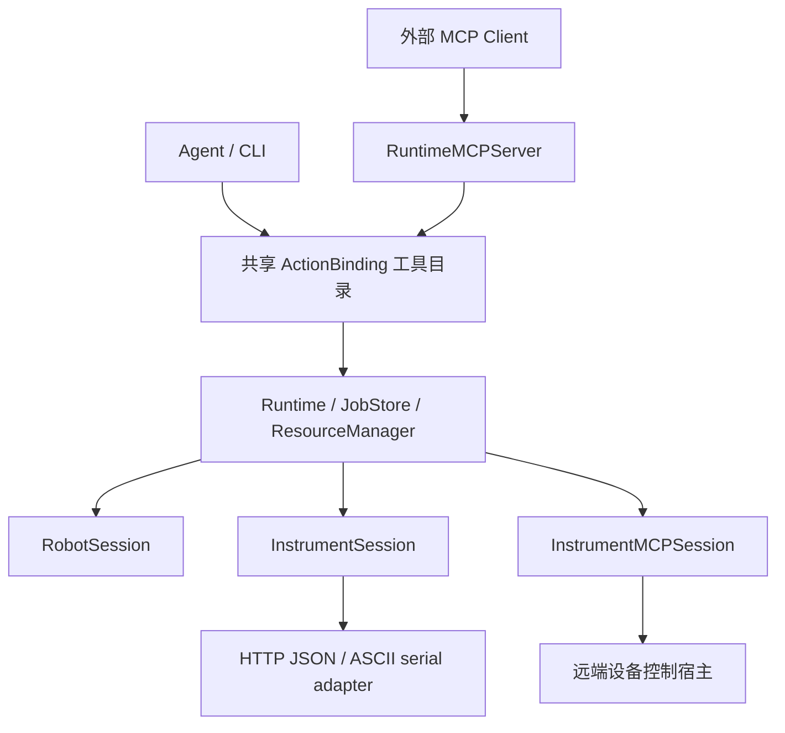

# 仪器领域接入

本轮重构最初以主仓 `cd54ad18442f98ec8e6d9ddb34ede69a6fd2bd1b` 和 PR #85 头 `f0bf5a0f0124f469c825d73435af84a8cdb84c08` 为基线，当前候选已同步主仓 `61031d17403f2ece6f635e983ac5399fed994a12`。仪器复用已有 Runtime、JobStore、资源准入和 fastagent 顺序执行。机器人 `ActionSpec`、`@implements`、`RobotSession` 的导入与构造接口保留。

## 所有权和职责



`tools/bindings.py` 是消费接口。机器人视图从 `ActionSpec + ToolMeta` 生成，保留原执行记录与感知缓存失效；仪器视图从已校验的声明生成。输入 Schema 在直接工具、Skill 和 MCP 导出之间共用。声明只描述单个动作，不保存步骤顺序。

`InstrumentSession` 不继承机器人 Env/API，不读取 home pose、相机或检测结果。能力和状态使用仪器的封闭词表。部署者选择仪器 profile、连接和调用者权限；来源文档、工具描述、调用参数不能授予权限或选择 Python 代码。发现过滤与调用授权分别执行。

仪器仅注册 `adapters/instrument/`，使用 `build_instrument_session` 及其 `config_factory`、`resource_keys` 与 BindingSnapshot。内部的 `direct/` 持有本地 profile、协议映射、策略、文档接入和 Skill 导出；`mcp/` 持有 SDK 客户端、远端 Schema 和完成证据；`common/` 仅包含稳定工具名和共用能力词。顶层不再有 instruments/onboarding 包。

```python
from jiuwensymbiosis.adapters.instrument import build_instrument_session

factory = build_instrument_session.config_factory
config = factory.from_yaml('instrument.yaml')  # 仅离线解析，不连接硬件
resources = build_instrument_session.resource_keys(config)
```

一次 binding 固定一种 access；只解析、构造选中的实现。失败或 unknown 后不会切换 access 重发。

## 安装与直接执行

继续使用主仓安装体系，不新增发行包：

```bash
python -m pip install -e '.[dev,instruments]'
```

顶层 `adapter: instrument` 选择仪器；必填的 `instrument.access` 明确选择 `direct` 或 `mcp`；`model` 仍选择模型。direct 的 `instrument.installation` 放经校验的 `config_version/devices/extensions` 数据，`instrument.permissions` 显式列出 principal 可用的设备限定工具名。每个运行 profile 必须有稳定的 `physical_device_id`；文档候选可暂缺此身份，但不得进入运行。

工具名由 `jiuwensymbiosis.adapters.instrument.common.naming.tool_name(device_id, operation_id)` 统一生成。权限为空时没有可调用动作。配置中的范围约束与声明 Schema 相交，默认值仅是建议，不替换显式参数。

`required_confirmations` 使用已注册的 `interlock_closed`、`emergency_stop_clear`、`device_ready`。映射适配器从本次状态响应的同名顶层字段读取布尔观测；只有 `true` 满足准入，缺失、`false`、数值或字符串均不能代替证据。

Python 有限步骤入口无需 MCP Server 或模型：

```python
from jiuwensymbiosis.runtime.jobs import Runtime

runtime = Runtime(workspace='./workspace', resource_directory='./shared-locks')
try:
    binding = runtime.prepare_binding('instrument.yaml')
    job = runtime.submit_actions(
        binding.binding_id, 'user-task-001',
        [{'op': tool_name, 'params': {}, 'request_key': 'device-read-001', 'bind': 'reading'}],
        principal='local',
    )
    result = runtime.wait_for_job(job['job_id'])
finally:
    runtime.close()
```

这里的 `tool_name` 是上述函数生成并获授权的名称。后续步骤可用 `reading.temperature_c` 或 `{"$ref": "reading.temperature_c"}` 引用已验证 JSON。机器人原有引用语法、检测规范化、新鲜度和恢复处理保留；仪器结果不进入检测处理，仪器失败不执行机器人 home/退让。

Agent CLI 使用既有命令：

```bash
jiuwensymbiosis-run --config instrument.yaml --query '读取温度'
jiuwensymbiosis-run --config instrument.yaml --stepagent --query '读取温度'
```

前台 CLI 是执行宿主，会等待任务终止。长任务需要宿主持续存活；持久化不代表退出后还能继续监控。关闭时未取得终态证据的动作保留未知记录和阻断。

本 PR 交付单 adapter 任务。机器人与仪器联合任务、多 adapter 列表、通用组合生命周期留待后续 PR；没有 mixed 或替代的 CompositeSession。direct 安装声明可以包含多个本地设备 profile，每个 profile 保留独立身份、状态、权限和资源键。

仪器 fastagent 使用现有 Tier-2 动作组合和 JSON 顺序执行。导出的 Skill 是静态声明材料，当前没有接入 Tier-1 技能发现与组合。未知结果会截断当前仪器任务，拒绝后续动作和下一轮模型调用，保留未决记录与资源阻断。

## 从旧 PR 配置迁移

| 原入口／字段 | 当前入口／字段 |
| --- | --- |
| `adapter: instrument` + `instruments` | `adapter: instrument` + `instrument: {access: direct, installation: ...}` |
| `instrument_permissions` | `instrument.permissions`，仍是 principal → 稳定工具名列表 |
| `adapter: instrument_mcp` + `instrument_mcp` | `adapter: instrument` + `instrument: {access: mcp, ...原远端字段}` |
| `jiuwensymbiosis.instruments.*` | `jiuwensymbiosis.adapters.instrument.direct.*`；工具名函数在 common/naming.py |
| `jiuwensymbiosis.onboarding.*` | `jiuwensymbiosis.adapters.instrument.direct.onboarding.*` |
| `adapters.instrument_mcp.*` | `adapters.instrument.mcp.*` |
| `mixed`／`adapters` 列表 | 当前拒绝，没有替代入口 |

旧字段与新外壳同时出现、access 缺失、跨分支字段和组合列表均在连接前拒绝。MCP 物理身份只允许位于 `instrument.physical_device_id`，根级同名字段会被拒绝。模型、agent、workspace 等配置保持原归属。`from_dict` 不读取配置文件；YAML/BindingSnapshot 的声明路径相对配置文件解析，并在冻结后不再读取文件或环境。

CLI 未显式指定 name/workspace 时，MCP 分支继续使用原 `instrument_mcp` 默认目录名，不因统一 selector 改为新的历史库；显式 workspace/name 仍按主仓原规则选择。

改目录不会改变工具名、动作版本、资源键或 action request_key。继续使用原 workspace、JobStore 和共享锁目录；新外壳会改变 binding 指纹，但不会重置动作级去重。旧库生成的成功调用可被新配置命中；unknown 保留阻断，需可信对账后才能释放。历史 SQL/锁记录夹具来自冻结 PR 头的真实合成执行，不提供自动清库或迁移命令。

## 持久执行语义

| 身份 | 所属与作用 |
| --- | --- |
| `job_id` | Runtime 用户任务或有限步骤计划 |
| `invocation_id` | JobStore 中单次设备动作记录 |
| `request_key` | 设备动作稳定去重键；相同键更换参数/绑定/契约会拒绝 |
| `ResourceLease.operation_id` | 资源准入代次，不是动作名，也不是调用去重键 |
| `physical:<id>` | 本地物理设备资源身份，与配置路径/URL/RPC ID 无关 |

Runtime 的动作记录保存设备绑定、契约版本、参数指纹、请求键、下发意图、结果范围、远端句柄和完成证据。顺序是：资源准入 → 当前观测与策略校验 → 持久意图 → 下发一次 → 保存执行事实 → 确认未决工作和连接清理 → 持久释放依据 → 释放 lease。本地写动作的 ACK 后还会检查状态：busy 保留原调用与占用继续查询，unknown/fault/offline 保留阻断；不会重发写命令，idle 观察也不升级为物理完成声明。SQLite 与文件锁不是同一个事务，崩溃或持久化失败保留阻断。

Runtime 在校验结束后及最终下发前重新检查取消、宿主关闭和持久化状态。意图已写入但尚未下发时取消，会先保存“未下发”的失败事实；该事实写入失败则保留阻断。已经下发的动作仍需设备的停止/完成证据。

同一物理资源绑定一个 JobStore 权威；换 workspace 不能绕过既有去重历史。相同主机上的直接调用和 MCP Server 可共享 Runtime；不同进程必须使用相同物理资源键和锁目录。跨主机设备集中到唯一控制宿主，其他调用者通过该宿主访问。配置身份错误不会被连接 URL 自动纠正。

`runtime.get_job()`、`list_invocations()`、`read_events()` 读取既有记录，无第二套状态库或反馈线程。请求停止不等于物理停止。人工对账只通过可信宿主 Python API `Runtime.reconcile_invocation()`，要求外部证据和清理报告，不导出给模型/MCP；对账不会自动重放未完成计划。

## MCP 接入与导出

接入使用 MCP SDK 公开 `ClientSession`，保留原始工具 `inputSchema/outputSchema`、所有 content 块、`structuredContent`、`isError` 和远端任务句柄。工具描述或输入 Schema 不证明幂等、停止、对账、物理完成；这些只有在部署者提供经审阅的 `RemoteSemantics` 后才使用。未声明时成功仅表示协议响应完成。声明物理完成时，必须同时提供 `evidence_field` 和经审阅的 `evidence_equals`（例如 `{"sensor_stopped": true}`）；要求字段类型和值均匹配，不能只因为证据对象非空就判定完成。

SDK 公开请求接口先返回完整 `CallToolResult`，领域层随后校验首次响应或查询响应的输出 Schema；不匹配时将原始结果和远端句柄一并记为 unknown。物理终止证据也适用于 `failed`、`cancelled` 和错误分支；错误伴随 running 或相互矛盾的状态不会结束监控并释放本地委托占用。

写工具还必须配置部署者审阅后的 `input_schema_sha256`。先通过 SDK `list_tools()` 获取输入 Schema，由人工审阅范围/单位后使用 `input_schema_digest(schema)` 固定摘要；远端 Schema 变化会在连接阶段拒绝，不能自动重新固定摘要。

配置使用 `adapter: instrument`、`instrument.access: mcp` 和 `instrument` 下的 `physical_device_id`、`authority`、`transport`、连接信息、`tools` 允许列表。stdio 的绝对命令由部署者选择；HTTP 凭据从配置指定的环境变量加载。远端 action 使用 delegated resource key 记录本地调用，实际物理 lease、设备状态和停止归远端宿主；本地不会另造物理完成事实。

导出通过 `jiuwensymbiosis.serving.instrument_mcp.RuntimeMCPServer(runtime, binding_id, allowed_tools=..., authority=..., stdio_principal=...)`。`run_stdio()` 使用可信宿主身份；`streamable_http_app(authenticate)` 返回 ASGI 应用，部署者负责身份校验和服务端部署。Server 只将获许可的工具交给同一个 Runtime，不直接调用驱动。

导入本框架导出的工具时，经审阅的 `RemoteSemantics.request_key_meta` 设为 `symbiosis/request_key`，并配置返回句柄、状态字段与查询工具；普通第三方工具只按其明确声明的接口配置。

动作调用的稳定键放在 MCP `_meta["symbiosis/request_key"]`，与 RPC ID 分离。长动作快速返回持久 `job_id`；`symbiosis_get_job`、`symbiosis_wait_job`、`symbiosis_request_stop` 围绕同一记录工作。动作的输入 Schema 与直接工具相同；导出即时输出是任务句柄，动作结果 Schema 在工具元数据 `resultSchema` 中。调用者只能访问自己的任务。

依赖声明为 `mcp>=1.30,<2`；当前验证环境为 MCP SDK 1.30.0，其他 SDK 版本待验，不将整个依赖区间视为已经验证。实际协议测试使用 MCP SDK 1.30.0，stdio 与 Streamable HTTP 均协商 `2025-11-25`。SDK 还声明较早版本，但本次没有逐版本复测。没有宣称支持 `2026-07-28`。写调用不使用 openjiuwen 的自动重试包装，不因连接异常透明重发；恢复连接不是重新执行。MCP 协议取消也不证明物理停止，参见[官方取消规则](https://modelcontextprotocol.io/specification/2025-11-25/basic/utilities/cancellation)。

## 文档接入、Skill 与验证边界

`adapters.instrument.direct.onboarding` 提供来源摘要/摘录核对、审阅候选校验、新配置安装和失败回滚。它不从文档执行代码，不把“文档已审阅”当作硬件已验证。Skill 导出是静态声明视图，不是独立执行系统；不携带连接凭据或授权。

Skill 导出始终以安装配置中的声明为准；显式传入的 registry 必须与其一致，不得另外覆盖 Schema、版本或来源信息。

合成链路测试位于 `tests/unit_tests/adapters/instrument/direct/onboarding/fixtures/temperature_fixture.py`，仅启动自己拥有的 localhost 软件服务。HTTP、伪串口、MCP 两种传输、Runtime 崩溃/去重/未知阻断及机器人回归均有对应测试。实机时序、物理停止和真实测量精度未在此本地评审中验证。

## 失败边界与运维限制

本地 mapping 的 guard 或完成基线检查若明确发生在动作下发之前，adapter 返回 `CommandNotSent` 证明；Session 将调用记为有 `dispatch_started: false` 证据的 failed，并清除 Session 与 InvocationContext 的 pending。Runtime 用户任务沿用原有 incomplete 阶段，已确认清理后可释放资源。普通 DriverError 即使 `uncertain=False`，也不证明动作未下发；写后超时、丢失回执或未经证实的 failed 仍保留 unknown。

`.authority` 固定物理设备对应的 JobStore，释放 lease 后仍保留。当前没有受信的 authority 迁移／解绑 API：更换 workspace 或删除文件不能作为迁移方式。这是合并前仍需另案解决或由 owner 明确接受的运维限制；本轮目录重构没有将其标为迁移能力已完成。

备份前先停止任务接收，确认设备停止、完成未决对账并关闭所有共享该设备的宿主。使用 SQLite 一致性备份（或完全关闭连接后复制数据库及必要的 WAL），同时保存原 workspace 和共享锁目录中的记录与 `.authority`，恢复到原 JobStore 路径和锁目录后再启动同一控制宿主。无法确认未决工作时保留阻断；不要清库、删除 authority 或让另一个 workspace 接管。

HTTP MCP 会话 owner 映射尚无完整的会话结束回收机制，属于 serving 的独立已知问题。本次未增加第三方 MCP 再导出或代理链路，也未以目录移动声明解决会话回收。
